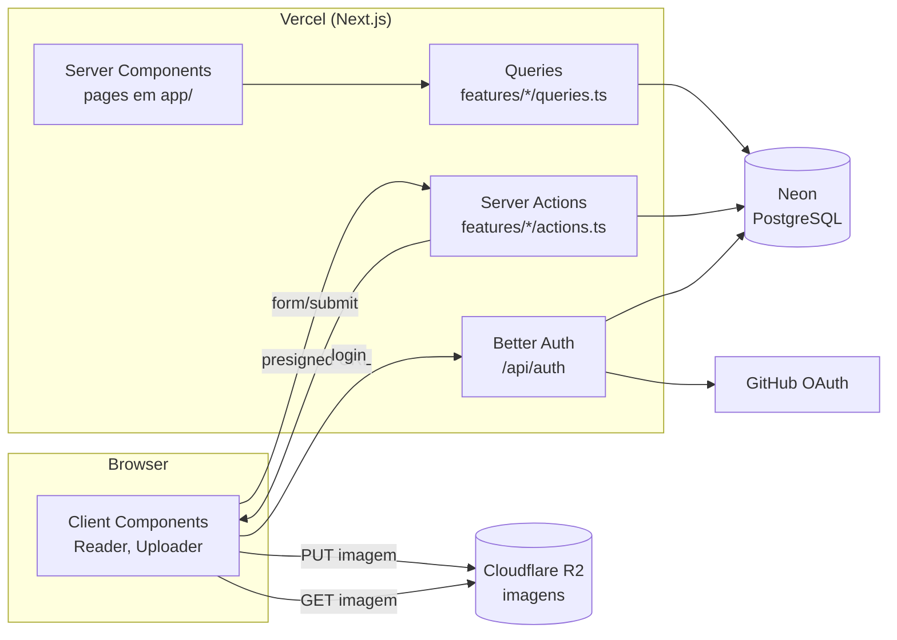
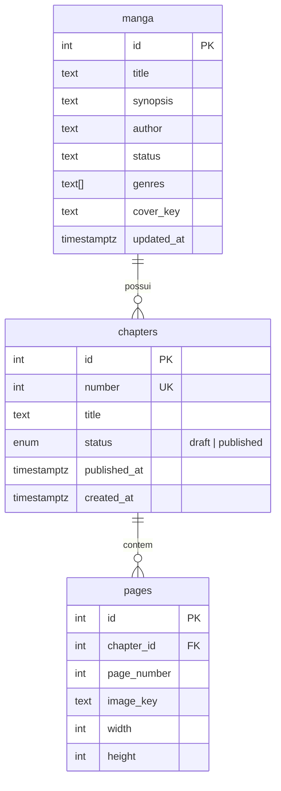
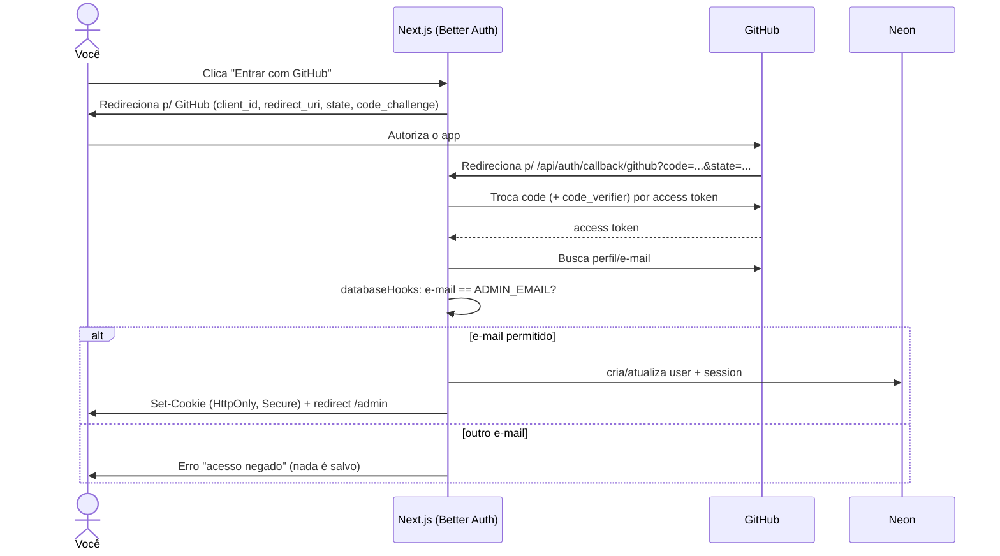
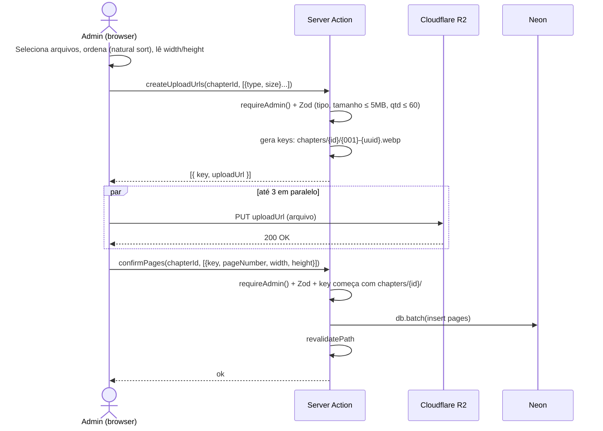

# 📚 Roadmap: Site de Mangá com Next.js

> Plano de **estudo + implementação** para uma rotina intensiva de **2–3h/dia**, em **8 semanas** (com opção de compressão para 6).
> Projeto de portfólio: site dedicado a uma única obra, com leitor página-a-página, painel admin protegido e deploy 100% gratuito.

---

## Sumário

1. [Visão geral do projeto](#1-visão-geral-do-projeto)
2. [Stack final](#2-stack-final)
3. [Como usar este roadmap](#3-como-usar-este-roadmap)
4. [Pré-requisitos (autoavaliação)](#4-pré-requisitos-autoavaliação)
5. [Arquitetura e estrutura de pastas](#5-arquitetura-e-estrutura-de-pastas)
6. [Modelo de dados](#6-modelo-de-dados)
7. [Cronograma semana a semana](#7-cronograma-semana-a-semana)
8. [Guia: Design System, tokens e componentização](#8-guia-design-system-tokens-e-componentização)
9. [Guia: ORM e Drizzle](#9-guia-orm-e-drizzle)
10. [Guia: Zod](#10-guia-zod)
11. [Guia: Autenticação com Better Auth](#11-guia-autenticação-com-better-auth)
12. [Guia: Cloudflare R2](#12-guia-cloudflare-r2)
13. [Guia: Deploy na Vercel](#13-guia-deploy-na-vercel)
14. [Checklist de portfólio](#14-checklist-de-portfólio)
15. [Versão comprimida (6 semanas)](#15-versão-comprimida-6-semanas)
16. [Biblioteca de estudos](#16-biblioteca-de-estudos)

---

## 1. Visão geral do projeto

### Funcionalidades

| Área | Rota | Descrição |
|---|---|---|
| Home | `/` | Página da obra: capa, sinopse, autor, status, gêneros e **lista de capítulos publicados** |
| Leitor | `/capitulos/[numero]?pagina=N` | **Uma página por vez**, com navegação por toque, swipe, teclado e botões |
| Sobre | `/sobre` | Informações do projeto e contato |
| Login | `/login` | Login do admin (só o seu e-mail é aceito) |
| Admin | `/admin` | Dashboard: listar, criar, editar, publicar/despublicar e excluir capítulos |
| Admin | `/admin/capitulos/novo` | Criar capítulo e fazer upload das páginas |
| Admin | `/admin/capitulos/[id]` | Editar capítulo, reordenar/substituir páginas |
| Admin | `/admin/obra` | Editar dados da obra (sinopse, capa etc.) |

### Restrições

- 💸 **100% gratuito**: Vercel Hobby + Neon Free + Cloudflare R2 Free.
- 📱 **Mobile-first**: o leitor precisa funcionar muito bem no celular.
- 👤 **Sem contas de usuário**: só existe um admin, que é você.
- 🖼️ Capítulos com **8 a 28 páginas**.

> ⚖️ **Direitos autorais:** publique só uma obra sua ou uma que você tenha permissão para distribuir. Isso também conta para o portfólio: um recrutador vai olhar o conteúdo.

---

## 2. Stack final

| Camada | Tecnologia | Seu nível | Profundidade de estudo |
|---|---|---|---|
| Framework | **Next.js 16+ (App Router)** | Aprendendo | 🔴 Alta (é o objetivo principal) |
| Linguagem | **TypeScript** | — | 🟡 Conforme a necessidade |
| Estilo | **Tailwind CSS v4** | Já conhece | 🟢 Baixa (só `@theme`, tokens e dark mode) |
| Animações | **Motion** (`motion/react`) | — | 🟢 Baixa (springs do M3 Expressive) |
| Design | **Figma** + componentes M3 Expressive feitos à mão | Vai criar | 🟡 Média (teoria de design system) |
| Validação | **Zod 4** | Já ouviu falar | 🟡 Média |
| Banco | **PostgreSQL (Neon)** | SQL bom | 🟢 Baixa |
| ORM | **Drizzle ORM + drizzle-kit** | Nunca usou | 🔴 Alta |
| Autenticação | **Better Auth** (OAuth GitHub, restrito ao seu e-mail) | Nunca usou | 🔴 Alta |
| Storage | **Cloudflare R2** (API S3) | Nunca usou | 🟡 Média |
| Deploy | **Vercel** | Nunca usou | 🟡 Média |
| Qualidade | ESLint, Prettier, GitHub Actions | — | 🟢 Baixa |

> 📌 **Versões:** instale sempre a versão estável mais recente. O roteiro assume **Next.js 16+**. Duas mudanças importam aqui: `middleware.ts` passou a se chamar **`proxy.ts`**, e `params`/`searchParams` são **Promises** (use `await`). Se algo divergir, a documentação oficial da versão instalada é a fonte da verdade.

---

## 3. Como usar este roadmap

### 3.1 Rotina diária (2h30)

| Bloco | Tempo | O que fazer |
|---|---|---|
| 📖 Estudo | 45 min | Ler os links da tabela **"Estudar"** do dia, **digitando** os exemplos num arquivo de rascunho |
| 🛠️ Implementação | 90 min | Seguir o **"Passo a passo"** no projeto real |
| 📝 Fechamento | 15 min | Conferir o **"Pronto quando"**, dar commit e escrever 3 linhas no `DEVLOG.md` |

- **6 dias por semana** (Seg–Sáb). O **domingo** é folga ou revisão/atraso.
- Cada semana termina com uma **entrega verificável** (✅ Entrega).
- Crie um **GitHub Project** (quadro Kanban) com uma issue por dia. Trabalhe em **branches** e abra **PRs para você mesmo**, porque isso simula o fluxo de mercado.

### 3.2 Anatomia de um dia neste roadmap

Todo dia segue o mesmo formato:

| Seção | Para que serve |
|---|---|
| 🎯 **Objetivo** | O que você terá ao final do dia, em uma frase |
| 📖 **Estudar** | Tabela com **link direto** da doc e o que procurar nela |
| 🎥 **Extra** (opcional) | Vídeos/artigos para quando a doc não bastar. Vídeos aparecem como **termos de busca**, porque vídeos específicos saem do ar |
| 🛠️ **Passo a passo** | Tarefas numeradas, na ordem, com comandos e código de referência |
| ✔️ **Pronto quando** | Checklist para saber que terminou |
| 💡 **Dicas** / ⚠️ **Armadilhas** | Atalhos e erros que costumam fazer iniciantes perderem horas |

> 🧭 **Se o dia não couber em 2h30:** termine o passo a passo no dia seguinte e use o domingo para recuperar. Nunca pule o "Pronto quando".

### 3.3 Como estudar documentação (sem se perder)

1. **Leia a seção "Getting Started"/"Guides" antes da "API Reference".** Os guias explicam o *porquê*, e a referência serve para consultar detalhes.
2. **Digite os exemplos, não copie.** Crie uma pasta `playground/` fora do projeto (ou uma branch `estudo/*`) para testar.
3. **Use a busca da doc** (quase todas abrem com `Ctrl + K`).
4. **Leia a mensagem de erro inteira** (e o *stack trace*) antes de pesquisar. Copie a frase principal do erro entre aspas na busca.
5. **Confira a versão.** Tutoriais antigos de Next.js usam a pasta `pages/` (Pages Router). Este projeto usa **App Router** (`app/`). Se o tutorial tem `getServerSideProps`, ele é do modelo antigo.
6. **Anote no DEVLOG** a dúvida *antes* de resolver e a resposta *depois*. Isso vira material de revisão e de entrevista.

### 3.4 Onde pedir ajuda

| Onde | Quando usar |
|---|---|
| [GitHub Discussions do Next.js](https://github.com/vercel/next.js/discussions) | Dúvidas de comportamento do Next |
| Discord oficial de cada ferramenta (link no site do Drizzle, Better Auth e Tailwind) | Respostas rápidas da comunidade |
| [Stack Overflow em Português](https://pt.stackoverflow.com) | Perguntas gerais em PT-BR |
| Issues do GitHub da biblioteca | Quando parece bug (busque antes de abrir) |
| IA (Claude, etc.) | Como **tutor**: peça explicação de conceitos e erros, e não o código pronto do dia |

> 💡 **Regra dos 30 minutos:** travou por 30 min? Isole o problema num exemplo mínimo e pergunte mostrando: o que tentou, o que esperava, o que aconteceu e a mensagem de erro.

### 3.5 Ambiente de desenvolvimento

**Extensões do VS Code (instale no Dia 1):**

| Extensão | Para quê |
|---|---|
| ESLint (`dbaeumer.vscode-eslint`) | Mostra erros de lint no editor |
| Prettier (`esbenp.prettier-vscode`) | Formatação automática |
| Tailwind CSS IntelliSense (`bradlc.vscode-tailwindcss`) | Autocomplete das classes, **inclusive os seus tokens** |
| Pretty TypeScript Errors (`yoavbls.pretty-ts-errors`) | Erros de TS legíveis |
| Error Lens (`usernamehw.errorlens`) | Erro na própria linha |

**`.vscode/settings.json` do projeto:**

```json
{
  "editor.formatOnSave": true,
  "editor.defaultFormatter": "esbenp.prettier-vscode",
  "editor.codeActionsOnSave": { "source.fixAll.eslint": "explicit" },
  "files.associations": { "*.css": "tailwindcss" },
  "typescript.tsdk": "node_modules/typescript/lib"
}
```

**Ferramentas do navegador:**
- **Chrome DevTools**: aba *Elements* (CSS), *Console*, *Network* (requisições e imagens), *Application* (cookies e localStorage), *Lighthouse*.
- **Modo dispositivo** (`Ctrl + Shift + M`), para simular celular.

### 3.6 Legenda

📖 estudo · 🎥 material extra · 🛠️ implementação · ✔️ critério de pronto · ✅ entrega da semana · ⚠️ armadilha · 💡 dica · 🆘 se travar

---

## 4. Pré-requisitos (autoavaliação)

Antes da Semana 1, veja se você se sente confortável com os itens abaixo. Se marcar **menos de 70%**, reserve **2–3 dias** (Semana 0) para revisar pelo [react.dev/learn](https://react.dev/learn).

**JavaScript/TypeScript**
- [ ] `async/await`, `Promise.all`, desestruturação, spread, módulos (`import/export`)
- [ ] Tipos básicos, `type` vs `interface`, union types, generics simples (`Array<T>`)
- [ ] `Array.map/filter/sort/reduce`

**React**
- [ ] Componentes, props, `children`
- [ ] `useState`, `useEffect`, `useRef`
- [ ] Renderização de listas com `key` e renderização condicional
- [ ] Formulários controlados vs não-controlados

**Ferramentas**
- [ ] Git: `branch`, `commit`, `push`, `merge`, PR no GitHub
- [ ] Node.js LTS e `npm`/`pnpm` instalados

---

## 5. Arquitetura e estrutura de pastas

### 5.1 Princípios

1. **Organização por feature (domínio)**: o código de "capítulos" fica junto (componentes, queries, actions, schemas), em vez de espalhado por tipo de arquivo.
2. **`app/` só roteia**: as páginas em `app/` são finas. Elas buscam dados e compõem componentes, e a lógica fica em `features/` e `lib/`.
3. **Separação servidor/cliente explícita**: arquivos que só podem rodar no servidor importam `server-only`.
4. **Design system isolado** em `components/ui/`, sem regra de negócio.
5. **Convenção de nomes**: **código em inglês** e **URLs em português** (`/capitulos`, `/sobre`), porque as URLs são voltadas ao usuário final.

### 5.2 Árvore do projeto

```
manga-site/
├── .github/
│   └── workflows/
│       └── ci.yml                    # lint + typecheck + build em cada PR
├── drizzle/                          # migrations SQL geradas pelo drizzle-kit (versionadas)
├── public/                           # favicon, og-image estática, etc.
├── src/
│   ├── app/                          # 🧭 ROTEAMENTO (App Router)
│   │   ├── (site)/                   # route group: layout público (navbar + footer)
│   │   │   ├── layout.tsx
│   │   │   ├── page.tsx              # Home = página da obra
│   │   │   ├── sobre/
│   │   │   │   └── page.tsx
│   │   │   └── capitulos/
│   │   │       └── [numero]/
│   │   │           ├── page.tsx      # Leitor
│   │   │           └── loading.tsx
│   │   ├── (reader)/                 # (opcional) layout imersivo sem navbar p/ o leitor
│   │   ├── admin/                    # área protegida
│   │   │   ├── layout.tsx            # verifica sessão (requireAdmin)
│   │   │   ├── page.tsx              # dashboard
│   │   │   ├── obra/page.tsx
│   │   │   └── capitulos/
│   │   │       ├── novo/page.tsx
│   │   │       └── [id]/page.tsx
│   │   ├── login/
│   │   │   └── page.tsx
│   │   ├── api/
│   │   │   └── auth/[...all]/route.ts   # handler do Better Auth
│   │   ├── layout.tsx                # root layout (html, body, fontes, tema)
│   │   ├── not-found.tsx
│   │   ├── error.tsx
│   │   ├── sitemap.ts
│   │   ├── robots.ts
│   │   └── globals.css               # importa tailwind + tokens
│   │
│   ├── components/
│   │   ├── ui/                       # 🎨 DESIGN SYSTEM (primitivos, sem regra de negócio)
│   │   │   ├── button.tsx
│   │   │   ├── icon-button.tsx
│   │   │   ├── card.tsx
│   │   │   ├── chip.tsx
│   │   │   ├── text-field.tsx
│   │   │   ├── dialog.tsx
│   │   │   ├── snackbar.tsx
│   │   │   ├── loading-indicator.tsx
│   │   │   └── index.ts
│   │   └── layout/                   # 🧱 estrutura de página
│   │       ├── top-app-bar.tsx
│   │       ├── navigation-bar.tsx    # barra inferior no mobile
│   │       ├── footer.tsx
│   │       └── theme-toggle.tsx
│   │
│   ├── features/                     # 🧩 DOMÍNIOS
│   │   ├── manga/
│   │   │   ├── components/           # MangaHero, MangaInfo, GenreList
│   │   │   ├── queries.ts            # getManga()
│   │   │   ├── actions.ts            # updateManga()
│   │   │   └── schemas.ts            # mangaSchema (Zod)
│   │   ├── chapters/
│   │   │   ├── components/           # ChapterList, ChapterListItem, ChapterForm
│   │   │   ├── queries.ts            # getPublishedChapters(), getChapterByNumber()
│   │   │   ├── actions.ts            # createChapter(), publishChapter(), deleteChapter()
│   │   │   └── schemas.ts
│   │   ├── reader/
│   │   │   ├── components/           # Reader, ReaderPage, ReaderControls, ProgressBar
│   │   │   └── hooks/                # useReaderNavigation, useSwipe, usePreloadImages
│   │   ├── uploads/
│   │   │   ├── components/           # PageUploader, PageSortableGrid
│   │   │   ├── actions.ts            # createUploadUrls(), confirmPages()
│   │   │   └── schemas.ts
│   │   └── auth/
│   │       └── components/           # SignInButton, SignOutButton
│   │
│   ├── lib/                          # ⚙️ INFRAESTRUTURA
│   │   ├── db/
│   │   │   ├── index.ts              # cliente drizzle
│   │   │   ├── schema.ts             # tabelas
│   │   │   └── seed.ts
│   │   ├── auth/
│   │   │   ├── auth.ts               # config Better Auth (server)
│   │   │   ├── auth-client.ts        # client do Better Auth (browser)
│   │   │   └── dal.ts                # requireAdmin(), getSession() — Data Access Layer
│   │   ├── storage/
│   │   │   └── r2.ts                 # cliente S3 + helpers de URL
│   │   ├── env.ts                    # validação das variáveis de ambiente com Zod
│   │   └── utils.ts                  # cn(), formatadores
│   │
│   ├── styles/
│   │   └── tokens.css                # tokens M3 (cores, tipografia, shape, motion)
│   │
│   └── proxy.ts                      # checagem otimista de sessão em /admin
│
├── .env.example                      # variáveis documentadas (sem valores!)
├── drizzle.config.ts
├── eslint.config.mjs
├── .prettierrc
├── next.config.ts
├── tsconfig.json
├── DEVLOG.md
└── README.md
```

### 5.3 Fluxo de dados



### 5.4 Regras de fronteira (decore essas)

| Pergunta | Resposta |
|---|---|
| Onde busco dados para exibir? | Em **Server Components**, chamando funções de `queries.ts` |
| Onde altero dados? | Em **Server Actions** (`actions.ts`), que **sempre** validam com Zod e verificam o admin |
| Quando uso `"use client"`? | Só quando precisar de estado, eventos, efeitos ou APIs do browser (leitor, uploader, toggle de tema) |
| Onde verifico autenticação? | **Em todo lugar que acessa dados sensíveis** (layout do admin + cada action). O `proxy.ts` é só uma primeira barreira |
| Posso importar `lib/db` num Client Component? | ❌ Nunca. Use `import "server-only"` para o build falhar se isso acontecer |

---

## 6. Modelo de dados



- `manga` tem **uma única linha**. Ter a tabela deixa você editar a obra pelo admin sem mexer no código.
- `pages.image_key` guarda a **chave** do objeto no R2 (ex.: `chapters/12/003-a1b2.webp`), e **não a URL completa**. Assim dá para trocar de domínio/CDN sem migrar dados.
- `width`/`height` servem para reservar o espaço da imagem e evitar *layout shift* (CLS).
- Restrição `UNIQUE (chapter_id, page_number)` e `ON DELETE CASCADE`.
- As tabelas do Better Auth (`user`, `session`, `account`, `verification`) são geradas pela CLI dele.

---

## 7. Cronograma semana a semana

| Semana | Tema | Entrega |
|---|---|---|
| 1 | Fundamentos Next.js + setup + arquitetura | Site navegável com dados mockados, já no ar na Vercel |
| 2 | Design System (Figma → tokens → componentes) | Tokens, componentes base, navbar responsiva e tema claro/escuro |
| 3 | Banco de dados: ORM, Drizzle, Neon, Zod básico | Home e lista de capítulos vindo do Postgres |
| 4 | Leitor página-a-página | Leitor completo, com imagens de teste |
| 5 | Autenticação em profundidade | `/admin` protegido, com login só para o seu e-mail |
| 6 | Cloudflare R2 + upload + Server Actions + Zod em formulários | Upload de capítulo funcionando ponta a ponta |
| 7 | Dashboard admin completo | CRUD de capítulos/obra, publicação e exclusão com limpeza no R2 |
| 8 | Polimento, SEO, acessibilidade, deploy final e portfólio | Site em produção, README e CI |

> 📌 Os códigos dos dias são **referências para você entender e digitar**, não para colar. Adapte os nomes ao seu protótipo.

---

## 🗓️ Semana 1: Fundamentos do Next.js + setup + arquitetura

> **Meta da semana:** entender o modelo mental do App Router (rotas por pastas, Server vs Client Components, renderização) e montar o esqueleto do projeto no ar.

---

### Dia 1: Setup profissional

**🎯 Objetivo:** projeto criado, formatado automaticamente, versionado no GitHub e com o quadro de tarefas pronto.

**📖 Estudar (45 min)**

| # | O quê | Link | O que procurar |
|---|---|---|---|
| 1 | Instalação do Next.js | [nextjs.org/docs/app/getting-started/installation](https://nextjs.org/docs/app/getting-started/installation) | Requisitos (versão do Node), as perguntas do `create-next-app` e os scripts `dev`/`build`/`start` |
| 2 | Estrutura de projeto | [nextjs.org/docs/app/getting-started/project-structure](https://nextjs.org/docs/app/getting-started/project-structure) | Arquivos de nível superior, pasta `app/`, convenções de arquivos (`page`, `layout`) e *colocation* |
| 3 | Conventional Commits | [conventionalcommits.org/pt-br](https://www.conventionalcommits.org/pt-br/v1.0.0/) | Os tipos `feat`, `fix`, `chore`, `docs`, `refactor`, `style` |
| 4 | (se precisar) Git | [Learn Git Branching](https://learngitbranching.js.org/?locale=pt_BR) | Níveis "Introdução" e "Push & Pull" |

**🎥 Extra:** busque `next.js app router crash course` (filtre pelo último ano).

**🛠️ Passo a passo (90 min)**

1. **Node.js LTS.** Verifique com `node -v`. O Next.js 16 exige **Node 20.9+**, e o recomendado é a LTS mais recente. No Fedora, prefira um gerenciador de versões:
   ```bash
   curl -fsSL https://fnm.vercel.app/install | bash   # fnm (Fast Node Manager)
   # reabra o terminal
   fnm install --lts && fnm default lts-latest
   node -v && npm -v
   ```
2. **Criar o projeto:**
   ```bash
   npx create-next-app@latest manga-site
   ```
   Se perguntar sobre *recommended defaults*, escolha **personalizar** para responder:

   | Pergunta | Resposta |
   |---|---|
   | TypeScript | Yes |
   | Linter | ESLint |
   | React Compiler | No (por enquanto, para simplificar) |
   | Tailwind CSS | Yes |
   | `src/` directory | Yes |
   | App Router | Yes |
   | Turbopack | Yes |
   | Import alias | `@/*` (padrão) |

3. **Rodar e explorar:** `cd manga-site && npm run dev` → abra `http://localhost:3000`. Abra cada arquivo gerado e anote no DEVLOG para que serve: `src/app/layout.tsx`, `src/app/page.tsx`, `src/app/globals.css`, `next.config.ts`, `tsconfig.json`, `eslint.config.mjs`, `package.json`.
4. **Limpar o boilerplate:** deixe `page.tsx` só com `<h1>Manga Site</h1>` e o `globals.css` só com `@import "tailwindcss";`.
5. **Prettier:**
   ```bash
   npm i -D prettier prettier-plugin-tailwindcss
   ```
   `.prettierrc`:
   ```json
   {
     "semi": true,
     "singleQuote": false,
     "trailingComma": "all",
     "printWidth": 100,
     "plugins": ["prettier-plugin-tailwindcss"]
   }
   ```
   No `package.json`, adicione `"format": "prettier --write ."` aos `scripts`.
6. **VS Code:** instale as extensões e crie o `.vscode/settings.json` da [seção 3.5](#35-ambiente-de-desenvolvimento).
7. **GitHub:** o `create-next-app` já roda `git init`. Crie um repositório **vazio** no GitHub (sem README) e rode:
   ```bash
   git add -A && git commit -m "chore: setup inicial do projeto"
   git branch -M main
   git remote add origin git@github.com:<seu-usuario>/manga-site.git
   git push -u origin main
   ```
8. **DEVLOG.md** na raiz:
   ```markdown
   # Devlog

   ## Semana 1 — Dia 1 (AAAA-MM-DD)
   - **Fiz:** ...
   - **Aprendi:** ...
   - **Travei em:** ...
   ```
9. **GitHub Project:** na aba *Projects* do seu perfil → *New project* → template *Kanban*. Crie as issues da Semana 1 (uma por dia).

**✔️ Pronto quando**
- [ ] `npm run dev` abre a página limpa
- [ ] Salvar um arquivo formata sozinho (teste bagunçando a indentação)
- [ ] Repositório no GitHub com o primeiro commit
- [ ] `DEVLOG.md` e quadro Kanban criados

**💡 Dicas**
- Confira que o `.gitignore` gerado contém `.env*`. Neste projeto os segredos locais ficarão em **`.env`**.
- Commits pequenos e frequentes contam uma história melhor no portfólio.

**⚠️ Armadilhas**
- Usar `sudo npm install -g`. Com o fnm isso nunca é necessário.
- Seguir tutoriais com a pasta `pages/`. Esse é o Pages Router, o modelo antigo.

---

### Dia 2: Roteamento

**🎯 Objetivo:** todas as rotas do site existem (vazias) e você entende como pastas viram URLs.

**📖 Estudar (45 min)**

| # | O quê | Link | O que procurar |
|---|---|---|---|
| 1 | Layouts e Pages | [nextjs.org/docs/app/getting-started/layouts-and-pages](https://nextjs.org/docs/app/getting-started/layouts-and-pages) | Pasta → segmento de URL; layouts aninhados; rotas dinâmicas |
| 2 | Linking and Navigating | [nextjs.org/docs/app/getting-started/linking-and-navigating](https://nextjs.org/docs/app/getting-started/linking-and-navigating) | `<Link>`, prefetch e navegação no cliente |
| 3 | Route Groups | [nextjs.org/docs/app/api-reference/file-conventions/route-groups](https://nextjs.org/docs/app/api-reference/file-conventions/route-groups) | `(pasta)` não entra na URL e serve para layouts diferentes |
| 4 | Dynamic Routes | [nextjs.org/docs/app/api-reference/file-conventions/dynamic-routes](https://nextjs.org/docs/app/api-reference/file-conventions/dynamic-routes) | `[param]`, e `params` como **Promise** |
| 5 | loading / not-found | [loading.js](https://nextjs.org/docs/app/api-reference/file-conventions/loading) · [not-found.js](https://nextjs.org/docs/app/api-reference/file-conventions/not-found) | Quando cada arquivo é exibido |

**🛠️ Passo a passo (90 min)**

1. Crie a branch: `git checkout -b feat/rotas`.
2. **Root layout** (`src/app/layout.tsx`): troque `lang="en"` por `lang="pt-BR"` e ajuste o `metadata` (título e descrição).
3. **Crie a estrutura de rotas** (a primeira linha move a home para dentro do grupo):
   ```bash
   mkdir -p "src/app/(site)/sobre" "src/app/(reader)/capitulos/[numero]" \
            src/app/admin/obra "src/app/admin/capitulos/novo" "src/app/admin/capitulos/[id]" \
            src/app/login
   git mv src/app/page.tsx "src/app/(site)/page.tsx"
   ```
   > O grupo `(reader)` terá um layout **sem navbar** (leitor imersivo) e o `(site)` terá navbar e footer.
4. Crie um `page.tsx` simples em cada pasta. Exemplo para a rota dinâmica:
   ```tsx
   // src/app/(reader)/capitulos/[numero]/page.tsx
   type Props = {
     params: Promise<{ numero: string }>;
     searchParams: Promise<{ pagina?: string }>;
   };

   export default async function ChapterPage({ params, searchParams }: Props) {
     const { numero } = await params;
     const { pagina = "1" } = await searchParams;
     return <h1>Capítulo {numero}, página {pagina}</h1>;
   }
   ```
5. **Layouts dos grupos:**
   ```tsx
   // src/app/(site)/layout.tsx
   import Link from "next/link";

   export default function SiteLayout({ children }: { children: React.ReactNode }) {
     return (
       <>
         <header className="flex gap-4 p-4">
           <Link href="/">Início</Link>
           <Link href="/sobre">Sobre</Link>
         </header>
         <main>{children}</main>
       </>
     );
   }
   ```
   Crie também `(reader)/layout.tsx`, só com `<main>{children}</main>`, e `admin/layout.tsx`, com um título "Admin".
6. **Teste manual.** Acesse cada URL e marque:

   | URL | Esperado |
   |---|---|
   | `/` | Home com header |
   | `/sobre` | Sobre com header |
   | `/capitulos/3?pagina=5` | "Capítulo 3, página 5", **sem** header |
   | `/admin`, `/admin/capitulos/novo`, `/admin/capitulos/7`, `/admin/obra` | Páginas do admin |
   | `/login` | Login |
   | `/qualquer-coisa` | 404 padrão |

7. Commit (`feat: cria estrutura de rotas`), push, abra um PR e dê merge.

**✔️ Pronto quando**
- [ ] Todas as URLs da tabela funcionam
- [ ] Você sabe explicar por que `(site)` não aparece na URL
- [ ] O leitor não tem header

**💡 Dicas**
- A partir do Next 15.5 existem helpers de tipo globais como `PageProps<"/capitulos/[numero]">`, gerados ao rodar `next dev`/`next build`. Tipar à mão, como no exemplo, ajuda a entender o conceito primeiro.
- Aspas nos caminhos do terminal são necessárias por causa dos parênteses e colchetes.

**⚠️ Armadilhas**
- Deixar `src/app/page.tsx` **e** `src/app/(site)/page.tsx` ao mesmo tempo gera erro de duas páginas para a mesma rota.
- Esquecer o `await` em `params` e receber `[object Promise]` na tela.

---

### Dia 3: Server Components vs Client Components

**🎯 Objetivo:** saber, de verdade, onde cada código roda e quando usar `"use client"`.

**📖 Estudar (45 min)**

| # | O quê | Link | O que procurar |
|---|---|---|---|
| 1 | Server and Client Components | [nextjs.org/docs/app/getting-started/server-and-client-components](https://nextjs.org/docs/app/getting-started/server-and-client-components) | Quando usar cada um, passagem de props, *interleaving* e `server-only` |
| 2 | Diretiva `'use client'` | [react.dev/reference/rsc/use-client](https://react.dev/reference/rsc/use-client) | O conceito de **fronteira** (boundary) |
| 3 | Server Components (React) | [react.dev/reference/rsc/server-components](https://react.dev/reference/rsc/server-components) | Componentes `async` |
| 4 | Artigo visual (Josh Comeau) | [Making Sense of React Server Components](https://www.joshwcomeau.com/react/server-components/) | Diagramas de onde cada coisa roda |

**🎥 Extra:** busque `react server components explained`.

**🛠️ Passo a passo (90 min): laboratório de experimentos**

Crie `src/app/(site)/lab/page.tsx` (você vai apagar no fim do dia) e faça os experimentos:

1. **Onde roda o server?** Coloque `console.log("render no servidor")` na página. Recarregue e veja que o log aparece no **terminal**, e não no console do navegador.
2. **Hook num Server Component.** Adicione `useState` na página e **leia o erro inteiro**. Depois remova.
3. **Primeiro Client Component:**
   ```tsx
   // src/app/(site)/lab/counter.tsx
   "use client";
   import { useState } from "react";

   export function Counter() {
     const [count, setCount] = useState(0);
     console.log("render no cliente (e também no SSR!)");
     return <button onClick={() => setCount(count + 1)}>Cliques: {count}</button>;
   }
   ```
   Use `<Counter />` na página. Observe que o log aparece nos **dois** lugares, porque Client Components também são pré-renderizados no servidor (SSR) e depois "hidratados" no browser.
4. **Padrão ilha / children:** crie um `Collapsible` client que recebe `children`, e passe dentro dele um conteúdo vindo do server. Assim, o conteúdo server **não** vira JS no cliente.
5. **`server-only`:**
   ```bash
   npm i server-only
   ```
   Crie `src/app/(site)/lab/secret.ts` com `import "server-only"; export const segredo = "123";`. Importe dentro do `counter.tsx` e **veja o build falhar**. Esse é o seu seguro contra vazar código de servidor.
6. **Responda no DEVLOG, sem consultar:**
   - O que acontece com o JavaScript de um Server Component no navegador?
   - Por que não posso usar `onClick` num Server Component?
   - Posso importar um Server Component dentro de um Client Component? E passar como `children`?
7. Apague a pasta `lab` (ou deixe numa branch `estudo/rsc`).

**✔️ Pronto quando**
- [ ] Os 5 experimentos foram feitos e observados
- [ ] As 3 perguntas foram respondidas no DEVLOG

**💡 Dica:** a regra prática é **empurrar o `"use client"` para as folhas da árvore**. A página e as seções ficam no servidor, e só o botão/leitor/formulário fica no cliente.

**⚠️ Armadilha:** tudo que é importado por um arquivo `"use client"` também vira código de cliente, inclusive libs pesadas.

---

### Dia 4: Renderização, busca de dados e build

**🎯 Objetivo:** criar a camada `queries.ts` com dados mockados e entender estático vs dinâmico lendo a saída do `build`.

**📖 Estudar (45 min)**

| # | O quê | Link | O que procurar |
|---|---|---|---|
| 1 | Fetching Data | [nextjs.org/docs/app/getting-started/fetching-data](https://nextjs.org/docs/app/getting-started/fetching-data) | Buscar dados em Server Components com ORM/banco; streaming com `loading` |
| 2 | Caching and Revalidating | [nextjs.org/docs/app/getting-started/caching-and-revalidating](https://nextjs.org/docs/app/getting-started/caching-and-revalidating) | `revalidatePath`, `revalidateTag` e o que torna uma rota dinâmica |
| 3 | generateStaticParams | [nextjs.org/docs/app/api-reference/functions/generate-static-params](https://nextjs.org/docs/app/api-reference/functions/generate-static-params) | Pré-gerar rotas dinâmicas no build |
| 4 | Metadata | [nextjs.org/docs/app/getting-started/metadata-and-og-images](https://nextjs.org/docs/app/getting-started/metadata-and-og-images) | `metadata` estático vs `generateMetadata` |

**🛠️ Passo a passo (90 min)**

1. **Tipos provisórios** (na Semana 3 serão substituídos pelos tipos inferidos do Drizzle):
   ```ts
   // src/features/chapters/types.ts
   export type ChapterStatus = "draft" | "published";
   export type Chapter = { id: number; number: number; title: string | null; status: ChapterStatus; publishedAt: Date | null };
   export type Page = { id: number; chapterId: number; pageNumber: number; imageKey: string; width: number; height: number };
   ```
2. **Mocks** em `src/features/chapters/mock-data.ts`: 5 capítulos (um em `draft`), cada um com 8–12 páginas.
3. **Queries com atraso artificial** (para ver o `loading.tsx` funcionando):
   ```ts
   // src/features/chapters/queries.ts
   import { chaptersMock, pagesMock } from "./mock-data";

   const delay = (ms: number) => new Promise((r) => setTimeout(r, ms));

   export async function getPublishedChapters() {
     await delay(800);
     return chaptersMock.filter((c) => c.status === "published").sort((a, b) => b.number - a.number);
   }

   export async function getPublishedChapterWithPages(number: number) {
     await delay(800);
     const chapter = chaptersMock.find((c) => c.number === number && c.status === "published");
     if (!chapter) return null;
     const pages = pagesMock.filter((p) => p.chapterId === chapter.id).sort((a, b) => a.pageNumber - b.pageNumber);
     return { ...chapter, pages };
   }
   ```
   Faça o mesmo para `features/manga/queries.ts` → `getManga()`.
4. **Loading:** crie `src/app/(site)/loading.tsx` com um "Carregando..." e veja-o aparecer durante o `delay`.
5. **Laboratório do build.** Rode `npm run build` e **leia a tabela de rotas** no final:
   - `○ (Static)`: gerada no build
   - `● (SSG)`: gerada no build via `generateStaticParams`
   - `ƒ (Dynamic)`: renderizada a cada requisição

   Anote no DEVLOG qual símbolo cada rota recebeu e **por quê** (dica: a página do capítulo usa `searchParams`, e isso a torna dinâmica).
6. Rode `npm run start` e compare a velocidade com o `dev`.

**✔️ Pronto quando**
- [ ] `queries.ts` existe para `manga` e `chapters`, e nenhuma página importa mocks diretamente
- [ ] Você sabe dizer por que cada rota ficou estática ou dinâmica

**💡 Dica:** a "página" nunca deve saber de onde vêm os dados. Na Semana 3 você troca o **conteúdo** das funções em `queries.ts` e nenhuma página muda. Isso é o **princípio da camada de acesso a dados**, e é ótimo de mencionar numa entrevista.

---

### Dia 5: Arquitetura de pastas + páginas mockadas

**🎯 Objetivo:** a árvore da seção 5.2 criada e a Home, a Sobre e o Capítulo mostrando os dados mockados.

**📖 Estudar (45 min)**

| # | O quê | Link | O que procurar |
|---|---|---|---|
| 1 | Seção 5 deste roadmap | [Arquitetura](#5-arquitetura-e-estrutura-de-pastas) | Regras de fronteira (5.4) |
| 2 | Bulletproof React: estrutura | [project-structure.md](https://github.com/alan2207/bulletproof-react/blob/master/docs/project-structure.md) | Por que organizar por feature |
| 3 | Error Handling | [nextjs.org/docs/app/getting-started/error-handling](https://nextjs.org/docs/app/getting-started/error-handling) | `notFound()`, `not-found.tsx`, `error.tsx` |
| 4 | Link | [nextjs.org/docs/app/api-reference/components/link](https://nextjs.org/docs/app/api-reference/components/link) | Props `href`, `prefetch` e `replace` |

**🛠️ Passo a passo (90 min)**

1. Crie as pastas restantes:
   ```bash
   mkdir -p src/components/{ui,layout} \
            src/features/{manga,chapters,reader,uploads,auth}/components \
            src/features/reader/hooks \
            src/lib/{db,auth,storage} src/styles
   ```
2. **Home** (`(site)/page.tsx`): busque `getManga()` e `getPublishedChapters()` **em paralelo**:
   ```tsx
   const [manga, chapters] = await Promise.all([getManga(), getPublishedChapters()]);
   ```
   Renderize título, sinopse e uma lista de `<Link href={`/capitulos/${c.number}`}>`.
3. Extraia os componentes para `features/chapters/components/chapter-list.tsx` e `chapter-list-item.tsx`.
4. **Página do capítulo:** valide o parâmetro e use `notFound()`:
   ```tsx
   const number = Number(numero);
   if (!Number.isInteger(number) || number < 1) notFound();
   const chapter = await getPublishedChapterWithPages(number);
   if (!chapter) notFound();
   ```
   Por enquanto, mostre "Capítulo X, N páginas".
5. `src/app/not-found.tsx` com mensagem amigável e link para a Home.
6. **Sobre:** texto provisório com seções "O projeto" e "Contato".
7. **Teste:** `/capitulos/999` e `/capitulos/abc` devem dar 404, e o capítulo `draft` também.

**✔️ Pronto quando**
- [ ] Nenhum dado mockado aparece fora de `features/*/mock-data.ts` e `queries.ts`
- [ ] Capítulo inexistente, inválido ou rascunho → 404 personalizado

**⚠️ Armadilha:** evite arquivos `index.ts` que reexportam tudo (*barrel files*) dentro de `features/`. Eles podem misturar código server e client num mesmo import. Em `components/ui` eles são aceitáveis.

---

### Dia 6: Primeiro deploy na Vercel

**🎯 Objetivo:** site no ar e fluxo de PR → preview → produção funcionando.

**📖 Estudar (45 min)**

| # | O quê | Link | O que procurar |
|---|---|---|---|
| 1 | Seção 13 deste roadmap | [Guia de deploy](#13-guia-deploy-na-vercel) | Partes 13.1 a 13.3 |
| 2 | Deploying (Next.js) | [nextjs.org/docs/app/getting-started/deploying](https://nextjs.org/docs/app/getting-started/deploying) | Opções de deploy |
| 3 | Getting started (Vercel) | [vercel.com/docs/getting-started-with-vercel](https://vercel.com/docs/getting-started-with-vercel) | Importar um projeto |
| 4 | Git na Vercel | [vercel.com/docs/git](https://vercel.com/docs/git) | Deploys automáticos por branch |
| 5 | Plano Hobby | [vercel.com/docs/plans/hobby](https://vercel.com/docs/plans/hobby) | O que é permitido e os limites |

**🛠️ Passo a passo (90 min)**

1. `npm run build` localmente, **sem erros**. Se falhar aqui, falhará na Vercel.
2. Siga a [seção 13.2](#132-primeiro-deploy-semana-1) (importar o repositório e fazer o deploy).
3. Abra a URL `*.vercel.app` **no celular**.
4. **Teste o fluxo de preview:**
   ```bash
   git checkout -b docs/readme-inicial
   # crie um README.md mínimo (nome do projeto + "em construção")
   git add README.md && git commit -m "docs: adiciona README inicial"
   git push -u origin docs/readme-inicial
   ```
   Abra o PR no GitHub, espere o comentário da Vercel com a **URL de preview**, abra-a, e dê merge. Veja o deploy de produção acontecer.
5. (Opcional) **Proteja a `main`:** *Settings → Branches → Add rule*, exigindo PR antes do merge.
6. Atualize o quadro e escreva o DEVLOG da semana.

**✔️ Pronto quando**
- [ ] O site abre em `*.vercel.app`
- [ ] Um PR gerou um preview e o merge gerou o deploy de produção

**🆘 Se travar:** abra o deploy com erro na Vercel → **Build Logs** e procure a primeira linha com `Error`. Quase sempre é erro de TypeScript ou ESLint que também aparece no `npm run build` local.

---

### ✅ Entrega da Semana 1
- [ ] Todas as rotas existem e navegam entre si
- [ ] Dados mockados isolados em `queries.ts`
- [ ] Site publicado em `*.vercel.app`
- [ ] Você sabe explicar a diferença entre Server e Client Component
- [ ] 6 entradas no DEVLOG

---

## 🗓️ Semana 2: Design System (Figma → tokens → componentes)

> **Meta da semana:** transformar o seu protótipo em **tokens** e **componentes reutilizáveis**. A leitura de apoio é a [seção 8](#8-guia-design-system-tokens-e-componentização).
> 📌 Se o protótipo no Figma ainda não estiver pronto, use os dias 1–3 para finalizá-lo junto com a teoria, e os dias 4–6 para o código.

---

### Dia 1: Teoria de design system + inventário do protótipo

**🎯 Objetivo:** entender o que é um design system e fazer o **inventário** de tudo o que o seu protótipo usa.

**📖 Estudar (45 min)**

| # | O quê | Link | O que procurar |
|---|---|---|---|
| 1 | Seção 8.1–8.3 deste roadmap | [Guia de design system](#8-guia-design-system-tokens-e-componentização) | Camadas e hierarquia de tokens |
| 2 | Design tokens no M3 | [m3.material.io/foundations/design-tokens/overview](https://m3.material.io/foundations/design-tokens/overview) | Reference, system e component tokens |
| 3 | M3 Expressive | [m3.material.io/blog/building-with-m3-expressive](https://m3.material.io/blog/building-with-m3-expressive) | O que muda: formas, motion e ênfase |
| 4 | Atomic Design, cap. 2 | [atomicdesign.bradfrost.com/chapter-2](https://atomicdesign.bradfrost.com/chapter-2/) | Átomos, moléculas, organismos, templates e páginas |
| 5 | Componentes M3 (visão geral) | [m3.material.io/components](https://m3.material.io/components) | Folhear e identificar os que você vai usar |

**🎥 Extra:** busque `design tokens explained` e `material 3 expressive`. No Figma Community, busque **"Material 3 Design Kit"** (arquivo oficial do Google) e duplique para consultar.

**🛠️ Passo a passo (90 min)**

1. **Organize o arquivo do Figma** em páginas: `📖 Cover`, `🎨 Foundations`, `🧩 Components`, `📱 Screens`, `🗑️ Sandbox`.
2. **Inventário.** Percorra todas as telas do protótipo e anote numa tabela (no Figma ou numa planilha):

   | Categoria | Valores encontrados | Vira token? |
   |---|---|---|
   | Cores | `#65558F`, `#FFFFFF`, ... | Sim, mapeado a um papel M3 |
   | Tamanhos de fonte | 57, 32, 22, 16, 14, 12 | Sim, escala tipográfica |
   | Raios de borda | 8, 12, 28, full | Sim, escala de shape |
   | Espaçamentos | 4, 8, 12, 16, 24 | Use a escala padrão do Tailwind (múltiplos de 4) |
   | Sombras/elevação | ... | Níveis 0–5 |

3. **Liste os componentes** que aparecem em mais de uma tela ou têm estados, e classifique-os (primitivo, composto, seção) seguindo a [seção 8.5](#85-como-decidir-a-componentização).
4. **Defina a navegação.** O M3 recomenda a *navigation bar* para **3 a 5 destinos**. Com só "Início" e "Sobre", avalie usar uma **top app bar** com ações/links, ou adicionar um terceiro destino (ex.: "Capítulos"). Registre a decisão.
5. Escreva no DEVLOG, com as suas palavras, a diferença entre *reference*, *system* e *component tokens*.

**✔️ Pronto quando**
- [ ] Inventário completo
- [ ] Lista de componentes classificada
- [ ] Decisão de navegação registrada

**💡 Dica:** se aparecerem 7 cinzas diferentes no inventário, é sinal de que o protótipo precisa ser **normalizado** em poucos papéis (`surface`, `surface-container`, `on-surface-variant`...). Esse é justamente o valor de um design system.

---

### Dia 2: Cores e tema claro/escuro

**🎯 Objetivo:** esquema de cores M3 gerado, espelhado em Variables do Figma e em CSS, com troca de tema funcionando.

**📖 Estudar (45 min)**

| # | O quê | Link | O que procurar |
|---|---|---|---|
| 1 | Color roles | [m3.material.io/styles/color/roles](https://m3.material.io/styles/color/roles) | `primary`/`on-primary`/`container`, surfaces e quando usar cada um |
| 2 | Material Theme Builder | [material-foundation.github.io/material-theme-builder](https://material-foundation.github.io/material-theme-builder/) | Cor semente e exportação |
| 3 | Figma Variables | [Guide to variables in Figma](https://help.figma.com/hc/en-us/articles/15339657135383-Guide-to-variables-in-Figma) | Coleções, **modes** (Light/Dark) e *aliasing* |
| 4 | Tailwind: theme variables | [tailwindcss.com/docs/theme](https://tailwindcss.com/docs/theme) | `@theme`, `@theme inline` e namespaces (`--color-*`, `--radius-*`) |
| 5 | Tailwind: dark mode | [tailwindcss.com/docs/dark-mode](https://tailwindcss.com/docs/dark-mode) | `@custom-variant dark` com classe |
| 6 | next-themes | [github.com/pacocoursey/next-themes](https://github.com/pacocoursey/next-themes) | `attribute="class"`, `suppressHydrationWarning` |

**🛠️ Passo a passo (90 min)**

1. **Gerar o esquema:** no Theme Builder, escolha a **cor semente** (ex.: tirada da capa do mangá com o conta-gotas). Confira as prévias claro/escuro.
2. **Exportar:** *Export* → formato **Web (CSS)**. Você recebe arquivos com variáveis `--md-sys-color-*` para light e dark.
3. **Figma:** use o plugin **Material Theme Builder** para gerar as cores no arquivo, ou crie à mão uma coleção `System` com os modos `Light`/`Dark`. Aplique nas telas **trocando cores soltas por variables**.
4. **Código:** crie `src/styles/tokens.css` com as variáveis exportadas: light em `:root` e dark em `.dark`. Mapeie no `globals.css` com `@theme inline` e `@custom-variant dark`, conforme a [seção 8.4](#84-tokens-no-tailwind-v4).
5. **Tema com next-themes:**
   ```bash
   npm i next-themes
   ```
   ```tsx
   // src/components/layout/theme-provider.tsx
   "use client";
   export { ThemeProvider } from "next-themes";
   ```
   ```tsx
   // src/app/layout.tsx (trecho)
   <html lang="pt-BR" suppressHydrationWarning>
     <body className="bg-surface text-on-surface">
       <ThemeProvider attribute="class" defaultTheme="system" enableSystem>
         {children}
       </ThemeProvider>
     </body>
   </html>
   ```
6. **Página de amostras:** crie `src/app/dev/ui/page.tsx` mostrando um quadrado de cada papel de cor com o nome. Proteja a rota:
   ```tsx
   if (process.env.NODE_ENV === "production") notFound();
   ```
7. Troque o tema do sistema operacional e veja a página mudar.

**✔️ Pronto quando**
- [ ] `bg-primary`, `text-on-surface` etc. funcionam com autocomplete no VS Code
- [ ] Dark mode segue o sistema, sem "piscar" branco ao carregar
- [ ] Telas do Figma usando variables

**⚠️ Armadilhas**
- Usar `@theme` (sem `inline`) com `var()` que muda no dark. Os utilitários podem ficar com o valor errado; use `@theme inline`.
- Esquecer `suppressHydrationWarning` no `<html>` e ver o aviso de hidratação no console.

---

### Dia 3: Tipografia, forma, motion e ícones

**🎯 Objetivo:** todos os tokens restantes definidos.

**📖 Estudar (45 min)**

| # | O quê | Link | O que procurar |
|---|---|---|---|
| 1 | Type scale tokens | [m3.material.io/styles/typography/type-scale-tokens](https://m3.material.io/styles/typography/type-scale-tokens) | Tamanho, altura de linha, peso e *tracking* de cada estilo |
| 2 | Corner radius scale | [m3.material.io/styles/shape/corner-radius-scale](https://m3.material.io/styles/shape/corner-radius-scale) | Escala de cantos (incluindo os novos do Expressive) |
| 3 | Motion (M3) | [m3.material.io/styles/motion/overview](https://m3.material.io/styles/motion/overview) | Springs: *spatial* vs *effects*; fast/default/slow |
| 4 | State layers | [m3.material.io/foundations/interaction/states/state-layers](https://m3.material.io/foundations/interaction/states/state-layers) | Opacidades de hover/focus/pressed/dragged |
| 5 | Fontes no Next | [nextjs.org/docs/app/getting-started/fonts](https://nextjs.org/docs/app/getting-started/fonts) | `next/font/google` e a opção `variable` |
| 6 | Motion: transitions | [motion.dev/docs/react-transitions](https://motion.dev/docs/react-transitions) | `type: "spring"`, `stiffness` e `damping` |
| 7 | Tailwind: custom styles | [tailwindcss.com/docs/adding-custom-styles](https://tailwindcss.com/docs/adding-custom-styles) | `@utility` |
| 8 | Material Symbols | [fonts.google.com/icons](https://fonts.google.com/icons) | Baixar SVG, estilos Outlined/Rounded e *fill* |

**🛠️ Passo a passo (90 min)**

1. **Fonte:**
   ```tsx
   // src/app/layout.tsx
   import { Roboto_Flex } from "next/font/google";
   const robotoFlex = Roboto_Flex({ subsets: ["latin"], variable: "--font-roboto-flex", display: "swap" });
   // <html className={robotoFlex.variable} ...>
   ```
   No `@theme inline`: `--font-sans: var(--font-roboto-flex), system-ui, sans-serif;`
2. **Escala tipográfica** como utilitários. Valores de referência do M3 (tamanho/altura de linha em px; **confira na doc**):

   | Estilo | Large | Medium | Small |
   |---|---|---|---|
   | Display | 57/64 | 45/52 | 36/44 |
   | Headline | 32/40 | 28/36 | 24/32 |
   | Title | 22/28 | 16/24 (500) | 14/20 (500) |
   | Body | 16/24 | 14/20 | 12/16 |
   | Label | 14/20 (500) | 12/16 (500) | 11/16 (500) |

   ```css
   @utility text-title-large { font-size: 1.375rem; line-height: 1.75rem; font-weight: 400; }
   @utility text-body-medium { font-size: 0.875rem; line-height: 1.25rem; letter-spacing: 0.016rem; }
   /* ...os 15 estilos */
   ```
3. **Shape:** complete os tokens de canto em `tokens.css` e mapeie para `--radius-*`.
4. **Motion:** o M3 especifica as springs por *damping ratio* (ζ) e *stiffness* (k). O Motion usa `damping` absoluto, então converta com **`damping = ζ × 2 × √k`**:
   ```ts
   // src/styles/motion.ts — valores do esquema Expressive; confira na doc do M3
   const spring = (ratio: number, stiffness: number) =>
     ({ type: "spring", stiffness, damping: ratio * 2 * Math.sqrt(stiffness) }) as const;

   export const springs = {
     fastSpatial: spring(0.6, 800),
     defaultSpatial: spring(0.8, 380),
     slowSpatial: spring(0.8, 200),
     fastEffects: spring(1, 3800),
     defaultEffects: spring(1, 1600),
     slowEffects: spring(1, 800),
   };
   ```
   ```bash
   npm i motion
   ```
5. **Ícones sem dependência:** baixe os SVGs que o protótipo usa (home, info, arrow_back, arrow_forward, menu, close, upload, delete, edit, light_mode, dark_mode) e crie componentes:
   ```tsx
   // src/components/ui/icons.tsx
   type IconProps = React.ComponentProps<"svg">;
   export function HomeIcon(props: IconProps) {
     return (
       <svg viewBox="0 -960 960 960" width="24" height="24" fill="currentColor" aria-hidden="true" {...props}>
         <path d="..." />
       </svg>
     );
   }
   ```
6. Adicione tipografia, raios e springs à página `/dev/ui`.

**✔️ Pronto quando**
- [ ] Os 15 estilos tipográficos, a escala de shape e as springs estão definidos
- [ ] Ícones usam `currentColor` (herdam a cor do texto)

**💡 Dica:** para ver uma spring, anime um quadrado em `/dev/ui` com `<motion.div animate={{ x: aberto ? 200 : 0 }} transition={springs.fastSpatial} />` e compare as seis.

---

### Dia 4: Componentes primitivos

**🎯 Objetivo:** `Button`, `IconButton`, `Card`, `Chip` e `TextField` prontos, acessíveis e só com tokens.

**📖 Estudar (45 min)**

| # | O quê | Link | O que procurar |
|---|---|---|---|
| 1 | Seção 8.5–8.6 deste roadmap | [Componentização](#85-como-decidir-a-componentização) | Fluxo de decisão e anatomia |
| 2 | Buttons (M3) | [m3.material.io/components/buttons](https://m3.material.io/components/buttons/overview) | Variantes, tamanhos e shapes |
| 3 | CVA | [cva.style/docs](https://cva.style/docs) | `cva`, `variants`, `defaultVariants`, `VariantProps` |
| 4 | tailwind-merge | [github.com/dcastil/tailwind-merge](https://github.com/dcastil/tailwind-merge) | Por que existe e **como registrar classes customizadas** |
| 5 | Botão acessível (WAI-ARIA) | [w3.org/WAI/ARIA/apg/patterns/button](https://www.w3.org/WAI/ARIA/apg/patterns/button/) | Teclado e `aria-label` |
| 6 | Tamanho de alvo de toque | [m3.material.io/foundations/designing/structure](https://m3.material.io/foundations/designing/structure) | Alvos de 48×48 |

**🛠️ Passo a passo (90 min)**

1. ```bash
   npm i clsx tailwind-merge class-variance-authority
   ```
2. **`cn()` com as suas classes de tipografia registradas:**
   ```ts
   // src/lib/utils.ts
   import { clsx, type ClassValue } from "clsx";
   import { extendTailwindMerge } from "tailwind-merge";

   const typeScale = ["display", "headline", "title", "body", "label"].flatMap((s) =>
     ["large", "medium", "small"].map((size) => `${s}-${size}`),
   );

   const twMerge = extendTailwindMerge({
     extend: { classGroups: { "font-size": [{ text: typeScale }] } },
   });

   export function cn(...inputs: ClassValue[]) {
     return twMerge(clsx(inputs));
   }
   ```
3. **Button:** implemente a partir da [seção 8.6](#86-anatomia-de-um-componente-primitivo), com as variantes e tamanhos do seu protótipo.
4. **IconButton** com `aria-label` **obrigatório no tipo**:
   ```tsx
   type IconButtonProps = React.ComponentProps<"button"> & { "aria-label": string };
   ```
5. **Card** (variantes elevated/filled/outlined) e **Chip**.
6. **TextField** acessível (será usado nas Semanas 6–7):
   ```tsx
   type TextFieldProps = React.ComponentProps<"input"> & { label: string; error?: string; name: string };

   export function TextField({ label, error, id, name, className, ...props }: TextFieldProps) {
     const inputId = id ?? name;
     const errorId = `${inputId}-error`;
     return (
       <div className={cn("flex flex-col gap-1", className)}>
         <label htmlFor={inputId} className="text-label-large">{label}</label>
         <input
           id={inputId}
           name={name}
           aria-invalid={!!error}
           aria-describedby={error ? errorId : undefined}
           className="h-14 rounded-sm border border-outline bg-transparent px-4 aria-invalid:border-error"
           {...props}
         />
         {error && <p id={errorId} className="text-body-small text-error">{error}</p>}
       </div>
     );
   }
   ```
7. Mostre **todas as variantes e estados** (incluindo `disabled`) em `/dev/ui`.
8. **Teste de teclado:** navegue na `/dev/ui` só com `Tab`, `Enter` e `Espaço`. O foco deve ser **visível** em tudo.

**✔️ Pronto quando**
- [ ] 5 componentes em `components/ui`, sem nenhuma cor hex ou valor mágico
- [ ] Todos usáveis por teclado, com foco visível
- [ ] `cn("text-title-large", "text-on-primary")` mantém **as duas** classes (teste no console com um `console.log`)

**⚠️ Armadilha:** sem o `extendTailwindMerge`, o `tailwind-merge` acha que `text-title-large` e `text-on-primary` são do mesmo grupo e **remove uma delas**. É um bug silencioso e difícil de achar.

---

### Dia 5: Layout e navegação responsiva

**🎯 Objetivo:** top app bar, navegação mobile/desktop, footer e troca de tema no layout público.

**📖 Estudar (45 min)**

| # | O quê | Link | O que procurar |
|---|---|---|---|
| 1 | Window size classes | [m3.material.io/foundations/layout/applying-layout/window-size-classes](https://m3.material.io/foundations/layout/applying-layout/window-size-classes) | Compact, medium e expanded |
| 2 | Navigation bar | [m3.material.io/components/navigation-bar](https://m3.material.io/components/navigation-bar/overview) | Quando usar e quantidade de destinos |
| 3 | Navigation rail | [m3.material.io/components/navigation-rail](https://m3.material.io/components/navigation-rail/overview) | Alternativa para telas maiores |
| 4 | App bars | [m3.material.io/components/app-bars](https://m3.material.io/components/app-bars/overview) | Top app bar |
| 5 | usePathname | [nextjs.org/docs/app/api-reference/functions/use-pathname](https://nextjs.org/docs/app/api-reference/functions/use-pathname) | Destacar o item ativo |
| 6 | generateViewport | [nextjs.org/docs/app/api-reference/functions/generate-viewport](https://nextjs.org/docs/app/api-reference/functions/generate-viewport) | `viewportFit`, `themeColor` |

**🛠️ Passo a passo (90 min)**

1. **Fonte única dos destinos:**
   ```ts
   // src/components/layout/nav-items.ts
   import { HomeIcon, InfoIcon } from "@/components/ui/icons";
   export const NAV_ITEMS = [
     { href: "/", label: "Início", icon: HomeIcon },
     { href: "/sobre", label: "Sobre", icon: InfoIcon },
   ] as const;
   ```
2. **TopAppBar** (server) com o título da obra e, à direita, o `ThemeToggle`.
3. **Item ativo** num componente client pequeno:
   ```tsx
   "use client";
   import { usePathname } from "next/navigation";
   // const isActive = pathname === item.href;
   // aria-current={isActive ? "page" : undefined}
   ```
4. **Navegação responsiva:** barra inferior no mobile (`fixed bottom-0 md:hidden`) e links na top app bar a partir de `md:`, ou um *rail*, conforme o seu protótipo. Reserve espaço para a barra inferior no `main` (`pb-20 md:pb-0`).
5. **Área segura do iPhone:**
   ```ts
   // src/app/layout.tsx
   import type { Viewport } from "next";
   export const viewport: Viewport = { viewportFit: "cover" };
   ```
   Na barra inferior: `pb-[env(safe-area-inset-bottom)]`.
6. **ThemeToggle:**
   ```tsx
   "use client";
   import { useTheme } from "next-themes";
   import { useEffect, useState } from "react";

   export function ThemeToggle() {
     const { resolvedTheme, setTheme } = useTheme();
     const [mounted, setMounted] = useState(false);
     useEffect(() => setMounted(true), []);
     if (!mounted) return <div className="size-12" />; // evita mismatch de hidratação
     const isDark = resolvedTheme === "dark";
     return (
       <IconButton aria-label={isDark ? "Ativar tema claro" : "Ativar tema escuro"} onClick={() => setTheme(isDark ? "light" : "dark")}>
         {isDark ? <LightModeIcon /> : <DarkModeIcon />}
       </IconButton>
     );
   }
   ```
7. **Footer** com links e ano. Monte tudo no `(site)/layout.tsx`.

**✔️ Pronto quando**
- [ ] Em 360px aparece a navegação mobile e em 1280px a de desktop
- [ ] O item ativo fica destacado e tem `aria-current="page"`
- [ ] A troca de tema funciona e persiste ao recarregar

---

### Dia 6: Telas públicas finais + teste no celular

**🎯 Objetivo:** Home e Sobre com o visual final, testadas num celular real.

**📖 Estudar (45 min)**

| # | O quê | Link | O que procurar |
|---|---|---|---|
| 1 | Chrome device mode | [developer.chrome.com/docs/devtools/device-mode](https://developer.chrome.com/docs/devtools/device-mode) | Simular dispositivos |
| 2 | Remote debugging Android | [developer.chrome.com/docs/devtools/remote-debugging](https://developer.chrome.com/docs/devtools/remote-debugging) | Inspecionar o celular pelo PC |
| 3 | Cards (M3) | [m3.material.io/components/cards](https://m3.material.io/components/cards/overview) | Uso na lista de capítulos |
| 4 | Lists (M3) | [m3.material.io/components/lists](https://m3.material.io/components/lists/overview) | Alternativa para a lista |
| 5 | allowedDevOrigins | [nextjs.org/docs/app/api-reference/config/next-config-js/allowedDevOrigins](https://nextjs.org/docs/app/api-reference/config/next-config-js/allowedDevOrigins) | Acessar o `dev` por IP da rede |

**🛠️ Passo a passo (90 min)**

1. **Home:** `MangaHero` (capa, título, autor, status, gêneros com `Chip`, sinopse) e `ChapterList`, com o visual do Figma.
2. **Sobre:** seções "O projeto", "Contato" (links com ícones) e "Tecnologias".
3. **Acessar pelo celular (mesma rede Wi-Fi):**
   ```bash
   hostname -I                                   # descubra o IP, ex.: 192.168.0.10
   sudo firewall-cmd --add-port=3000/tcp         # Fedora: libera a porta até o próximo reboot
   npm run dev -- -H 0.0.0.0
   ```
   No `next.config.ts`: `allowedDevOrigins: ["192.168.0.10"]`. No celular, abra `http://192.168.0.10:3000`.
4. **Checklist visual** em 360px, 768px e 1280px: textos não cortam, nada rola na horizontal, alvos de toque confortáveis, tema escuro legível.
5. Commit, PR, preview no celular e merge.

**✔️ Pronto quando**
- [ ] Home e Sobre fiéis ao Figma nas 3 larguras
- [ ] Testadas num celular real

**💡 Dica:** para achar o elemento que causa rolagem horizontal, cole `* { outline: 1px solid red }` temporariamente no CSS.

---

### ✅ Entrega da Semana 2
- [ ] Tokens de cor, tipografia, shape e motion em CSS/TS, espelhando o Figma
- [ ] Tema claro/escuro sem "piscar"
- [ ] Button, IconButton, Card, Chip, TextField, TopAppBar e navegação prontos
- [ ] Página `/dev/ui` com todos os componentes
- [ ] Home e Sobre com o visual final

---

## 🗓️ Semana 3: Banco de dados (ORM, Drizzle, Neon) + Zod básico

> **Meta da semana:** trocar os mocks por Postgres real. A leitura de apoio é a [seção 9](#9-guia-orm-e-drizzle) e a [seção 10](#10-guia-zod).

---

### Dia 1: Conceitos de ORM + conta no Neon

**🎯 Objetivo:** entender o que é um ORM e ter o banco na nuvem acessível.

**📖 Estudar (45 min)**

| # | O quê | Link | O que procurar |
|---|---|---|---|
| 1 | Seção 9.1–9.2 deste roadmap | [ORM e Drizzle](#9-guia-orm-e-drizzle) | O que é ORM e as peças do Drizzle |
| 2 | Drizzle: overview | [orm.drizzle.team/docs/overview](https://orm.drizzle.team/docs/overview) | Filosofia "SQL-like" |
| 3 | Neon: introdução | [neon.com/docs/introduction](https://neon.com/docs/introduction) | Serverless Postgres e autosuspend |
| 4 | Neon: branching | [neon.com/docs/introduction/branching](https://neon.com/docs/introduction/branching) | Branches de banco, como no Git |
| 5 | Neon: conexão | [neon.com/docs/connect/connect-from-any-app](https://neon.com/docs/connect/connect-from-any-app) | Connection string; pooled vs direct |

**🎥 Extra:** busque `what is an ORM` e `drizzle orm crash course`.

**🛠️ Passo a passo (90 min)**

1. Crie a conta em **neon.com** (login com GitHub).
2. **Novo projeto:** nome `manga-site`, Postgres na versão padrão. **Região:** escolha **AWS US East (N. Virginia)**, porque as funções da Vercel rodam por padrão em `iad1` (Washington). A latência que mais importa é **entre a função e o banco**, e não entre você e o banco.
3. **Branches:** o projeto já vem com o branch `main` (produção). Crie o branch **`dev`** a partir dele.
4. **Connection string do branch `dev`:** botão *Connect*. Copie a **pooled** (host com `-pooler`) e a **direct** (sem `-pooler`).
5. Crie o `.env` na raiz:
   ```bash
   DATABASE_URL="postgresql://...-pooler.../neondb?sslmode=require"
   ```
   E o `.env.example` (sem valores, esse vai para o git):
   ```bash
   DATABASE_URL=
   ```
6. **Teste em SQL puro** no *SQL Editor* do Neon: `select now();`.
7. **Instale:**
   ```bash
   npm i drizzle-orm @neondatabase/serverless zod
   npm i -D drizzle-kit dotenv tsx
   ```
8. No DEVLOG: 3 vantagens e 2 desvantagens de ORM, com as suas palavras.

**✔️ Pronto quando**
- [ ] Branches `main` e `dev` no Neon
- [ ] `.env` com a URL do `dev`, **fora do git** (confira com `git status`)

**💡 Dica:** se uma migration falhar por causa do pooler, use a URL **direct** no `drizzle.config.ts`. O Neon recomenda conexão direta para migrations.

---

### Dia 2: Zod fundamentos + validação do ambiente

**🎯 Objetivo:** saber criar, usar e inferir tipos de schemas Zod, e validar as variáveis de ambiente.

**📖 Estudar (45 min)**

| # | O quê | Link | O que procurar |
|---|---|---|---|
| 1 | Seção 10.1–10.3 deste roadmap | [Zod](#10-guia-zod) | Por que validar em runtime |
| 2 | Zod: Intro | [zod.dev](https://zod.dev) | Instalação e requisitos de TS (`strict`) |
| 3 | Zod: Basic usage | [zod.dev/basics](https://zod.dev/basics) | `parse`, `safeParse`, `z.infer` |
| 4 | Zod: Defining schemas | [zod.dev/api](https://zod.dev/api) | Strings, números, `object`, `array`, `enum`, `coerce` |
| 5 | Zod: Customizing errors | [zod.dev/error-customization](https://zod.dev/error-customization) | Mensagens personalizadas em PT-BR |
| 6 | Zod: Formatting errors | [zod.dev/error-formatting](https://zod.dev/error-formatting) | `z.flattenError`, `z.treeifyError` |
| 7 | Environment Variables (Next) | [nextjs.org/docs/app/guides/environment-variables](https://nextjs.org/docs/app/guides/environment-variables) | Ordem de carregamento e `NEXT_PUBLIC_` |

**🛠️ Passo a passo (90 min)**

1. **Playground:** crie `playground/zod.ts` (adicione `playground/` ao `.gitignore`) e rode com `npx tsx playground/zod.ts`.
2. **Exercícios** (resolva cada um antes de olhar a doc de novo):
   1. Schema de capítulo: `number` inteiro positivo, `title` opcional com no máximo 120 caracteres e `status` `"draft" | "published"`.
   2. Use `z.infer` para gerar o tipo e passe um objeto errado para ver o erro **de TypeScript**.
   3. Valide `{ number: "12" }` com `z.number()` (falha) e com `z.coerce.number()` (passa). Entenda o porquê.
   4. Use `safeParse` com dados inválidos e imprima `z.flattenError(result.error)`.
   5. Crie uma mensagem de erro em português para `positive()`.
   6. Transforme `"ação, drama , comédia"` num array limpo usando `.transform()`.
3. **`src/lib/env.ts`:** crie como na [seção 10.3](#103-validando-variáveis-de-ambiente), **mas só com `DATABASE_URL` por enquanto**. Adicione as outras variáveis nas semanas em que forem criadas.
4. Teste: apague temporariamente a `DATABASE_URL` do `.env` e veja a mensagem clara de erro.

**✔️ Pronto quando**
- [ ] 6 exercícios resolvidos
- [ ] `env.ts` validando e falhando com mensagem clara

**⚠️ Armadilhas**
- `env.ts` com todas as variáveis desde o início quebra o app, porque as de auth e R2 ainda não existem. Adicione incrementalmente.
- Variáveis `NEXT_PUBLIC_*` são **substituídas no build** dentro de código client. Em Client Components use `process.env.NEXT_PUBLIC_...` diretamente, e **nunca** importe `env.ts` neles.

---

### Dia 3: Schema e migrations

**🎯 Objetivo:** tabelas criadas no Neon a partir do schema TypeScript, com migrations versionadas.

**📖 Estudar (45 min)**

| # | O quê | Link | O que procurar |
|---|---|---|---|
| 1 | Drizzle + Neon (tutorial) | [orm.drizzle.team/docs/get-started/neon-new](https://orm.drizzle.team/docs/get-started/neon-new) | O passo a passo oficial, do começo ao fim |
| 2 | Schema declaration | [orm.drizzle.team/docs/sql-schema-declaration](https://orm.drizzle.team/docs/sql-schema-declaration) | `pgTable`, *casing*, onde colocar o schema |
| 3 | Tipos de coluna (PG) | [orm.drizzle.team/docs/column-types/pg](https://orm.drizzle.team/docs/column-types/pg) | `integer`, `text`, `timestamp`, `pgEnum`, identity |
| 4 | Indexes & constraints | [orm.drizzle.team/docs/indexes-constraints](https://orm.drizzle.team/docs/indexes-constraints) | `unique`, `references`, `onDelete` |
| 5 | Migrations | [orm.drizzle.team/docs/migrations](https://orm.drizzle.team/docs/migrations) | As estratégias; você vai usar **generate + migrate** |
| 6 | drizzle-kit | [orm.drizzle.team/docs/kit-overview](https://orm.drizzle.team/docs/kit-overview) | `generate`, `migrate`, `push`, `studio` |

**🛠️ Passo a passo (90 min)**

1. Crie `src/lib/db/schema.ts` conforme a [seção 9.3](#93-schema-config-e-cliente).
2. Crie `drizzle.config.ts` (seção 9.3).
3. Scripts no `package.json`:
   ```json
   "db:generate": "drizzle-kit generate",
   "db:migrate": "drizzle-kit migrate",
   "db:studio": "drizzle-kit studio",
   "db:seed": "tsx --env-file=.env src/lib/db/seed.ts"
   ```
4. `npm run db:generate` → **abra o `.sql` em `drizzle/`** e compare com o SQL que você escreveria. Anote as diferenças no DEVLOG.
5. `npm run db:migrate` → confira no Neon (*Tables*) e rode `npm run db:studio` (abre no navegador).
6. **Exercício de migration** num branch descartável:
   1. No Neon, crie o branch `teste-migration` a partir do `dev` e aponte o `.env` para ele.
   2. Adicione uma coluna `views: integer().default(0)` em `chapters`, rode `generate` e veja o `ALTER TABLE`, depois `migrate`.
   3. Remova a coluna, rode `generate` (vai gerar o `DROP COLUMN`) e `migrate`.
   4. **Apague esses dois arquivos de migration de teste e o branch `teste-migration`**, e volte o `.env` para o `dev`.
   > Isso só é seguro porque as migrations nunca rodaram em produção.
7. Crie `src/lib/db/index.ts` (seção 9.3) e commit incluindo a pasta `drizzle/`.

**✔️ Pronto quando**
- [ ] Tabelas `manga`, `chapters` e `pages` no branch `dev`
- [ ] Pasta `drizzle/` versionada
- [ ] Você sabe explicar a diferença entre `generate`, `migrate` e `push`

---

### Dia 4: Queries e seed

**🎯 Objetivo:** dados de teste no banco e as funções de `queries.ts` usando o Drizzle.

**📖 Estudar (45 min)**

| # | O quê | Link | O que procurar |
|---|---|---|---|
| 1 | Seção 9.4 deste roadmap | [SQL → Drizzle](#94-sql--drizzle-cola) | A cola de comandos |
| 2 | Select | [orm.drizzle.team/docs/select](https://orm.drizzle.team/docs/select) | Seleção parcial, `where`, `orderBy`, `limit` |
| 3 | Filters (operadores) | [orm.drizzle.team/docs/operators](https://orm.drizzle.team/docs/operators) | `eq`, `and`, `gt`, `lt`, `inArray` |
| 4 | Insert | [orm.drizzle.team/docs/insert](https://orm.drizzle.team/docs/insert) | Múltiplas linhas e `returning` |
| 5 | Joins | [orm.drizzle.team/docs/joins](https://orm.drizzle.team/docs/joins) | `leftJoin` |
| 6 | Batch API | [orm.drizzle.team/docs/batch-api](https://orm.drizzle.team/docs/batch-api) | Execução atômica no `neon-http` |

**🛠️ Passo a passo (90 min)**

1. **Imagens de teste:** coloque 12 imagens em `public/test-pages/001.jpg` ... `012.jpg`. Use páginas do seu mangá ou placeholders do tamanho de uma página (ex.: `https://placehold.co/800x1200.jpg?text=1`).
2. **Seed:**
   ```ts
   // src/lib/db/seed.ts
   import { db } from "./index";
   import { chapters, manga, pages } from "./schema";

   async function main() {
     await db.delete(chapters); // ON DELETE CASCADE apaga as pages
     await db.delete(manga);

     await db.insert(manga).values({
       title: "Nome da Obra",
       synopsis: "Sinopse de teste...",
       author: "Autor",
       status: "Em andamento",
       genres: ["Ação", "Drama"],
     });

     const inserted = await db
       .insert(chapters)
       .values([
         { number: 1, title: "O começo", status: "published", publishedAt: new Date() },
         { number: 2, title: "A jornada", status: "published", publishedAt: new Date() },
         { number: 3, title: "Rascunho", status: "draft" },
       ])
       .returning();

     await db.insert(pages).values(
       inserted.flatMap((chapter) =>
         Array.from({ length: 12 }, (_, i) => ({
           chapterId: chapter.id,
           pageNumber: i + 1,
           imageKey: `test-pages/${String(i + 1).padStart(3, "0")}.jpg`,
           width: 800,
           height: 1200,
         })),
       ),
     );

     console.log("Seed concluído ✅");
   }

   main().catch((error) => {
     console.error(error);
     process.exit(1);
   });
   ```
   Rode `npm run db:seed` e confira no Studio.
3. **Reescreva `features/chapters/queries.ts`**, mantendo as assinaturas do Dia 4 da Semana 1:
   ```ts
   import "server-only";
   import { and, asc, desc, eq, gt, lt } from "drizzle-orm";
   import { db } from "@/lib/db";
   import { chapters, pages } from "@/lib/db/schema";

   const isPublished = eq(chapters.status, "published");

   export async function getPublishedChapters() {
     return db
       .select({ id: chapters.id, number: chapters.number, title: chapters.title, publishedAt: chapters.publishedAt })
       .from(chapters)
       .where(isPublished)
       .orderBy(desc(chapters.number));
   }

   export async function getPublishedChapterWithPages(number: number) {
     const [chapter] = await db.select().from(chapters).where(and(isPublished, eq(chapters.number, number))).limit(1);
     if (!chapter) return null;
     const chapterPages = await db.select().from(pages).where(eq(pages.chapterId, chapter.id)).orderBy(asc(pages.pageNumber));
     return { ...chapter, pages: chapterPages };
   }

   export async function getAdjacentChapters(number: number) {
     const [[prev], [next]] = await Promise.all([
       db.select({ number: chapters.number }).from(chapters).where(and(isPublished, lt(chapters.number, number))).orderBy(desc(chapters.number)).limit(1),
       db.select({ number: chapters.number }).from(chapters).where(and(isPublished, gt(chapters.number, number))).orderBy(asc(chapters.number)).limit(1),
     ]);
     return { prev: prev?.number ?? null, next: next?.number ?? null };
   }
   ```
4. Troque `features/chapters/types.ts` pelos tipos inferidos (`typeof chapters.$inferSelect`) e apague `mock-data.ts`. Faça o mesmo em `features/manga`.
5. **Laboratório:** escreva a mesma consulta em SQL no Neon e compare com o resultado.

**✔️ Pronto quando**
- [ ] `npm run db:seed` popula o banco
- [ ] Nenhum arquivo `mock-data.ts` restante
- [ ] `npx tsc --noEmit` sem erros

**⚠️ Armadilhas**
- O `server-only` fica em `queries.ts`, e **não** em `lib/db/index.ts`. Scripts como o seed e as CLIs rodam fora do Next e quebrariam ao importar `server-only`.
- O `number` do capítulo é `integer`. Capítulos "12.5" exigiriam `numeric`, que o Drizzle devolve como **string**. Mantenha simples.

---

### Dia 5: Dados reais nas páginas

**🎯 Objetivo:** Home e página do capítulo lendo do Postgres, com estados de carregamento e erro.

**📖 Estudar (45 min)**

| # | O quê | Link | O que procurar |
|---|---|---|---|
| 1 | Fetching Data (releitura) | [nextjs.org/docs/app/getting-started/fetching-data](https://nextjs.org/docs/app/getting-started/fetching-data) | Streaming, `Suspense`, buscas paralelas |
| 2 | Error Handling | [nextjs.org/docs/app/getting-started/error-handling](https://nextjs.org/docs/app/getting-started/error-handling) | `error.tsx` é Client Component |
| 3 | loading.js | [nextjs.org/docs/app/api-reference/file-conventions/loading](https://nextjs.org/docs/app/api-reference/file-conventions/loading) | Skeletons |

**🛠️ Passo a passo (90 min)**

1. Com os mocks trocados, a Home deve funcionar sem mudanças. **Confirme** que isso aconteceu (é a prova de que a arquitetura funcionou).
2. **Skeletons:** substitua o "Carregando..." por um skeleton com o formato do hero e da lista (`animate-pulse bg-surface-container-high`).
3. **`error.tsx`:**
   ```tsx
   "use client";
   export default function Error({ reset }: { error: Error & { digest?: string }; reset: () => void }) {
     return (
       <div className="p-6">
         <h2 className="text-headline-small">Algo deu errado</h2>
         <Button onClick={() => reset()}>Tentar novamente</Button>
       </div>
     );
   }
   ```
4. **Teste o erro:** coloque uma URL de banco errada no `.env`, veja o `error.tsx` e depois corrija.
5. **Teste de segurança:** acesse `/capitulos/3` (o `draft` do seed) e confirme o **404**.
6. Rode `npm run build` e veja se a Home continua `○ Static`. Ela é gerada **no build, consultando o banco**, e só muda com `revalidatePath`, que você vai usar ao publicar na Semana 7.

**✔️ Pronto quando**
- [ ] Home e capítulo vindos do banco
- [ ] Skeleton, erro e 404 testados

**⚠️ Armadilha:** como a Home é gerada no build, **o build da Vercel precisa da `DATABASE_URL`**. Sem ela, o deploy falha. Esse é o assunto de amanhã.

---

### Dia 6: Banco em produção

**🎯 Objetivo:** produção usando o branch `main` do Neon, e previews usando o `dev`.

**📖 Estudar (45 min)**

| # | O quê | Link | O que procurar |
|---|---|---|---|
| 1 | Seção 13.4–13.5 deste roadmap | [Variáveis e migrations em produção](#134-variáveis-de-ambiente-semanas-3-5-e-6) | Tabela de variáveis por ambiente |
| 2 | Vercel: Environment variables | [vercel.com/docs/environment-variables](https://vercel.com/docs/environment-variables) | Escopos Production/Preview/Development |
| 3 | Neon serverless driver | [neon.com/docs/serverless/serverless-driver](https://neon.com/docs/serverless/serverless-driver) | HTTP vs WebSocket e transações |
| 4 | Drizzle: Transactions | [orm.drizzle.team/docs/transactions](https://orm.drizzle.team/docs/transactions) | Por que o `neon-http` usa `batch` |

**🛠️ Passo a passo (90 min)**

1. **Migrations no branch `main` do Neon:**
   ```bash
   DATABASE_URL="<url do branch main>" npm run db:migrate
   DATABASE_URL="<url do branch main>" npm run db:seed    # só desta vez, para ter conteúdo
   ```
   > Variáveis passadas no comando **têm prioridade** sobre o `.env`.
2. **Vercel → Settings → Environment Variables:**
   - `DATABASE_URL` = URL do `main` → marque **só Production**
   - `DATABASE_URL` = URL do `dev` → marque **Preview** (e Development)
3. **Redeploy** da produção e confira os dados.
4. Abra um PR qualquer e veja o preview usando o `dev`. Para diferenciar, mude um título no `dev` pelo Studio.
5. Revisão escrita no DEVLOG: por que o driver HTTP combina com funções serverless?

**✔️ Pronto quando**
- [ ] Produção mostra os dados do `main`
- [ ] Preview mostra os dados do `dev`

**⚠️ Armadilha:** **nunca rode o seed de novo em produção** depois de ter conteúdo real, porque ele apaga todos os capítulos.

---

### ✅ Entrega da Semana 3
- [ ] Migrations versionadas em `drizzle/`
- [ ] Seed funcionando
- [ ] Home real, vinda do Neon, em produção
- [ ] Variáveis de ambiente validadas com Zod

---

## 🗓️ Semana 4: Leitor página-a-página

> **Meta da semana:** a funcionalidade principal. Por enquanto as imagens vêm de `public/test-pages/`. Na Semana 6, basta trocar a URL base para o R2.

---

### Dia 1: Decisões de UX + estrutura do leitor

**🎯 Objetivo:** leitor desenhado, decisões registradas e dados chegando no componente client.

**📖 Estudar (45 min)**

| # | O quê | Link | O que procurar |
|---|---|---|---|
| 1 | Leitores existentes | Abra o MangaDex e outro leitor **no celular** | Zonas de toque, controles, progresso e fim de capítulo |
| 2 | Linking and Navigating: History API | [nextjs.org/docs/app/getting-started/linking-and-navigating](https://nextjs.org/docs/app/getting-started/linking-and-navigating) | `window.history.pushState/replaceState` integrados ao Next |
| 3 | Passar dados server → client | [nextjs.org/docs/app/getting-started/server-and-client-components](https://nextjs.org/docs/app/getting-started/server-and-client-components) | Props serializáveis |
| 4 | Thinking in React | [react.dev/learn/thinking-in-react](https://react.dev/learn/thinking-in-react) | Onde deve morar o estado |

**🛠️ Passo a passo (90 min)**

1. **No Figma**, desenhe os estados do leitor: controles ocultos, controles visíveis (top bar com voltar e título, bottom bar com progresso e anterior/próximo) e tela de fim de capítulo.
2. **Decisões** (registre no README, em "Decisões técnicas"):

   | Decisão | Recomendação |
   |---|---|
   | Direção de leitura | Configurável; padrão **RTL** (mangá japonês) |
   | Estado da página | `?pagina=N` na URL, atualizada com `history.replaceState` (sem ida ao servidor) |
   | Controles | Ocultos por padrão; toque no centro mostra/oculta |
   | Fim do capítulo | Uma "página extra" com os botões de próximo capítulo e voltar à lista |

   > 💡 **Por que `history.replaceState` e não `router.replace`?** O `router` do Next refaz a renderização no servidor (e consulta o banco) a cada troca de página. O History API só muda a URL, então a troca é instantânea.
3. **Helper de URL pública** (servirá para o R2 depois):
   ```ts
   // src/lib/storage/public-url.ts
   export const publicUrl = (key: string) => `${process.env.NEXT_PUBLIC_R2_PUBLIC_URL}/${key}`;
   ```
   No `.env`, provisoriamente: `NEXT_PUBLIC_R2_PUBLIC_URL="http://localhost:3000"`.
4. **Página (server):**
   ```tsx
   // src/app/(reader)/capitulos/[numero]/page.tsx
   export default async function ChapterPage({ params, searchParams }: Props) {
     const { numero } = await params;
     const { pagina } = await searchParams;
     const number = Number(numero);
     if (!Number.isInteger(number) || number < 1) notFound();

     const [chapter, adjacent] = await Promise.all([getPublishedChapterWithPages(number), getAdjacentChapters(number)]);
     if (!chapter || chapter.pages.length === 0) notFound();

     return (
       <Reader
         chapterNumber={chapter.number}
         chapterTitle={chapter.title}
         pages={chapter.pages.map((p) => ({ url: publicUrl(p.imageKey), width: p.width, height: p.height }))}
         initialPage={Number(pagina) || 1}
         prevChapter={adjacent.prev}
         nextChapter={adjacent.next}
       />
     );
   }
   ```
5. **`Reader` (client)** em `features/reader/components/reader.tsx`, que por enquanto mostra só a primeira imagem e o total de páginas.

**✔️ Pronto quando**
- [ ] Os estados do leitor estão no Figma
- [ ] Decisões registradas
- [ ] `/capitulos/1` mostra a primeira página vinda do banco

---

### Dia 2: Navegação (botões e teclado)

**🎯 Objetivo:** avançar e voltar páginas com botões e teclado, com a URL sincronizada.

**📖 Estudar (45 min)**

| # | O quê | Link | O que procurar |
|---|---|---|---|
| 1 | Custom Hooks | [react.dev/learn/reusing-logic-with-custom-hooks](https://react.dev/learn/reusing-logic-with-custom-hooks) | Extrair lógica de estado |
| 2 | useEffect (cleanup) | [react.dev/reference/react/useEffect](https://react.dev/reference/react/useEffect) | Adicionar e remover listeners |
| 3 | useCallback | [react.dev/reference/react/useCallback](https://react.dev/reference/react/useCallback) | Estabilizar funções usadas em efeitos |
| 4 | KeyboardEvent.key | [developer.mozilla.org/en-US/docs/Web/API/KeyboardEvent/key](https://developer.mozilla.org/en-US/docs/Web/API/KeyboardEvent/key) | Valores `ArrowLeft`, `ArrowRight` |
| 5 | History.replaceState | [developer.mozilla.org/en-US/docs/Web/API/History/replaceState](https://developer.mozilla.org/en-US/docs/Web/API/History/replaceState) | Alterar URL sem navegar |

**🛠️ Passo a passo (90 min)**

1. **Hook de navegação** (a página `total + 1` é a tela de fim):
   ```ts
   // src/features/reader/hooks/use-reader-navigation.ts
   "use client";
   import { useCallback, useState } from "react";

   export function useReaderNavigation(totalPages: number, initialPage: number) {
     const lastIndex = totalPages + 1; // tela "fim do capítulo"
     const clamp = useCallback((n: number) => Math.min(Math.max(n, 1), lastIndex), [lastIndex]);
     const [page, setPage] = useState(() => clamp(initialPage));

     const goTo = useCallback(
       (target: number) => {
         const next = clamp(target);
         setPage(next);
         const params = new URLSearchParams(window.location.search);
         params.set("pagina", String(next));
         window.history.replaceState(null, "", `?${params}`);
       },
       [clamp],
     );

     return {
       page,
       goTo,
       next: () => goTo(page + 1),
       prev: () => goTo(page - 1),
       isFirst: page === 1,
       isEnd: page === lastIndex,
     };
   }
   ```
2. **Teclado, respeitando a direção:**
   ```ts
   useEffect(() => {
     function onKeyDown(e: KeyboardEvent) {
       const forward = direction === "rtl" ? "ArrowLeft" : "ArrowRight";
       const backward = direction === "rtl" ? "ArrowRight" : "ArrowLeft";
       if (e.key === forward) next();
       else if (e.key === backward) prev();
       else if (e.key === "Home") goTo(1);
       else if (e.key === "End") goTo(totalPages);
     }
     window.addEventListener("keydown", onKeyDown);
     return () => window.removeEventListener("keydown", onKeyDown);
   }, [direction, next, prev, goTo, totalPages]);
   ```
3. **Controles:** `IconButton` anterior/próximo e o indicador `3 / 12`, com `aria-live="polite"` para leitores de tela.
4. **Tela de fim:** se `isEnd`, mostre "Fim do capítulo X" com os botões "Próximo capítulo" (se houver `nextChapter`) e "Voltar à lista".
5. Teste: recarregue em `?pagina=7` (continua na 7), `?pagina=999` (vai para o fim) e `?pagina=abc` (vai para a 1).

**✔️ Pronto quando**
- [ ] Botões e setas funcionam nas duas direções
- [ ] A URL acompanha e o refresh mantém a página

**⚠️ Armadilha:** esquecer a função de *cleanup* do `useEffect` faz os listeners se acumularem e as páginas pularem de 2 em 2.

---

### Dia 3: Toque e swipe (mobile)

**🎯 Objetivo:** leitura confortável no celular com zonas de toque e swipe, sem quebrar o zoom.

**📖 Estudar (45 min)**

| # | O quê | Link | O que procurar |
|---|---|---|---|
| 1 | Pointer Events | [developer.mozilla.org/en-US/docs/Web/API/Pointer_events](https://developer.mozilla.org/en-US/docs/Web/API/Pointer_events) | `pointerdown/up/cancel` e `isPrimary` |
| 2 | touch-action | [developer.mozilla.org/en-US/docs/Web/CSS/touch-action](https://developer.mozilla.org/en-US/docs/Web/CSS/touch-action) | `pan-y pinch-zoom` |
| 3 | VisualViewport | [developer.mozilla.org/en-US/docs/Web/API/VisualViewport](https://developer.mozilla.org/en-US/docs/Web/API/VisualViewport) | Detectar zoom (`scale`) |
| 4 | Motion: AnimatePresence | [motion.dev/docs/react-animate-presence](https://motion.dev/docs/react-animate-presence) | Animar entrada e saída com `key` |

**🛠️ Passo a passo (90 min)**

1. **Hook de gestos** (swipe e toque num lugar só):
   ```ts
   // src/features/reader/hooks/use-gestures.ts
   "use client";
   import { useRef } from "react";

   type Options = {
     onSwipeLeft: () => void;
     onSwipeRight: () => void;
     onTap: (xRatio: number) => void; // 0 = borda esquerda, 1 = direita
     threshold?: number;
   };

   export function useGestures({ onSwipeLeft, onSwipeRight, onTap, threshold = 50 }: Options) {
     const start = useRef<{ x: number; y: number } | null>(null);

     return {
       onPointerDown(e: React.PointerEvent) {
         start.current = e.isPrimary ? { x: e.clientX, y: e.clientY } : null; // 2º dedo cancela
       },
       onPointerCancel() {
         start.current = null;
       },
       onPointerUp(e: React.PointerEvent<HTMLElement>) {
         const s = start.current;
         start.current = null;
         if (!s || !e.isPrimary) return;
         if ((window.visualViewport?.scale ?? 1) > 1) return; // com zoom, deixa o usuário mover a imagem

         const dx = e.clientX - s.x;
         const dy = e.clientY - s.y;
         if (Math.abs(dx) < 10 && Math.abs(dy) < 10) {
           const rect = e.currentTarget.getBoundingClientRect();
           onTap((e.clientX - rect.left) / rect.width);
         } else if (Math.abs(dx) > threshold && Math.abs(dx) > Math.abs(dy)) {
           if (dx < 0) onSwipeLeft();
           else onSwipeRight();
         }
       },
     };
   }
   ```
2. **Mapeamento RTL/LTR:**

   | Gesto | LTR | RTL |
   |---|---|---|
   | Toque em 0–30% | anterior | próxima |
   | Toque em 30–70% | mostrar/ocultar controles | mostrar/ocultar controles |
   | Toque em 70–100% | próxima | anterior |
   | Swipe para a esquerda | próxima | anterior |
   | Swipe para a direita | anterior | próxima |

3. Aplique no container com `style={{ touchAction: "pan-y pinch-zoom" }}` e `select-none`.
4. **Transição** com `AnimatePresence` e `key={page}`, usando `springs.fastSpatial`. Deixe a direção da animação seguir a direção de leitura.
5. **Teste no celular** (Dia 6 da Semana 2): toque, swipe, zoom com dois dedos e rotação.

**✔️ Pronto quando**
- [ ] Toque e swipe funcionam nas duas direções de leitura
- [ ] O pinch-zoom continua funcionando e não troca de página por acidente

**⚠️ Armadilha:** usar `touch-action: none` desativa o zoom do navegador. Isso é um problema de acessibilidade.

---

### Dia 4: Performance de imagens

**🎯 Objetivo:** página seguinte aparecendo instantaneamente, sem "pulos" de layout e sem gastar cota da Vercel.

**📖 Estudar (45 min)**

| # | O quê | Link | O que procurar |
|---|---|---|---|
| 1 | Image Component | [nextjs.org/docs/app/api-reference/components/image](https://nextjs.org/docs/app/api-reference/components/image) | `unoptimized`, `priority`/`preload`, `remotePatterns`, `sizes` |
| 2 | Limites de Image Optimization (Vercel) | [vercel.com/docs/image-optimization/limits-and-pricing](https://vercel.com/docs/image-optimization/limits-and-pricing) | Por que evitar otimizar centenas de páginas |
| 3 | CLS | [web.dev/articles/cls](https://web.dev/articles/cls) | Por que `width`/`height` importam |
| 4 | Learn Images (web.dev) | [web.dev/learn/images](https://web.dev/learn/images) | Formatos e carregamento |
| 5 | fetchpriority | [developer.mozilla.org/en-US/docs/Web/API/HTMLImageElement/fetchPriority](https://developer.mozilla.org/en-US/docs/Web/API/HTMLImageElement/fetchPriority) | Prioridade da imagem atual |

**🛠️ Passo a passo (90 min)**

1. **Página atual:**
   ```tsx
   <Image
     src={current.url}
     width={current.width}
     height={current.height}
     alt={`Página ${page} do capítulo ${chapterNumber}`}
     unoptimized
     fetchPriority="high"
     className="h-dvh w-auto max-w-full object-contain"
   />
   ```
2. **Pré-carregamento** das 2 próximas e da anterior:
   ```ts
   // src/features/reader/hooks/use-preload-images.ts
   "use client";
   import { useEffect } from "react";

   export function usePreloadImages(urls: string[]) {
     const key = urls.join("|");
     useEffect(() => {
       key.split("|").filter(Boolean).forEach((url) => {
         const img = new Image();
         img.src = url;
       });
     }, [key]);
   }
   // uso: usePreloadImages([pages[page], pages[page + 1], pages[page - 2]].filter(Boolean).map((p) => p.url));
   ```
3. **Indicador de carregamento:** mostre o *Loading Indicator* enquanto `onLoad` não disparar (estado `loaded` resetado quando a página muda).
4. **Teste lento:** DevTools → Network → **Slow 4G**. Avance páginas e veja que as pré-carregadas aparecem na hora. Na aba Network, filtre por *Img* e observe os downloads antecipados.
5. **Cache:** confira que voltar uma página **não** baixa a imagem de novo (*(disk cache)* / *(memory cache)* na Network).

**✔️ Pronto quando**
- [ ] Avançar para uma página pré-carregada é instantâneo, mesmo em Slow 4G
- [ ] Nenhum pulo de layout ao trocar de página

**💡 Dica:** `h-dvh` usa a altura *dinâmica* da viewport, que desconta a barra de endereço do celular. `h-screen` (`100vh`) costuma cortar a imagem no mobile.

---

### Dia 5: Transição entre capítulos e preferências

**🎯 Objetivo:** leitura contínua entre capítulos e preferências salvas.

**📖 Estudar (45 min)**

| # | O quê | Link | O que procurar |
|---|---|---|---|
| 1 | `<dialog>` | [developer.mozilla.org/en-US/docs/Web/HTML/Reference/Elements/dialog](https://developer.mozilla.org/en-US/docs/Web/HTML/Reference/Elements/dialog) | `showModal()` e fechar com Esc |
| 2 | Bottom sheets (M3) | [m3.material.io/components/bottom-sheets](https://m3.material.io/components/bottom-sheets/overview) | Visual do seletor de capítulos |
| 3 | localStorage | [developer.mozilla.org/en-US/docs/Web/API/Window/localStorage](https://developer.mozilla.org/en-US/docs/Web/API/Window/localStorage) | API e limites |
| 4 | Hydration errors | [nextjs.org/docs/messages/react-hydration-error](https://nextjs.org/docs/messages/react-hydration-error) | Por que ler `localStorage` só no `useEffect` |

**🛠️ Passo a passo (90 min)**

1. **Seletor de capítulos:** `IconButton` na top bar do leitor que abre um `<dialog>` estilizado como bottom sheet, listando os capítulos publicados e destacando o atual. Os dados vêm do server (passe `getPublishedChapters()` como prop).
2. **Botão de direção de leitura** (RTL/LTR) nos controles.
3. **Hook de preferência:**
   ```ts
   export function useReadingDirection() {
     const [direction, setDirection] = useState<"rtl" | "ltr">("rtl");
     useEffect(() => {
       const saved = localStorage.getItem("reading-direction");
       if (saved === "rtl" || saved === "ltr") setDirection(saved);
     }, []);
     const update = (d: "rtl" | "ltr") => {
       setDirection(d);
       localStorage.setItem("reading-direction", d);
     };
     return [direction, update] as const;
   }
   ```
4. (Opcional) **Continuar lendo:** salve `{ chapter, page }` no `localStorage` a cada troca e mostre um card "Continuar do capítulo X, página Y" na Home (client component).
5. Links de próximo capítulo com `href={`/capitulos/${nextChapter}?pagina=1`}`.

**✔️ Pronto quando**
- [ ] Ao fim do capítulo 1 dá para ir ao capítulo 2 sem voltar à Home
- [ ] A direção escolhida persiste ao recarregar

---

### Dia 6: SEO do leitor + bateria de testes

**🎯 Objetivo:** metadados por capítulo e o leitor validado em cenários reais.

**📖 Estudar (45 min)**

| # | O quê | Link | O que procurar |
|---|---|---|---|
| 1 | generateMetadata | [nextjs.org/docs/app/api-reference/functions/generate-metadata](https://nextjs.org/docs/app/api-reference/functions/generate-metadata) | Metadata dinâmica e Open Graph |
| 2 | Network throttling | [developer.chrome.com/docs/devtools/settings/throttling](https://developer.chrome.com/docs/devtools/settings/throttling) | Simular redes lentas |
| 3 | React `cache` | [react.dev/reference/react/cache](https://react.dev/reference/react/cache) | Evitar consulta duplicada entre `generateMetadata` e a página |

**🛠️ Passo a passo (90 min)**

1. **Evite consultar o banco duas vezes:**
   ```ts
   import { cache } from "react";
   export const getPublishedChapterWithPages = cache(async (number: number) => { /* ... */ });
   ```
2. **Metadata:**
   ```tsx
   export async function generateMetadata({ params }: Props): Promise<Metadata> {
     const { numero } = await params;
     const chapter = await getPublishedChapterWithPages(Number(numero));
     if (!chapter) return {};
     return {
       title: `Capítulo ${chapter.number}${chapter.title ? `: ${chapter.title}` : ""}`,
       description: `Leia o capítulo ${chapter.number} de Nome da Obra.`,
     };
   }
   ```
3. **Bateria de testes** (anote os resultados no DEVLOG):

   | Cenário | OK? |
   |---|---|
   | Android real, retrato e paisagem | |
   | iPhone real (ou Safari do macOS de um amigo) | |
   | Slow 4G | |
   | Capítulo com 8 e com 12+ páginas | |
   | `?pagina=` inválida | |
   | Só teclado | |
   | Tema escuro | |
   | Zoom com dois dedos | |

4. Corrija o que falhar, PR, preview no celular e merge.

**✔️ Pronto quando**
- [ ] Título da aba: "Capítulo 1: O começo | Nome da Obra"
- [ ] Todos os cenários da tabela OK

---

### ✅ Entrega da Semana 4
- [ ] Leitor página-a-página com botões, teclado, toque e swipe
- [ ] Página atual refletida na URL, sem ida ao servidor
- [ ] Pré-carregamento e ausência de layout shift
- [ ] Transição para o próximo capítulo e preferências salvas

---

## 🗓️ Semana 5: Autenticação em profundidade

> **Meta da semana:** entender **como a autenticação funciona por baixo** e proteger o `/admin`. A leitura de apoio é a [seção 11](#11-guia-autenticação-com-better-auth).

---

### Dia 1: Teoria de autenticação

**🎯 Objetivo:** conseguir explicar cookies, sessões, OAuth e os principais ataques **sem consultar nada**.

**📖 Estudar (45 min + use os 90 min de implementação para continuar estudando hoje)**

| # | O quê | Link | O que procurar |
|---|---|---|---|
| 1 | Seção 11.1–11.2 deste roadmap | [Conceitos e fluxo OAuth](#111-conceitos-essenciais) | Tabela de conceitos e diagrama |
| 2 | Cookies HTTP (MDN) | [developer.mozilla.org/en-US/docs/Web/HTTP/Guides/Cookies](https://developer.mozilla.org/en-US/docs/Web/HTTP/Guides/Cookies) | `Secure`, `HttpOnly`, `SameSite`, expiração |
| 3 | Set-Cookie (MDN) | [developer.mozilla.org/en-US/docs/Web/HTTP/Reference/Headers/Set-Cookie](https://developer.mozilla.org/en-US/docs/Web/HTTP/Reference/Headers/Set-Cookie) | Cada atributo em detalhe |
| 4 | The Copenhagen Book | [thecopenhagenbook.com](https://thecopenhagenbook.com/) | Capítulos **Sessions**, **OAuth**, **CSRF** |
| 5 | OAuth 2.0 | [oauth.net/2](https://oauth.net/2/) · [PKCE](https://oauth.net/2/pkce/) | Authorization Code e por que existe o PKCE |
| 6 | Authorization Code + PKCE (Auth0) | [auth0.com/docs/.../authorization-code-flow-with-pkce](https://auth0.com/docs/get-started/authentication-and-authorization-flow/authorization-code-flow-with-pkce) | Diagrama passo a passo |
| 7 | OWASP: Session Management | [cheatsheetseries.owasp.org/.../Session_Management_Cheat_Sheet.html](https://cheatsheetseries.owasp.org/cheatsheets/Session_Management_Cheat_Sheet.html) | Boas práticas de sessão |
| 8 | OWASP: CSRF | [cheatsheetseries.owasp.org/.../Cross-Site_Request_Forgery_Prevention_Cheat_Sheet.html](https://cheatsheetseries.owasp.org/cheatsheets/Cross-Site_Request_Forgery_Prevention_Cheat_Sheet.html) | O que é e como SameSite ajuda |
| 9 | OWASP: XSS | [owasp.org/www-community/attacks/xss](https://owasp.org/www-community/attacks/xss/) | Por que `HttpOnly` protege a sessão |
| 10 | Next.js: Authentication | [nextjs.org/docs/app/guides/authentication](https://nextjs.org/docs/app/guides/authentication) | Visão geral: autenticação, sessão e autorização |

**🎥 Extra:** busque `oauth 2.0 explained`, `session vs jwt` e `csrf attack explained`.

**🛠️ Exercícios práticos**

1. **Inspecione cookies reais:** logado no github.com, abra DevTools → *Application* → *Cookies*. Anote quais têm `HttpOnly`, `Secure` e qual `SameSite`.
2. **Veja um fluxo OAuth real:** em qualquer site com "Entrar com Google/GitHub", abra a aba *Network* com *Preserve log* ligado, faça login e encontre os parâmetros `client_id`, `redirect_uri`, `state`, `code_challenge` e o `code` no retorno.
3. **Desenhe de memória** (papel ou FigJam) o fluxo da seção 11.2 e compare.
4. **Responda no DEVLOG:**
   1. Diferença entre autenticação e autorização?
   2. Por que um cookie de sessão deve ser `HttpOnly`?
   3. O que o `state` protege no OAuth? E o PKCE?
   4. Sessão no banco vs JWT: qual permite "deslogar de todos os dispositivos" facilmente? Por quê?
   5. Como `SameSite=Lax` reduz CSRF?
   6. Por que não guardar a sessão em `localStorage`?

**✔️ Pronto quando**
- [ ] Os 4 exercícios foram feitos
- [ ] As 6 perguntas foram respondidas sem consulta

---

### Dia 2: Setup do Better Auth + login funcionando

**🎯 Objetivo:** login com GitHub funcionando localmente, com sessão salva no banco.

**📖 Estudar (45 min)**

| # | O quê | Link | O que procurar |
|---|---|---|---|
| 1 | Better Auth: Installation | [better-auth.com/docs/installation](https://www.better-auth.com/docs/installation) | Variáveis, instância `auth`, handler e client |
| 2 | Integração Next.js | [better-auth.com/docs/integrations/next](https://www.better-auth.com/docs/integrations/next) | `toNextJsHandler`, `nextCookies`, sessão em RSC |
| 3 | Drizzle adapter | [better-auth.com/docs/adapters/drizzle](https://www.better-auth.com/docs/adapters/drizzle) | `drizzleAdapter` e geração do schema |
| 4 | GitHub provider | [better-auth.com/docs/authentication/github](https://www.better-auth.com/docs/authentication/github) | Callback URL e escopo de e-mail |
| 5 | CLI | [better-auth.com/docs/concepts/cli](https://www.better-auth.com/docs/concepts/cli) | `generate` |
| 6 | Criar OAuth App no GitHub | [docs.github.com/.../creating-an-oauth-app](https://docs.github.com/en/apps/oauth-apps/building-oauth-apps/creating-an-oauth-app) | Campos do formulário |

**🛠️ Passo a passo (90 min)**

1. ```bash
   git checkout -b feat/auth
   npm i better-auth
   ```
2. **Secret:** `openssl rand -base64 32`. Adicione ao `.env` (e as chaves vazias ao `.env.example`):
   ```bash
   BETTER_AUTH_SECRET="..."
   BETTER_AUTH_URL="http://localhost:3000"
   ADMIN_EMAIL="seu-email@exemplo.com"
   ```
3. **GitHub OAuth App (dev):** GitHub → *Settings* → *Developer settings* → *OAuth Apps* → *New OAuth App*, com os valores da [seção 11.4](#114-github-oauth-app). Gere o *client secret* e adicione ao `.env`:
   ```bash
   GITHUB_CLIENT_ID="..."
   GITHUB_CLIENT_SECRET="..."
   ```
4. Adicione essas variáveis ao schema do `env.ts`.
5. Crie `src/lib/auth/auth.ts` (seção 11.3), **por enquanto sem os `databaseHooks`**.
6. **Gerar as tabelas de auth:**
   ```bash
   npx @better-auth/cli@latest generate --output src/lib/db/auth-schema.ts
   ```
   No final de `src/lib/db/schema.ts`, adicione `export * from "./auth-schema";`. Depois:
   ```bash
   npm run db:generate && npm run db:migrate
   ```
   Abra o SQL gerado e identifique as tabelas `user`, `session`, `account` e `verification`.
7. Crie o route handler (`app/api/auth/[...all]/route.ts`) e o `auth-client.ts` (seção 11.3).
8. **Botão de login** em `/login`:
   ```tsx
   // src/features/auth/components/sign-in-button.tsx
   "use client";
   import { authClient } from "@/lib/auth/auth-client";

   export function SignInButton() {
     return (
       <Button onClick={() => authClient.signIn.social({ provider: "github", callbackURL: "/admin" })}>
         Entrar com GitHub
       </Button>
     );
   }
   ```
9. **Teste:** faça login e confira no Drizzle Studio as linhas em `user`, `account` e `session`. No DevTools, veja o cookie `better-auth.session_token` e os atributos dele.

**✔️ Pronto quando**
- [ ] Login com GitHub redireciona para `/admin`
- [ ] A sessão existe no banco e o cookie é `HttpOnly`

**⚠️ Armadilhas**
- `redirect_uri mismatch` no GitHub: a callback URL do OAuth App precisa ser **exatamente** `http://localhost:3000/api/auth/callback/github`.
- A CLI do Better Auth importa o `auth.ts`. Se ele (ou o `lib/db/index.ts`) importar `server-only`, a CLI quebra. Por isso esses dois arquivos não usam `server-only`.

---

### Dia 3: Restringir ao seu e-mail + tela de login

**🎯 Objetivo:** só o seu e-mail consegue criar conta, e a tela de login trata os erros.

**📖 Estudar (45 min)**

| # | O quê | Link | O que procurar |
|---|---|---|---|
| 1 | Database hooks | [better-auth.com/docs/concepts/database](https://www.better-auth.com/docs/concepts/database) | Seção *Database Hooks*: `before` e como abortar |
| 2 | Hooks | [better-auth.com/docs/concepts/hooks](https://www.better-auth.com/docs/concepts/hooks) | `APIError` |
| 3 | Sign in social (opções) | [better-auth.com/docs/concepts/oauth](https://www.better-auth.com/docs/concepts/oauth) | `callbackURL` e `errorCallbackURL` |
| 4 | Scopes do GitHub | [docs.github.com/.../scopes-for-oauth-apps](https://docs.github.com/en/apps/oauth-apps/building-oauth-apps/scopes-for-oauth-apps) | `user:email` |

**🛠️ Passo a passo (90 min)**

1. **Apague** o usuário de teste do banco (Studio → `user` → delete; o cascade remove sessão e conta).
2. Adicione os `databaseHooks` da [seção 11.3](#113-configuração) ao `auth.ts`.
3. **Tratamento de erro no login:**
   ```tsx
   authClient.signIn.social({
     provider: "github",
     callbackURL: "/admin",
     errorCallbackURL: "/login?erro=acesso-negado",
   });
   ```
   Em `login/page.tsx`, leia `searchParams.erro` e mostre "Esta conta não tem acesso ao painel."
4. **Botão de sair:**
   ```tsx
   "use client";
   import { useRouter } from "next/navigation";
   import { authClient } from "@/lib/auth/auth-client";

   export function SignOutButton() {
     const router = useRouter();
     return (
       <Button variant="text" onClick={async () => { await authClient.signOut(); router.push("/login"); }}>
         Sair
       </Button>
     );
   }
   ```
5. **Teste negativo:** faça login numa **janela anônima** com **outra conta do GitHub** (crie uma de teste, se precisar). Deve aparecer a mensagem de erro **e nenhuma linha nova** em `user`.
6. **Teste positivo:** login com a sua conta, depois "Sair", e confira que a linha em `session` sumiu.

**✔️ Pronto quando**
- [ ] Outra conta é recusada e nada é salvo no banco
- [ ] A sua conta entra e sai normalmente

**💡 Dica:** se o **seu** login for recusado, confira qual e-mail o GitHub devolveu (`console.log(user.email)` dentro do hook). Pode ser o e-mail principal diferente do esperado ou um e-mail não verificado.

---

### Dia 4: Data Access Layer + proteção em camadas

**🎯 Objetivo:** `/admin` protegido no proxy e no layout, com a verificação centralizada.

**📖 Estudar (45 min)**

| # | O quê | Link | O que procurar |
|---|---|---|---|
| 1 | Seção 11.5 deste roadmap | [Proteção em camadas](#115-proteção-em-camadas-defesa-em-profundidade) | As 3 camadas |
| 2 | Next.js: Data Security | [nextjs.org/docs/app/guides/data-security](https://nextjs.org/docs/app/guides/data-security) | **Data Access Layer**, DTOs, `server-only` |
| 3 | Next.js: Authentication (autorização) | [nextjs.org/docs/app/guides/authentication](https://nextjs.org/docs/app/guides/authentication) | *Optimistic checks* no proxy vs *secure checks* na DAL |
| 4 | proxy.js | [nextjs.org/docs/app/api-reference/file-conventions/proxy](https://nextjs.org/docs/app/api-reference/file-conventions/proxy) | `matcher` e `NextResponse.redirect` |
| 5 | CVE-2025-29927 | [nextjs.org/blog/cve-2025-29927](https://nextjs.org/blog/cve-2025-29927) | O caso real de bypass de middleware |
| 6 | Better Auth: sessão em RSC | [better-auth.com/docs/integrations/next](https://www.better-auth.com/docs/integrations/next) | `auth.api.getSession({ headers })` e `getSessionCookie` |

**🛠️ Passo a passo (90 min)**

1. Crie `src/lib/auth/dal.ts` (seção 11.5).
2. **Layout do admin:**
   ```tsx
   // src/app/admin/layout.tsx
   import { requireAdmin } from "@/lib/auth/dal";

   export default async function AdminLayout({ children }: { children: React.ReactNode }) {
     const session = await requireAdmin();
     return (
       <div>
         <header className="flex items-center justify-between p-4">
           <span className="text-title-medium">Olá, {session.user.name}</span>
           <SignOutButton />
         </header>
         <main className="p-4">{children}</main>
       </div>
     );
   }
   ```
3. Crie `src/proxy.ts` (seção 11.5).
4. **Testes** (anote no DEVLOG):

   | Teste | Esperado |
   |---|---|
   | Deslogado → `/admin` | Redireciona para `/login` (camada 1) |
   | DevTools: edite o **valor** do cookie para algo inválido → `/admin` | O proxy deixa passar, mas o layout redireciona (camada 2) |
   | Logado → `/admin` | Mostra o painel |
   | Logado → `/login` | (opcional) redirecionar para `/admin` |

5. **Revise:** a página `admin/page.tsx` também precisa chamar `requireAdmin()`? Leia na doc de Data Security por que layouts **não** re-renderizam em toda navegação, e por que a recomendação é verificar **perto do dado**. Decida e documente (recomendação: chame nas páginas e actions também; o `cache` evita consultas repetidas).

**✔️ Pronto quando**
- [ ] Os 3 primeiros testes da tabela passam
- [ ] Você sabe explicar por que o proxy **não é suficiente**

---

### Dia 5: Protegendo Server Actions

**🎯 Objetivo:** entender que Server Actions são endpoints públicos e proteger todas elas.

**📖 Estudar (45 min)**

| # | O quê | Link | O que procurar |
|---|---|---|---|
| 1 | Updating Data | [nextjs.org/docs/app/getting-started/updating-data](https://nextjs.org/docs/app/getting-started/updating-data) | O que é uma Server Function e como é chamada |
| 2 | Server Functions (React) | [react.dev/reference/rsc/server-functions](https://react.dev/reference/rsc/server-functions) | `"use server"` |
| 3 | Data Security: Server Actions | [nextjs.org/docs/app/guides/data-security](https://nextjs.org/docs/app/guides/data-security) | Seção sobre segurança de actions: validar input e autorizar sempre |

**🛠️ Passo a passo (90 min)**

1. **Veja uma action pela rede.** Crie uma action de teste:
   ```ts
   // src/features/chapters/actions.ts
   "use server";
   import { requireAdmin } from "@/lib/auth/dal";

   export async function pingAdmin() {
     await requireAdmin();
     return { ok: true, at: new Date().toISOString() };
   }
   ```
   Chame num botão client em `/admin`, abra a aba *Network* e clique. Observe que é um **POST** para a própria URL com o header `Next-Action`. Qualquer um pode reproduzir essa requisição.
2. **Teste de ataque simples:** abra `/admin` numa aba, faça logout em outra aba e clique no botão da primeira. A action deve **falhar/redirecionar**.
3. **Remova temporariamente** o `requireAdmin()` e repita o teste: a action responde. Recoloque. Esse é o motivo da regra.
4. **Padrão de actions:** registre no README (em "Decisões técnicas") a regra "toda action começa com `requireAdmin()` e valida a entrada com Zod".
5. (Opcional) Configure uma regra de lint ou um snippet do VS Code que já crie actions com esse cabeçalho.

**✔️ Pronto quando**
- [ ] Você viu a requisição POST da action na aba Network
- [ ] A action falha sem sessão

---

### Dia 6: Auth em produção

**🎯 Objetivo:** login funcionando no domínio `.vercel.app`.

**📖 Estudar (45 min)**

| # | O quê | Link | O que procurar |
|---|---|---|---|
| 1 | Seção 13.4 deste roadmap | [Variáveis por ambiente](#134-variáveis-de-ambiente-semanas-3-5-e-6) | Tabela |
| 2 | Better Auth: options | [better-auth.com/docs/reference/options](https://www.better-auth.com/docs/reference/options) | `baseURL`, `trustedOrigins` |
| 3 | Better Auth: security | [better-auth.com/docs/reference/security](https://www.better-auth.com/docs/reference/security) | Proteções já incluídas |

**🛠️ Passo a passo (90 min)**

1. **Migrations de auth em produção:** `DATABASE_URL="<main>" npm run db:migrate`.
2. **Segundo OAuth App** (produção), com as URLs do seu domínio `.vercel.app`.
3. **Variáveis na Vercel (Production):** `BETTER_AUTH_SECRET` (**um secret novo**, diferente do dev), `BETTER_AUTH_URL=https://seu-app.vercel.app`, `GITHUB_CLIENT_ID`, `GITHUB_CLIENT_SECRET` e `ADMIN_EMAIL`.
4. Merge do PR → deploy → login em produção pelo celular.
5. **Previews:** decida se o login precisa funcionar em preview (a URL muda a cada deploy). Recomendação: **não**. Teste auth localmente e em produção.
6. Painel `/admin` listando **todos** os capítulos (inclusive rascunhos) com uma query nova `getAllChaptersForAdmin()`.

**✔️ Pronto quando**
- [ ] Login e logout funcionam em produção
- [ ] Outra conta é recusada em produção

**🆘 Se travar:** Vercel → deploy → **Runtime Logs**, filtrando por `/api/auth`. Os erros mais comuns são `BETTER_AUTH_URL` errada ou a callback do OAuth App de produção errada.

---

### ✅ Entrega da Semana 5
- [ ] Login com GitHub só para o seu e-mail, em dev e em produção
- [ ] `/admin` protegido no proxy, no layout/páginas e nas actions
- [ ] Você sabe explicar o fluxo OAuth, cookies HttpOnly e por que o proxy sozinho não basta

---

## 🗓️ Semana 6: Cloudflare R2 + upload + Server Actions + Zod em formulários

> **Meta da semana:** criar um capítulo e subir as páginas pelo admin. A leitura de apoio é a [seção 12](#12-guia-cloudflare-r2) e a [seção 10.4](#104-zod-em-server-actions).

---

### Dia 1: R2 em 45 minutos + bucket no ar

**🎯 Objetivo:** entender object storage e ter um bucket servindo uma imagem publicamente.

**📖 Estudar (45 min)**

| # | O quê | Link | O que procurar |
|---|---|---|---|
| 1 | Seção 12.1–12.3 deste roadmap | [Conceitos e passo a passo](#121-conceitos-em-5-minutos) | Bucket, key, presigned URL |
| 2 | O que é object storage | [cloudflare.com/learning/cloud/what-is-object-storage](https://www.cloudflare.com/learning/cloud/what-is-object-storage/) | Diferença para sistema de arquivos |
| 3 | R2: Get started | [developers.cloudflare.com/r2/get-started](https://developers.cloudflare.com/r2/get-started/) | Criar bucket e subir arquivo |
| 4 | R2: How R2 works | [developers.cloudflare.com/r2/how-r2-works](https://developers.cloudflare.com/r2/how-r2-works/) | Arquitetura em alto nível |
| 5 | R2: Pricing | [developers.cloudflare.com/r2/pricing](https://developers.cloudflare.com/r2/pricing/) | Free tier: armazenamento, Class A/B, egress grátis |
| 6 | R2: Public buckets | [developers.cloudflare.com/r2/buckets/public-buckets](https://developers.cloudflare.com/r2/buckets/public-buckets/) | Subdomínio `r2.dev` e limitações |

**🛠️ Passo a passo (90 min)**

1. **Conta Cloudflare** → *R2 Object Storage* → ativar o plano (pode pedir cartão; veja o aviso na seção 12.2).
2. **Buckets:** `manga-dev` e `manga-prod`.
3. **Acesso público** via r2.dev nos dois buckets. Anote as URLs `https://pub-xxxx.r2.dev`.
4. **Upload manual** pelo painel de `test-pages/001.jpg` ... `012.jpg` no `manga-dev`, **com as mesmas keys do seed**.
5. Abra `https://pub-xxxx.r2.dev/test-pages/001.jpg` no navegador.
6. **Troca mágica:** no `.env`, mude `NEXT_PUBLIC_R2_PUBLIC_URL` para a URL do r2.dev, reinicie o `dev` e abra o leitor. As imagens agora vêm do R2 **sem mudar nenhuma linha de código**. Confirme na aba Network.
7. Em `next.config.ts`, libere o domínio para o `next/image` (usado na capa):
   ```ts
   images: {
     remotePatterns: [new URL("https://pub-xxxx.r2.dev/**")],
   },
   ```

**✔️ Pronto quando**
- [ ] O leitor carrega as imagens do R2 localmente
- [ ] Você sabe explicar bucket, key e egress

---

### Dia 2: Credenciais, CORS e cliente S3

**🎯 Objetivo:** enviar um arquivo ao R2 **por código**, usando presigned URL.

**📖 Estudar (45 min)**

| # | O quê | Link | O que procurar |
|---|---|---|---|
| 1 | R2: API tokens | [developers.cloudflare.com/r2/api/tokens](https://developers.cloudflare.com/r2/api/tokens/) | Permissões e escopo por bucket |
| 2 | R2: S3 API compatibility | [developers.cloudflare.com/r2/api/s3/api](https://developers.cloudflare.com/r2/api/s3/api/) | Endpoint e operações suportadas |
| 3 | R2 + aws-sdk-js-v3 | [developers.cloudflare.com/r2/examples/aws/aws-sdk-js-v3](https://developers.cloudflare.com/r2/examples/aws/aws-sdk-js-v3/) | Configuração do `S3Client` e presigned URL |
| 4 | R2: Presigned URLs | [developers.cloudflare.com/r2/api/s3/presigned-urls](https://developers.cloudflare.com/r2/api/s3/presigned-urls/) | Como funcionam e expiração |
| 5 | R2: CORS | [developers.cloudflare.com/r2/buckets/cors](https://developers.cloudflare.com/r2/buckets/cors/) | Formato JSON da política |
| 6 | CORS (MDN) | [developer.mozilla.org/en-US/docs/Web/HTTP/Guides/CORS](https://developer.mozilla.org/en-US/docs/Web/HTTP/Guides/CORS) | *Preflight* (`OPTIONS`) |

**🛠️ Passo a passo (90 min)**

1. **API Token** (seção 12.3, passo 4). Adicione ao `.env` e ao `env.ts`:
   ```bash
   R2_ACCOUNT_ID="..."
   R2_ACCESS_KEY_ID="..."
   R2_SECRET_ACCESS_KEY="..."
   R2_BUCKET="manga-dev"
   ```
2. **CORS** no `manga-dev` (seção 12.4).
3. ```bash
   npm i @aws-sdk/client-s3 @aws-sdk/s3-request-presigner
   ```
4. Crie `src/lib/storage/r2.ts` (seção 12.5).
5. **Script de laboratório** (fora do Next, com cliente próprio):
   ```ts
   // scripts/r2-lab.ts  → rode: npx tsx --env-file=.env scripts/r2-lab.ts
   import { ListObjectsV2Command, PutObjectCommand, S3Client } from "@aws-sdk/client-s3";
   import { getSignedUrl } from "@aws-sdk/s3-request-presigner";

   const r2 = new S3Client({
     region: "auto",
     endpoint: `https://${process.env.R2_ACCOUNT_ID}.r2.cloudflarestorage.com`,
     credentials: { accessKeyId: process.env.R2_ACCESS_KEY_ID!, secretAccessKey: process.env.R2_SECRET_ACCESS_KEY! },
   });

   const list = await r2.send(new ListObjectsV2Command({ Bucket: process.env.R2_BUCKET, Prefix: "test-pages/" }));
   console.log(list.Contents?.map((o) => `${o.Key} (${o.Size} bytes)`));

   const url = await getSignedUrl(
     r2,
     new PutObjectCommand({ Bucket: process.env.R2_BUCKET, Key: "lab/teste.jpg", ContentType: "image/jpeg" }),
     { expiresIn: 300 },
   );
   console.log(url);
   ```
6. **Upload com curl** usando a URL impressa:
   ```bash
   curl -X PUT -H "Content-Type: image/jpeg" --data-binary @public/test-pages/001.jpg "<URL>"
   ```
   Abra `https://pub-xxxx.r2.dev/lab/teste.jpg`.
7. **Experimentos:** (a) mande outro `Content-Type` e veja `SignatureDoesNotMatch`; (b) espere a URL expirar (gere uma com `expiresIn: 10`) e veja o erro.

**✔️ Pronto quando**
- [ ] Um arquivo subiu via presigned URL
- [ ] Você viu os dois erros dos experimentos e entendeu o motivo

---

### Dia 3: Server Actions + formulários + Zod

**🎯 Objetivo:** criar capítulos pelo admin com validação e mensagens de erro por campo.

**📖 Estudar (45 min)**

| # | O quê | Link | O que procurar |
|---|---|---|---|
| 1 | Seção 10.4 deste roadmap | [Zod em Server Actions](#104-zod-em-server-actions) | Exemplo completo |
| 2 | Next.js: Forms | [nextjs.org/docs/app/guides/forms](https://nextjs.org/docs/app/guides/forms) | Validação, estados pendentes e erros |
| 3 | useActionState | [react.dev/reference/react/useActionState](https://react.dev/reference/react/useActionState) | Assinatura `(prevState, formData)` |
| 4 | useFormStatus | [react.dev/reference/react-dom/hooks/useFormStatus](https://react.dev/reference/react-dom/hooks/useFormStatus) | Botão de submit com "pending" |
| 5 | revalidatePath | [nextjs.org/docs/app/api-reference/functions/revalidatePath](https://nextjs.org/docs/app/api-reference/functions/revalidatePath) | Atualizar páginas estáticas |
| 6 | redirect | [nextjs.org/docs/app/api-reference/functions/redirect](https://nextjs.org/docs/app/api-reference/functions/redirect) | Por que não vai dentro de `try/catch` |
| 7 | Códigos de erro do Postgres | [postgresql.org/docs/current/errcodes-appendix.html](https://www.postgresql.org/docs/current/errcodes-appendix.html) | `23505` = unique_violation |

**🛠️ Passo a passo (90 min)**

1. Schema e action conforme a [seção 10.4](#104-zod-em-server-actions).
2. **Tratar número duplicado:**
   ```ts
   function isUniqueViolation(error: unknown) {
     const e = error as { code?: string; cause?: { code?: string } };
     return e?.code === "23505" || e?.cause?.code === "23505";
   }

   let created;
   try {
     [created] = await db.insert(chapters).values({ ... }).returning({ id: chapters.id });
   } catch (error) {
     if (isUniqueViolation(error)) return { errors: { number: ["Já existe um capítulo com esse número"] } };
     throw error;
   }
   redirect(`/admin/capitulos/${created.id}`); // fora do try!
   ```
3. **Manter os valores digitados quando der erro.** Desde o React 19 o formulário é resetado após a action. Devolva os valores no estado:
   ```ts
   return { errors: ..., values: { number: String(formData.get("number") ?? ""), title: String(formData.get("title") ?? "") } };
   ```
   E use `defaultValue={state.values?.number}` nos campos.
4. **Botão com pending:**
   ```tsx
   "use client";
   import { useFormStatus } from "react-dom";
   export function SubmitButton({ children }: { children: React.ReactNode }) {
     const { pending } = useFormStatus();
     return <Button type="submit" disabled={pending}>{pending ? "Salvando..." : children}</Button>;
   }
   ```
5. Página `/admin/capitulos/novo` com o `ChapterForm` usando o seu `TextField`.
6. **Testes:** vazio, número negativo, `abc`, título com 200 caracteres, número duplicado e um caso válido (deve redirecionar).

**✔️ Pronto quando**
- [ ] Todos os casos inválidos mostram a mensagem no campo certo, mantendo o que foi digitado
- [ ] O caso válido cria em `draft` e redireciona

**⚠️ Armadilha:** `redirect()` funciona **lançando uma exceção especial**. Dentro de um `try/catch`, o seu `catch` a captura e o redirecionamento não acontece.

---

### Dia 4: Uploader no cliente

**🎯 Objetivo:** selecionar/arrastar arquivos, ordenar corretamente, pré-visualizar e ler as dimensões.

**📖 Estudar (45 min)**

| # | O quê | Link | O que procurar |
|---|---|---|---|
| 1 | Usar arquivos em apps web | [developer.mozilla.org/en-US/docs/Web/API/File_API/Using_files_from_web_applications](https://developer.mozilla.org/en-US/docs/Web/API/File_API/Using_files_from_web_applications) | `input[type=file]`, drag & drop, pré-visualização |
| 2 | URL.createObjectURL | [developer.mozilla.org/en-US/docs/Web/API/URL/createObjectURL_static](https://developer.mozilla.org/en-US/docs/Web/API/URL/createObjectURL_static) | Criar e **revogar** URLs |
| 3 | createImageBitmap | [developer.mozilla.org/en-US/docs/Web/API/Window/createImageBitmap](https://developer.mozilla.org/en-US/docs/Web/API/Window/createImageBitmap) | Ler largura/altura |
| 4 | Intl.Collator | [developer.mozilla.org/en-US/docs/Web/JavaScript/Reference/Global_Objects/Intl/Collator](https://developer.mozilla.org/en-US/docs/Web/JavaScript/Reference/Global_Objects/Intl/Collator) | Opção `numeric: true` |
| 5 | HTMLCanvasElement.toBlob | [developer.mozilla.org/en-US/docs/Web/API/HTMLCanvasElement/toBlob](https://developer.mozilla.org/en-US/docs/Web/API/HTMLCanvasElement/toBlob) | Converter para WebP (opcional) |

**🛠️ Passo a passo (90 min)**

1. **Utilitários puros** (fáceis de testar na Semana 8):
   ```ts
   // src/features/uploads/lib/files.ts
   const collator = new Intl.Collator(undefined, { numeric: true, sensitivity: "base" });

   export function sortFilesNaturally(files: File[]) {
     return [...files].sort((a, b) => collator.compare(a.name, b.name));
   }

   export async function readImageSize(file: Blob) {
     const bitmap = await createImageBitmap(file);
     const size = { width: bitmap.width, height: bitmap.height };
     bitmap.close();
     return size;
   }
   ```
2. **Componente `PageUploader`** (client):
   - `<input type="file" multiple accept="image/webp,image/jpeg,image/png">` escondido, mais um botão que o aciona
   - Área de *drop* com `onDragOver={(e) => e.preventDefault()}` e `onDrop`
   - Estado: `items: { id, file, previewUrl, width, height, status, progress }[]`
3. **Pré-visualização em grid** com número da página, nome do arquivo e botão de remover. Revogue as URLs ao remover ou desmontar:
   ```ts
   useEffect(() => () => items.forEach((i) => URL.revokeObjectURL(i.previewUrl)), []); // ao desmontar
   ```
4. **Validação no cliente** (só UX): tipo permitido e tamanho ≤ 5 MB, com mensagem por arquivo.
5. (Opcional) **Conversão para WebP:**
   ```ts
   export async function toWebp(file: File, quality = 0.85): Promise<Blob> {
     const bitmap = await createImageBitmap(file);
     const canvas = document.createElement("canvas");
     canvas.width = bitmap.width;
     canvas.height = bitmap.height;
     canvas.getContext("2d")!.drawImage(bitmap, 0, 0);
     bitmap.close();
     return new Promise((resolve, reject) =>
       canvas.toBlob((b) => (b ? resolve(b) : reject(new Error("Falha ao converter"))), "image/webp", quality),
     );
   }
   ```
6. **Teste:** selecione arquivos `1.jpg, 2.jpg, 10.jpg, 11.jpg` fora de ordem e confira a ordem `1, 2, 10, 11`.

**✔️ Pronto quando**
- [ ] Seleção e arrastar-e-soltar funcionam
- [ ] A ordenação natural está correta
- [ ] As dimensões de cada arquivo foram lidas

---

### Dia 5: Fluxo de upload ponta a ponta

**🎯 Objetivo:** as páginas vão ao R2 e os metadados ao banco, com progresso e retry.

**📖 Estudar (45 min)**

| # | O quê | Link | O que procurar |
|---|---|---|---|
| 1 | Seção 12.5 deste roadmap | [Fluxo de upload](#125-cliente-e-fluxo-de-upload) | Diagrama e regras de segurança |
| 2 | XMLHttpRequest.upload | [developer.mozilla.org/en-US/docs/Web/API/XMLHttpRequest/upload](https://developer.mozilla.org/en-US/docs/Web/API/XMLHttpRequest/upload) | Evento `progress` |
| 3 | crypto.randomUUID | [developer.mozilla.org/en-US/docs/Web/API/Crypto/randomUUID](https://developer.mozilla.org/en-US/docs/Web/API/Crypto/randomUUID) | Nomes únicos |
| 4 | serverActions.bodySizeLimit | [nextjs.org/docs/app/api-reference/config/next-config-js/serverActions](https://nextjs.org/docs/app/api-reference/config/next-config-js/serverActions) | Por que os arquivos não passam pela action |

**🛠️ Passo a passo (90 min)**

1. **Schemas:**
   ```ts
   // src/features/uploads/schemas.ts
   import { z } from "zod";

   export const ALLOWED_TYPES = ["image/webp", "image/jpeg", "image/png"] as const;
   export const MAX_FILE_SIZE = 5 * 1024 * 1024;

   export const CreateUploadUrlsSchema = z.object({
     chapterId: z.number().int().positive(),
     files: z.array(z.object({ contentType: z.enum(ALLOWED_TYPES), size: z.number().int().positive().max(MAX_FILE_SIZE) })).min(1).max(60),
   });

   export const ConfirmPagesSchema = z
     .object({
       chapterId: z.number().int().positive(),
       pages: z.array(z.object({
         key: z.string().min(1),
         pageNumber: z.number().int().positive(),
         width: z.number().int().positive(),
         height: z.number().int().positive(),
       })).min(1),
     })
     .refine((d) => d.pages.every((p) => p.key.startsWith(`chapters/${d.chapterId}/`)), { message: "Key inválida para este capítulo" });
   ```
2. **Actions:**
   ```ts
   // src/features/uploads/actions.ts
   "use server";
   import { z } from "zod";
   import { revalidatePath } from "next/cache";
   import { requireAdmin } from "@/lib/auth/dal";
   import { db } from "@/lib/db";
   import { pages } from "@/lib/db/schema";
   import { getUploadUrl } from "@/lib/storage/r2";
   import { ConfirmPagesSchema, CreateUploadUrlsSchema } from "./schemas";

   const EXTENSIONS = { "image/webp": "webp", "image/jpeg": "jpg", "image/png": "png" } as const;

   export async function createUploadUrls(input: z.input<typeof CreateUploadUrlsSchema>) {
     await requireAdmin();
     const { chapterId, files } = CreateUploadUrlsSchema.parse(input);
     // 💡 confira também se o capítulo existe
     return Promise.all(
       files.map(async (file, i) => {
         const key = `chapters/${chapterId}/${String(i + 1).padStart(3, "0")}-${crypto.randomUUID()}.${EXTENSIONS[file.contentType]}`;
         return { key, uploadUrl: await getUploadUrl(key, file.contentType, file.size) };
       }),
     );
   }

   export async function confirmPages(input: z.input<typeof ConfirmPagesSchema>) {
     await requireAdmin();
     const data = ConfirmPagesSchema.parse(input);
     // um INSERT com várias linhas já é atômico
     await db.insert(pages).values(data.pages.map((p) => ({ chapterId: data.chapterId, imageKey: p.key, pageNumber: p.pageNumber, width: p.width, height: p.height })));
     revalidatePath("/admin");
   }
   ```
3. **Upload com progresso e concorrência limitada** (no cliente):
   ```ts
   export function uploadWithProgress(url: string, file: Blob, contentType: string, onProgress: (pct: number) => void) {
     return new Promise<void>((resolve, reject) => {
       const xhr = new XMLHttpRequest();
       xhr.open("PUT", url);
       xhr.setRequestHeader("Content-Type", contentType);
       xhr.upload.onprogress = (e) => e.lengthComputable && onProgress(Math.round((e.loaded / e.total) * 100));
       xhr.onload = () => (xhr.status >= 200 && xhr.status < 300 ? resolve() : reject(new Error(`HTTP ${xhr.status}`)));
       xhr.onerror = () => reject(new Error("Falha de rede"));
       xhr.send(file);
     });
   }

   export async function runWithConcurrency<T>(items: T[], limit: number, worker: (item: T, index: number) => Promise<void>) {
     let cursor = 0;
     const runners = Array.from({ length: Math.min(limit, items.length) }, async () => {
       while (cursor < items.length) {
         const index = cursor++;
         await worker(items[index], index);
       }
     });
     await Promise.all(runners);
   }
   ```
4. **Orquestração** no `PageUploader` ao clicar em "Enviar":
   1. `createUploadUrls` com `{ contentType, size }` de cada arquivo (na ordem)
   2. `runWithConcurrency(items, 3, ...)`: faz o upload de cada item, atualizando `status` (`uploading` → `done` | `error`) e `progress`. Use `try/catch` **por arquivo**
   3. Se houver erros, mostre "Tentar novamente" só para os que falharam (gere novas URLs para eles)
   4. Todos `done` → `confirmPages` → `router.refresh()`, com mensagem de sucesso
5. **Teste completo:** crie o capítulo 4, suba 10 páginas e publique pelo Studio (`status = published`, por enquanto). Leia no site.

**✔️ Pronto quando**
- [ ] 10+ páginas sobem com barra de progresso
- [ ] Um erro simulado (DevTools → Network → *Offline* no meio do envio) pode ser refeito
- [ ] O capítulo é lido normalmente no leitor

**⚠️ Armadilha:** se o upload falhar com erro de CORS **só no navegador** (no curl funcionou), confira os `AllowedHeaders` e as `AllowedOrigins` do bucket e o comentário sobre `requestChecksumCalculation` no `r2.ts` (seção 12.6).

---

### Dia 6: Integração e produção

**🎯 Objetivo:** upload funcionando em produção pelo celular.

**📖 Estudar (45 min)**

| # | O quê | Link | O que procurar |
|---|---|---|---|
| 1 | Seção 12.6 deste roadmap | [Troubleshooting](#126-troubleshooting) | Tabela de erros |
| 2 | Seção 13.4 deste roadmap | [Variáveis por ambiente](#134-variáveis-de-ambiente-semanas-3-5-e-6) | Variáveis do R2 |
| 3 | Vercel: Runtime logs | [vercel.com/docs/logs/runtime](https://vercel.com/docs/logs/runtime) | Ver erros das actions |

**🛠️ Passo a passo (90 min)**

1. **CORS do `manga-prod`** com o domínio de produção.
2. **Vercel:** variáveis do R2 (Production → `manga-prod`; Preview → `manga-dev`) e `NEXT_PUBLIC_R2_PUBLIC_URL` de cada bucket. Adicione o domínio r2.dev de produção ao `remotePatterns`.
3. **Imagens do seed em produção:** suba as `test-pages/*` também no `manga-prod`, ou apague os capítulos de teste de produção.
4. Merge → deploy → **pelo celular**, crie um capítulo e envie as páginas **direto da galeria**.
5. Leia o capítulo publicado em produção.
6. Apague o `scripts/r2-lab.ts` e a pasta `lab/` do bucket.

**✔️ Pronto quando**
- [ ] Capítulo real criado e lido em produção, enviado pelo celular

---

### ✅ Entrega da Semana 6
- [ ] Criar capítulo e subir 8–28 páginas pelo admin
- [ ] Imagens no R2 e metadados no Neon
- [ ] Formulários validados com Zod, com erros por campo
- [ ] Funcionando em produção

---

## 🗓️ Semana 7: Dashboard admin completo

> **Meta da semana:** fechar o CRUD e deixar o painel agradável de usar no celular.

---

### Dia 1: Listagem do dashboard

**🎯 Objetivo:** visão geral de todos os capítulos, com filtro, legível no celular e no desktop.

**📖 Estudar (45 min)**

| # | O quê | Link | O que procurar |
|---|---|---|---|
| 1 | Drizzle: `count` e agregações | [orm.drizzle.team/docs/select#aggregations](https://orm.drizzle.team/docs/select#aggregations) | `count()` com `groupBy` |
| 2 | Página com `searchParams` | [nextjs.org/docs/app/api-reference/file-conventions/page](https://nextjs.org/docs/app/api-reference/file-conventions/page) | Prop `searchParams` |
| 3 | Intl.DateTimeFormat | [developer.mozilla.org/en-US/docs/Web/JavaScript/Reference/Global_Objects/Intl/DateTimeFormat](https://developer.mozilla.org/en-US/docs/Web/JavaScript/Reference/Global_Objects/Intl/DateTimeFormat) | Datas em `pt-BR` |
| 4 | Chips (M3) | [m3.material.io/components/chips](https://m3.material.io/components/chips/overview) | *Filter chips* |

**🛠️ Passo a passo (90 min)**

1. **Query do admin** (usando a cola da seção 9.4):
   ```ts
   export async function getAllChaptersForAdmin(status?: "draft" | "published") {
     return db
       .select({ id: chapters.id, number: chapters.number, title: chapters.title, status: chapters.status, publishedAt: chapters.publishedAt, pageCount: count(pages.id) })
       .from(chapters)
       .leftJoin(pages, eq(pages.chapterId, chapters.id))
       .where(status ? eq(chapters.status, status) : undefined)
       .groupBy(chapters.id)
       .orderBy(desc(chapters.number));
   }
   ```
2. **Filtro por URL:** chips "Todos / Publicados / Rascunhos" como `<Link href="/admin?status=draft">`. Valide `searchParams.status` com `z.enum([...]).optional().catch(undefined)`.
3. **Responsivo:** tabela a partir de `md:` e cards no mobile. Mostre número, título, chip de status, nº de páginas, data formatada e ações (editar).
4. **Resumo** no topo: total de capítulos, publicados e rascunhos.
5. **Estado vazio:** "Nenhum capítulo ainda", com botão "Criar primeiro capítulo".

**✔️ Pronto quando**
- [ ] O filtro funciona e fica na URL
- [ ] É usável em 360px

---

### Dia 2: Publicar / despublicar

**🎯 Objetivo:** publicar com um toque, com feedback imediato e o site público atualizado.

**📖 Estudar (45 min)**

| # | O quê | Link | O que procurar |
|---|---|---|---|
| 1 | useOptimistic | [react.dev/reference/react/useOptimistic](https://react.dev/reference/react/useOptimistic) | UI otimista |
| 2 | useTransition | [react.dev/reference/react/useTransition](https://react.dev/reference/react/useTransition) | Chamar actions fora de `<form>` |
| 3 | revalidatePath (tipos) | [nextjs.org/docs/app/api-reference/functions/revalidatePath](https://nextjs.org/docs/app/api-reference/functions/revalidatePath) | `revalidatePath("/capitulos/[numero]", "page")` |
| 4 | Drizzle: `sql` | [orm.drizzle.team/docs/sql](https://orm.drizzle.team/docs/sql) | SQL cru dentro de queries |
| 5 | Snackbar (M3) | [m3.material.io/components/snackbar](https://m3.material.io/components/snackbar/overview) | Duração e ações |
| 6 | ARIA live regions | [developer.mozilla.org/en-US/docs/Web/Accessibility/ARIA/Guides/Live_regions](https://developer.mozilla.org/en-US/docs/Web/Accessibility/ARIA/Guides/Live_regions) | `role="status"` |

**🛠️ Passo a passo (90 min)**

1. **Action:**
   ```ts
   const SetStatusSchema = z.object({ id: z.number().int().positive(), status: z.enum(["draft", "published"]) });

   export async function setChapterStatus(input: z.input<typeof SetStatusSchema>) {
     await requireAdmin();
     const { id, status } = SetStatusSchema.parse(input);
     await db
       .update(chapters)
       .set({
         status,
         // mantém a data da primeira publicação
         ...(status === "published" && { publishedAt: sql`coalesce(${chapters.publishedAt}, now())` }),
       })
       .where(eq(chapters.id, id));
     revalidatePath("/");
     revalidatePath("/capitulos/[numero]", "page");
     revalidatePath("/admin");
   }
   ```
2. **Botão otimista:**
   ```tsx
   "use client";
   const [optimisticStatus, setOptimisticStatus] = useOptimistic(status);
   const [isPending, startTransition] = useTransition();

   function toggle() {
     const next = optimisticStatus === "published" ? "draft" : "published";
     startTransition(async () => {
       setOptimisticStatus(next);
       await setChapterStatus({ id, status: next });
       snackbar.show(next === "published" ? `Capítulo ${number} publicado` : `Capítulo ${number} voltou a rascunho`);
     });
   }
   ```
3. **Snackbar:** crie um `SnackbarProvider` (context) no layout do admin, com uma região `role="status" aria-live="polite"` e sumiço automático após 4 s. (Se estiver sem tempo, use a lib `sonner`.)
4. **Bloqueio:** não permita publicar um capítulo com 0 páginas (valide **na action** e desabilite o botão).
5. **Teste:** publique no admin e abra a Home numa aba anônima. O capítulo deve aparecer (em produção também).

**✔️ Pronto quando**
- [ ] O chip muda na hora e o site público reflete a mudança
- [ ] A data da primeira publicação é preservada ao despublicar e republicar

---

### Dia 3: Editar capítulo e gerenciar páginas

**🎯 Objetivo:** corrigir título/número, reordenar, substituir e adicionar páginas.

**📖 Estudar (45 min)**

| # | O quê | Link | O que procurar |
|---|---|---|---|
| 1 | dnd-kit: Sortable | [docs.dndkit.com/presets/sortable](https://docs.dndkit.com/presets/sortable) | `SortableContext`, `useSortable`, `arrayMove` |
| 2 | Drizzle: Update | [orm.drizzle.team/docs/update](https://orm.drizzle.team/docs/update) | `set` com expressões |
| 3 | Drizzle: Batch API | [orm.drizzle.team/docs/batch-api](https://orm.drizzle.team/docs/batch-api) | Operações atômicas |
| 4 | Constraints UNIQUE (Postgres) | [postgresql.org/docs/current/ddl-constraints.html](https://www.postgresql.org/docs/current/ddl-constraints.html) | Seção *Unique Constraints* |

**🛠️ Passo a passo (90 min)**

1. **Página `/admin/capitulos/[id]`:** formulário de número/título (reaproveite `ChapterForm` com `defaultValues`) e uma action `updateChapter`.
2. **Grid de páginas existentes** com miniaturas (`` a partir do R2).
3. **Reordenar:**
   ```bash
   npm i @dnd-kit/core @dnd-kit/sortable @dnd-kit/utilities
   ```
   Ao salvar a nova ordem, o UNIQUE `(chapter_id, page_number)` impede trocar números diretamente. A solução é mover tudo para negativo e depois aplicar a ordem nova, num único `batch` atômico:
   ```ts
   export async function reorderPages(input: { chapterId: number; orderedPageIds: number[] }) {
     await requireAdmin();
     const { chapterId, orderedPageIds } = ReorderSchema.parse(input);
     const [first, ...rest] = orderedPageIds.map((id, i) =>
       db.update(pages).set({ pageNumber: i + 1 }).where(and(eq(pages.id, id), eq(pages.chapterId, chapterId))),
     );
     await db.batch([
       db.update(pages).set({ pageNumber: sql`-${pages.pageNumber}` }).where(eq(pages.chapterId, chapterId)),
       first,
       ...rest,
     ]);
     revalidatePath("/capitulos/[numero]", "page");
   }
   ```
   > 💡 Em SQL: por que o UNIQUE falha num `UPDATE` que troca 1↔2? Pesquise "deferrable constraints". É uma ótima discussão para o DEVLOG.
4. **Adicionar páginas no fim:** reaproveite o `PageUploader`, começando a numeração em `ultimaPagina + 1` (o `createUploadUrls` precisa receber o número inicial).
5. **Substituir uma página:** suba o novo arquivo → `UPDATE pages SET image_key = nova` → só **depois** apague o objeto antigo no R2.

**✔️ Pronto quando**
- [ ] Reordenar 1↔3 funciona e o leitor reflete a nova ordem
- [ ] Adicionar e substituir páginas funcionam

---

### Dia 4: Excluir com limpeza no R2

**🎯 Objetivo:** excluir capítulo e páginas com segurança, sem deixar lixo visível.

**📖 Estudar (45 min)**

| # | O quê | Link | O que procurar |
|---|---|---|---|
| 1 | Dialogs (M3) | [m3.material.io/components/dialogs](https://m3.material.io/components/dialogs/overview) | Diálogo de confirmação destrutiva |
| 2 | `<dialog>` (MDN) | [developer.mozilla.org/en-US/docs/Web/HTML/Reference/Elements/dialog](https://developer.mozilla.org/en-US/docs/Web/HTML/Reference/Elements/dialog) | `showModal`, `close` e acessibilidade |
| 3 | DeleteObjects (R2) | [developers.cloudflare.com/r2/api/s3/api](https://developers.cloudflare.com/r2/api/s3/api/) | Operação suportada |
| 4 | Dialog modal (WAI-ARIA) | [w3.org/WAI/ARIA/apg/patterns/dialog-modal](https://www.w3.org/WAI/ARIA/apg/patterns/dialog-modal/) | Foco e teclado |

**🛠️ Passo a passo (90 min)**

1. **Componente `Dialog`** em `components/ui` usando `<dialog>` nativo (`ref.current?.showModal()`).
2. **Confirmação forte:** o botão "Excluir" só habilita quando o usuário digitar o número do capítulo.
3. **Action**, com a ordem de operações pensada:
   ```ts
   export async function deleteChapter(chapterId: number) {
     await requireAdmin();
     const id = z.number().int().positive().parse(chapterId);

     const keys = (await db.select({ key: pages.imageKey }).from(pages).where(eq(pages.chapterId, id))).map((r) => r.key);

     // 1º banco: se falhar aqui, nada mudou
     await db.delete(chapters).where(eq(chapters.id, id));

     // 2º storage: se falhar, sobram arquivos órfãos invisíveis (o script do Dia 6 limpa)
     try {
       await deleteObjects(keys);
     } catch (error) {
       console.error("Falha ao limpar o R2:", error);
     }

     revalidatePath("/");
     revalidatePath("/admin");
     redirect("/admin");
   }
   ```
4. **Registre a decisão** no README: "banco primeiro, storage depois", porque um arquivo órfão é invisível e limpável, enquanto uma página no banco apontando para imagem apagada é um bug visível.
5. **Teste:** exclua um capítulo de teste e confira no painel do R2 que a pasta `chapters/{id}/` sumiu.

**✔️ Pronto quando**
- [ ] A exclusão remove as linhas e os arquivos
- [ ] O diálogo é acessível por teclado (Esc fecha, o foco fica preso dentro)

---

### Dia 5: Editar a obra

**🎯 Objetivo:** atualizar sinopse, autor, status, gêneros e capa pelo painel.

**📖 Estudar (45 min)**

| # | O quê | Link | O que procurar |
|---|---|---|---|
| 1 | Zod: transform / pipe | [zod.dev/api](https://zod.dev/api) | Seções *Transforms* e *Pipes* |
| 2 | Image (capa otimizada) | [nextjs.org/docs/app/api-reference/components/image](https://nextjs.org/docs/app/api-reference/components/image) | `sizes`, `preload`/`priority` |
| 3 | revalidatePath com layout | [nextjs.org/docs/app/api-reference/functions/revalidatePath](https://nextjs.org/docs/app/api-reference/functions/revalidatePath) | `revalidatePath("/", "layout")` |

**🛠️ Passo a passo (90 min)**

1. **Schema:**
   ```ts
   export const UpdateMangaSchema = z.object({
     title: z.string().trim().min(1).max(120),
     author: z.string().trim().min(1).max(80),
     status: z.string().trim().min(1).max(30),
     synopsis: z.string().trim().min(10).max(3000),
     genres: z
       .string()
       .transform((s) => s.split(",").map((g) => g.trim()).filter(Boolean))
       .pipe(z.array(z.string().max(30)).max(10)),
   });
   ```
2. **Formulário** em `/admin/obra` com `textarea` para a sinopse e gêneros separados por vírgula.
3. **Capa:** uploader de 1 arquivo, com a key `cover/{uuid}.webp`. Salve `cover_key` e apague a capa antiga depois.
4. `revalidatePath("/", "layout")`, porque o título da obra aparece em todo o site.
5. **Sobre:** decida se o conteúdo fica fixo no código (recomendado) ou editável.

**✔️ Pronto quando**
- [ ] Editar a sinopse e trocar a capa refletem na Home

---

### Dia 6: Robustez + limpeza de órfãos

**🎯 Objetivo:** o painel não quebra em casos extremos e existe uma ferramenta de manutenção.

**📖 Estudar (45 min)**

| # | O quê | Link | O que procurar |
|---|---|---|---|
| 1 | ListObjectsV2 (paginação) | [docs.aws.amazon.com/AmazonS3/latest/API/API_ListObjectsV2.html](https://docs.aws.amazon.com/AmazonS3/latest/API/API_ListObjectsV2.html) | `ContinuationToken`, `IsTruncated` |
| 2 | Error Handling (releitura) | [nextjs.org/docs/app/getting-started/error-handling](https://nextjs.org/docs/app/getting-started/error-handling) | Erros esperados vs inesperados |

**🛠️ Passo a passo (90 min)**

1. `loading.tsx` e `error.tsx` dentro de `app/admin/`.
2. **Auditoria de actions:** faça uma tabela no DEVLOG com cada action e marque ✅ `requireAdmin()`, ✅ Zod e ✅ `revalidatePath` correto.
3. **Script de órfãos:**
   ```ts
   // scripts/cleanup-orphans.ts  → npx tsx --env-file=.env scripts/cleanup-orphans.ts [--delete]
   // 1. liste TODAS as keys do bucket (loop com ContinuationToken)
   // 2. busque todas as image_key de pages + cover_key de manga
   // 3. órfãos = keys do bucket que não estão no banco
   // 4. imprima; com --delete, apague em lotes de até 1000
   ```
4. **Casos extremos:** capítulo sem páginas (não aparece no site), 28 páginas grandes, número 0 (bloqueado pelo Zod), dois cliques rápidos em "Enviar" (botão desabilitado).

**✔️ Pronto quando**
- [ ] Todas as actions auditadas
- [ ] O script lista os órfãos corretamente (crie um arquivo órfão de propósito para testar)

---

### ✅ Entrega da Semana 7
- [ ] CRUD completo de capítulos e da obra
- [ ] Publicação refletindo imediatamente no site
- [ ] Exclusão remove os arquivos do R2
- [ ] Admin usável no celular

---

## 🗓️ Semana 8: Polimento, SEO, acessibilidade, deploy final e portfólio

> **Meta da semana:** transformar o projeto funcional num **projeto de portfólio**.

---

### Dia 1: SEO e metadados

**🎯 Objetivo:** o site bem apresentado no Google e em compartilhamentos.

**📖 Estudar (45 min)**

| # | O quê | Link | O que procurar |
|---|---|---|---|
| 1 | Metadata and OG images | [nextjs.org/docs/app/getting-started/metadata-and-og-images](https://nextjs.org/docs/app/getting-started/metadata-and-og-images) | `metadataBase`, `title.template`, OG dinâmica |
| 2 | sitemap.xml | [nextjs.org/docs/app/api-reference/file-conventions/metadata/sitemap](https://nextjs.org/docs/app/api-reference/file-conventions/metadata/sitemap) | Sitemap gerado por código |
| 3 | robots.txt | [nextjs.org/docs/app/api-reference/file-conventions/metadata/robots](https://nextjs.org/docs/app/api-reference/file-conventions/metadata/robots) | Bloquear `/admin` |
| 4 | opengraph-image | [nextjs.org/docs/app/api-reference/file-conventions/metadata/opengraph-image](https://nextjs.org/docs/app/api-reference/file-conventions/metadata/opengraph-image) | `ImageResponse` |
| 5 | Google: SEO Starter Guide | [developers.google.com/search/docs/fundamentals/seo-starter-guide](https://developers.google.com/search/docs/fundamentals/seo-starter-guide?hl=pt-br) | Fundamentos |

**🛠️ Passo a passo (90 min)**

1. **Root layout:**
   ```ts
   export const metadata: Metadata = {
     metadataBase: new URL("https://seu-app.vercel.app"),
     title: { default: "Nome da Obra", template: "%s | Nome da Obra" },
     description: "Leia Nome da Obra online.",
     openGraph: { type: "website", locale: "pt_BR", siteName: "Nome da Obra" },
   };
   ```
2. **`app/sitemap.ts`** com a Home, a Sobre e cada capítulo publicado (`lastModified: publishedAt`).
3. **`app/robots.ts`** com `disallow: ["/admin", "/login", "/api"]`.
4. **Metadata do admin:** `robots: { index: false }` no `admin/layout.tsx`.
5. (Opcional) `opengraph-image.tsx` no capítulo com a capa e "Capítulo X".
6. **Teste:** abra `/sitemap.xml` e `/robots.txt`, e cole a URL de produção num validador de Open Graph (ex.: *opengraph.xyz*) ou numa conversa do WhatsApp/Discord.

**✔️ Pronto quando**
- [ ] `/sitemap.xml` e `/robots.txt` estão corretos
- [ ] O link compartilhado mostra título, descrição e imagem

---

### Dia 2: Acessibilidade e performance

**🎯 Objetivo:** Lighthouse ≥ 90 no mobile e o site usável por teclado e leitor de tela.

**📖 Estudar (45 min)**

| # | O quê | Link | O que procurar |
|---|---|---|---|
| 1 | Lighthouse | [developer.chrome.com/docs/lighthouse/overview](https://developer.chrome.com/docs/lighthouse/overview) | Rodar pelo DevTools e interpretar |
| 2 | Learn Accessibility | [web.dev/learn/accessibility](https://web.dev/learn/accessibility) | Módulos de foco, ARIA e imagens |
| 3 | Contrast Checker | [webaim.org/resources/contrastchecker](https://webaim.org/resources/contrastchecker/) | Razão mínima 4.5:1 |
| 4 | prefers-reduced-motion | [developer.mozilla.org/en-US/docs/Web/CSS/@media/prefers-reduced-motion](https://developer.mozilla.org/en-US/docs/Web/CSS/@media/prefers-reduced-motion) | Respeitar a preferência |
| 5 | Motion: acessibilidade | [motion.dev/docs/react-accessibility](https://motion.dev/docs/react-accessibility) | `MotionConfig reducedMotion="user"` |
| 6 | Production checklist (Next) | [nextjs.org/docs/app/guides/production-checklist](https://nextjs.org/docs/app/guides/production-checklist) | Itens de performance e segurança |

**🛠️ Passo a passo (90 min)**

1. **Lighthouse** (DevTools → Lighthouse → *Mobile*) em `/`, `/capitulos/1` e `/sobre`, **numa janela anônima** e **na URL de produção**. Anote as notas.
2. Corrija os itens apontados, priorizando os de *Accessibility*.
3. **Reduced motion:** envolva a app com `<MotionConfig reducedMotion="user">`.
4. **Teste só com teclado:** Home → capítulo → ler 3 páginas → voltar → Sobre.
5. **Leitor de tela:** no Android, ative o TalkBack e navegue pela Home. (No Fedora, o leitor de tela Orca vem com o GNOME: `Super + Alt + S`.)
6. Rode o Lighthouse de novo e registre o antes/depois no DEVLOG (é ótimo material para o README).

**✔️ Pronto quando**
- [ ] ≥ 90 em Performance, Accessibility, Best Practices e SEO (mobile)
- [ ] O fluxo principal funciona só com teclado

---

### Dia 3: Qualidade de código e CI

**🎯 Objetivo:** cada PR verificado automaticamente, com alguns testes.

**📖 Estudar (45 min)**

| # | O quê | Link | O que procurar |
|---|---|---|---|
| 1 | GitHub Actions: quickstart | [docs.github.com/en/actions/writing-workflows/quickstart](https://docs.github.com/en/actions/writing-workflows/quickstart) | Estrutura de um workflow |
| 2 | actions/setup-node | [github.com/actions/setup-node](https://github.com/actions/setup-node) | Cache do npm |
| 3 | Vitest com Next.js | [nextjs.org/docs/app/guides/testing/vitest](https://nextjs.org/docs/app/guides/testing/vitest) | Setup |
| 4 | Vitest: guia | [vitest.dev/guide](https://vitest.dev/guide/) | `describe`, `it`, `expect` |
| 5 | (Opcional) Playwright com Next.js | [nextjs.org/docs/app/guides/testing/playwright](https://nextjs.org/docs/app/guides/testing/playwright) | Teste E2E |

**🛠️ Passo a passo (90 min)**

1. **Vitest** para funções puras:
   ```bash
   npm i -D vitest vite-tsconfig-paths
   ```
   ```ts
   // vitest.config.mts
   import { defineConfig } from "vitest/config";
   import tsconfigPaths from "vite-tsconfig-paths";
   export default defineConfig({ plugins: [tsconfigPaths()], test: { environment: "node" } });
   ```
   Adicione `"test": "vitest"` aos scripts.
2. **Testes que valem a pena:**
   ```ts
   // src/features/chapters/schemas.test.ts
   import { describe, expect, it } from "vitest";
   import { CreateChapterSchema } from "./schemas";

   describe("CreateChapterSchema", () => {
     it("converte string numérica", () => {
       expect(CreateChapterSchema.parse({ number: "12", title: "" }).number).toBe(12);
     });
     it("recusa número negativo", () => {
       expect(CreateChapterSchema.safeParse({ number: "-1" }).success).toBe(false);
     });
   });
   ```
   Teste também: a ordenação natural dos nomes de arquivo (extraia uma função `compareNames(a, b)` pura), o `ConfirmPagesSchema` recusando key de outro capítulo e o *clamp* de página do leitor.
3. **CI** em `.github/workflows/ci.yml`:
   ```yaml
   name: CI
   on:
     pull_request:
     push:
       branches: [main]

   jobs:
     quality:
       runs-on: ubuntu-latest
       steps:
         - uses: actions/checkout@v4
         - uses: actions/setup-node@v4
           with:
             node-version: 22
             cache: npm
         - run: npm ci
         - run: npm run lint
         - run: npx next typegen
         - run: npx tsc --noEmit
         - run: npx vitest run
   ```
   > 💡 O **build** fica a cargo da Vercel, que já roda em cada PR e aparece como *check* no GitHub. Rodar o build no CI exigiria as variáveis de ambiente e acesso ao banco.
   > Use as versões mais recentes das actions `checkout` e `setup-node` indicadas nos repositórios delas.
4. **Badge** no README: ``.
5. Abra um PR e veja os dois checks (CI + Vercel) ficarem verdes.

**✔️ Pronto quando**
- [ ] ≥ 5 testes passando
- [ ] CI verde num PR

---

### Dia 4: Revisão de segurança

**🎯 Objetivo:** nenhum segredo exposto e todas as superfícies de ataque revisadas.

**📖 Estudar (45 min)**

| # | O quê | Link | O que procurar |
|---|---|---|---|
| 1 | Data Security (releitura) | [nextjs.org/docs/app/guides/data-security](https://nextjs.org/docs/app/guides/data-security) | Checklist de auditoria |
| 2 | GitHub: secret scanning | [docs.github.com/en/code-security/secret-scanning/introduction/about-secret-scanning](https://docs.github.com/en/code-security/secret-scanning/introduction/about-secret-scanning) | Push protection |
| 3 | Dependabot | [docs.github.com/en/code-security/dependabot](https://docs.github.com/en/code-security/dependabot) | Alertas de dependências vulneráveis |

**🛠️ Passo a passo (90 min)**

1. **Checklist:**
   - [ ] `git log --all -p | grep -iE "secret|password|BETTER_AUTH_SECRET=|R2_SECRET"` não encontra valores reais
   - [ ] `.env` nunca foi commitado (`git log --all -- .env` vazio)
   - [ ] Todas as actions com `requireAdmin()` + Zod (auditoria da Semana 7)
   - [ ] Queries públicas filtram `published`
   - [ ] Presigned URLs com expiração curta e `ContentType`/`ContentLength` assinados
   - [ ] Token do R2 com escopo só nos buckets do projeto
   - [ ] CORS do R2 só com os seus domínios
   - [ ] `/admin` com `robots: noindex`
   - [ ] Nenhuma variável secreta com prefixo `NEXT_PUBLIC_`
2. **GitHub → Settings → Code security:** ative *Secret scanning*, *Push protection* e *Dependabot alerts*.
3. `npm audit` e avalie os alertas (nem todos são relevantes; anote a análise).
4. **Se algum segredo vazou no histórico:** **troque o segredo** (gere outro no GitHub/Cloudflare/Vercel). Apagar o commit não basta.

**✔️ Pronto quando**
- [ ] Checklist completo
- [ ] Proteções do GitHub ativadas

---

### Dia 5: README e documentação

**🎯 Objetivo:** um README que convence um recrutador em 30 segundos.

**📖 Estudar (45 min)**

| # | O quê | Link | O que procurar |
|---|---|---|---|
| 1 | Seção 14 deste roadmap | [Checklist de portfólio](#14-checklist-de-portfólio) | Estrutura sugerida |
| 2 | Diagramas no GitHub | [docs.github.com/.../creating-diagrams](https://docs.github.com/en/get-started/writing-on-github/working-with-advanced-formatting/creating-diagrams) | Mermaid no README |
| 3 | Markdown do GitHub | [docs.github.com/.../basic-writing-and-formatting-syntax](https://docs.github.com/en/get-started/writing-on-github/getting-started-with-writing-and-formatting-on-github/basic-writing-and-formatting-syntax) | Imagens, tabelas, `<details>` |
| 4 | Awesome README | [github.com/matiassingers/awesome-readme](https://github.com/matiassingers/awesome-readme) | Exemplos de bons READMEs |

**🛠️ Passo a passo (90 min)**

1. **Mídia:**
   - Grave a tela **do celular** usando o leitor (gravador nativo do Android/iOS).
   - Converta para GIF leve:
     ```bash
     ffmpeg -i leitor.mp4 -vf "fps=12,scale=360:-1:flags=lanczos,split[a][b];[a]palettegen[p];[b][p]paletteuse" -loop 0 docs/leitor.gif
     ```
     (No Fedora: `sudo dnf install ffmpeg-free`.) Alternativa: arraste o `.mp4` no editor de README do GitHub pelo navegador, que ele hospeda o vídeo.
   - Screenshots: Home (claro/escuro), leitor e admin, em `docs/`.
2. **Escreva o README** seguindo a seção 14. Na seção **Decisões técnicas**, traga as que você registrou ao longo das semanas:
   - Leitor com History API em vez de `router` (troca de página sem servidor)
   - Upload direto ao R2 por presigned URL (limite de 1 MB das actions e segurança)
   - Proteção em 3 camadas (CVE-2025-29927)
   - "Banco primeiro, storage depois" na exclusão
   - Tokens M3 → Tailwind `@theme inline`
3. **Rodando localmente:** teste as instruções num **clone limpo** em outra pasta.
4. Adicione o link do Figma (com permissão de visualização pública).

**✔️ Pronto quando**
- [ ] O README tem GIF, demo, stack, arquitetura, decisões e instruções testadas

---

### Dia 6: Lançamento

**🎯 Objetivo:** projeto publicado e divulgado.

**🛠️ Passo a passo (2h30)**

1. **Smoke test em produção** (pelo celular e pelo desktop):
   - [ ] Home carrega com capa e capítulos
   - [ ] Ler um capítulo inteiro e ir ao próximo
   - [ ] Tema claro/escuro
   - [ ] Login → criar capítulo → upload → publicar → aparece na Home → despublicar → excluir
   - [ ] Logout
2. **Conteúdo real:** publique os capítulos que tiver.
3. **Repositório:** descrição, *topics* (`nextjs`, `drizzle-orm`, `material-design-3`, `cloudflare-r2`, `better-auth`) e o link da demo no *About*. Fixe o repositório no seu perfil.
4. **Post no LinkedIn** (estrutura sugerida):
   - 1 linha de gancho ("Construí um leitor de mangá do zero em 8 semanas para aprender Next.js")
   - GIF do leitor
   - 3–5 aprendizados técnicos concretos (use o DEVLOG)
   - Stack em uma linha
   - Links da demo e do repositório
5. **Retrospectiva** no DEVLOG: o que funcionou, o que faria diferente e os próximos passos (ex.: PWA offline, modo webtoon, testes E2E, domínio próprio).

**✔️ Pronto quando**
- [ ] O smoke test passou
- [ ] O post foi publicado

---

### ✅ Entrega da Semana 8
- [ ] Site em produção, estável
- [ ] README de portfólio
- [ ] CI verde
- [ ] Post de lançamento

---

## 8. Guia: Design System, tokens e componentização

### 8.1 O que é um Design System

Um **design system** é a fonte única de verdade visual e de interação de um produto. Ele tem quatro camadas:

| Camada | O que é | No seu projeto |
|---|---|---|
| **Foundations** | Decisões básicas: cor, tipografia, espaçamento, forma, elevação, movimento | Variables do Figma + `tokens.css` |
| **Tokens** | Essas decisões com **nome**, armazenadas em formato reutilizável | `--md-sys-color-primary`, `--md-sys-shape-corner-large` |
| **Componentes** | Peças de UI construídas **só** com tokens | `components/ui/*` |
| **Padrões** | Como os componentes se combinam para resolver problemas | Lista de capítulos, leitor, formulário do admin |

> 💡 Regra de ouro: **nenhum valor mágico em componentes**. Se você escreveu `#6750A4` ou `rounded-[28px]` dentro de um componente, isso deveria ser um token.

### 8.2 Material 3 Expressive: o que observar

O M3 Expressive é uma evolução do M3 com mais **personalidade**: formas mais variadas, **motion baseado em física (springs)**, tipografia mais enfática e componentes com mais contraste de tamanho. Estude em [m3.material.io](https://m3.material.io):

- **Color**: esquema de papéis (roles) gerado a partir de uma cor semente
- **Typography**: escala e fontes variáveis
- **Shape**: escala de cantos, e *shape morphing* (forma que muda na interação)
- **Motion**: springs (*spatial* para movimento/posição, *effects* para cor/opacidade)
- **Interaction states**: state layers de hover, focus, pressed e dragged
- **Components**: botões (e button groups), FAB, top app bar, navigation bar/rail, cards, chips, dialogs, snackbars, loading indicator, progress indicators

### 8.3 Hierarquia de tokens (padrão M3)

```
Reference tokens (paleta crua)       →  --md-ref-palette-primary40: #6750A4
        ↓
System tokens (papel/significado)    →  --md-sys-color-primary: var(--md-ref-palette-primary40)
        ↓
Component tokens (uso específico)    →  --md-comp-filled-button-container-color: var(--md-sys-color-primary)
```

- **Reference**: *o que existe* (todas as cores e tamanhos disponíveis).
- **System**: *o que significa* (primary, surface, corner-large). **O dark mode troca só esta camada.**
- **Component**: *onde é usado*. É opcional em projetos pequenos; você pode usar os system tokens direto nos componentes.

No Figma, espelhe isso com **Variable Collections**: `Reference` (1 modo), `System` (modos Light/Dark, apontando para Reference).

### 8.4 Tokens no Tailwind v4

```css
/* src/styles/tokens.css */
:root {
  /* Cores (exportadas do Material Theme Builder) */
  --md-sys-color-primary: #65558f;
  --md-sys-color-on-primary: #ffffff;
  --md-sys-color-primary-container: #e9ddff;
  --md-sys-color-on-primary-container: #4d3d75;
  --md-sys-color-surface: #fdf7ff;
  --md-sys-color-on-surface: #1d1b20;
  --md-sys-color-surface-container: #f2ecf4;
  --md-sys-color-outline: #7a757f;
  /* ... */

  /* Shape */
  --md-sys-shape-corner-small: 8px;
  --md-sys-shape-corner-medium: 12px;
  --md-sys-shape-corner-large: 16px;
  --md-sys-shape-corner-extra-large: 28px;
  --md-sys-shape-corner-full: 9999px;

  /* State layers (opacidade) */
  --md-sys-state-hover: 0.08;
  --md-sys-state-focus: 0.1;
  --md-sys-state-pressed: 0.1;
}

.dark {
  --md-sys-color-primary: #cfbdfe;
  --md-sys-color-on-primary: #36275d;
  --md-sys-color-surface: #141218;
  --md-sys-color-on-surface: #e6e0e9;
  /* ... */
}
```

```css
/* src/app/globals.css */
@import "tailwindcss";
@import "../styles/tokens.css";

@custom-variant dark (&:where(.dark, .dark *));

/* @theme inline: gera utilitários que referenciam as CSS vars em runtime (necessário p/ dark mode) */
@theme inline {
  --color-primary: var(--md-sys-color-primary);
  --color-on-primary: var(--md-sys-color-on-primary);
  --color-primary-container: var(--md-sys-color-primary-container);
  --color-surface: var(--md-sys-color-surface);
  --color-on-surface: var(--md-sys-color-on-surface);
  --color-surface-container: var(--md-sys-color-surface-container);
  --color-outline: var(--md-sys-color-outline);

  --radius-sm: var(--md-sys-shape-corner-small);
  --radius-lg: var(--md-sys-shape-corner-large);
  --radius-xl: var(--md-sys-shape-corner-extra-large);
}
```

Com isso você usa `bg-primary text-on-primary rounded-xl`, e o dark mode funciona sozinho.

**Tipografia:** defina utilitários com `@utility`, por exemplo `@utility text-title-large { font-size: 1.375rem; line-height: 1.75rem; font-weight: 400; }`, seguindo a escala oficial do M3.

**Motion (springs):** centralize em um arquivo TS:
```ts
// src/styles/motion.ts
export const springs = {
  fastSpatial:    { type: "spring", stiffness: 1400, damping: 90 },  // ajuste conforme m3.material.io
  defaultSpatial: { type: "spring", stiffness: 700,  damping: 60 },
  fastEffects:    { type: "spring", stiffness: 3800, damping: 120 },
} as const;
```
> ⚠️ Os valores acima são **ilustrativos**. Pegue os valores oficiais na seção *Motion* do M3 e converta para o formato do Motion.

### 8.5 Como decidir a componentização

Use este fluxo para cada elemento do protótipo:

```
1. Aparece em 2+ lugares OU tem estados/variantes?          → vira componente
2. Tem regra de negócio / conhece "capítulo", "mangá"?        → features/<dominio>/components
   Não conhece domínio, é puramente visual?                   → components/ui
   É estrutura da página (navbar, footer)?                    → components/layout
3. Precisa de estado, evento, efeito ou API do browser?       → "use client"
   Senão                                                       → Server Component (padrão)
4. Está ficando > ~150 linhas ou fazendo 2+ coisas?           → dividir
```

**Níveis (inspirados em Atomic Design, de forma pragmática):**

| Nível | Exemplo | Pasta |
|---|---|---|
| Primitivo | `Button`, `Chip`, `Card` | `components/ui` |
| Composto | `ChapterListItem` (Card + textos + Chip de status) | `features/chapters/components` |
| Seção | `ChapterList`, `MangaHero` | `features/*/components` |
| Página | `app/(site)/page.tsx` | `app/` |

**Sinais de componentização ruim:**
- ❌ `Button` recebendo `chapterId` (primitivo conhecendo domínio)
- ❌ Props booleanas se multiplicando (`isBig`, `isRed`, `isRounded`) → troque por `variant` e `size`
- ❌ Copiar e colar o mesmo JSX com pequenas mudanças → extraia um componente

### 8.6 Anatomia de um componente primitivo

```tsx
// src/components/ui/button.tsx
import { cva, type VariantProps } from "class-variance-authority";
import { cn } from "@/lib/utils";

const buttonVariants = cva(
  // base: layout, foco, state layer via pseudo-elemento
  "relative inline-flex items-center justify-center gap-2 overflow-hidden font-medium transition-[border-radius] " +
    "focus-visible:outline-2 focus-visible:outline-offset-2 focus-visible:outline-primary " +
    "disabled:pointer-events-none disabled:opacity-38 " +
    "before:absolute before:inset-0 before:bg-current before:opacity-0 hover:before:opacity-8 active:before:opacity-10",
  {
    variants: {
      variant: {
        filled: "bg-primary text-on-primary",
        tonal: "bg-secondary-container text-on-secondary-container",
        outlined: "border border-outline text-primary",
        text: "text-primary",
      },
      size: {
        sm: "h-10 px-4 text-sm rounded-full",
        md: "h-14 px-6 text-base rounded-full",
      },
    },
    defaultVariants: { variant: "filled", size: "sm" },
  },
);

type ButtonProps = React.ComponentProps<"button"> & VariantProps<typeof buttonVariants>;

export function Button({ className, variant, size, ...props }: ButtonProps) {
  return <button className={cn(buttonVariants({ variant, size }), className)} {...props} />;
}
```

Checklist de um bom primitivo:
- [ ] Aceita `className` e repassa `...props` nativas
- [ ] Variantes tipadas
- [ ] Estados: hover, focus-visible, pressed, disabled
- [ ] Alvo de toque ≥ 48px (use padding ou área invisível se o visual for menor)
- [ ] Só usa tokens

### 8.7 Do Figma para o código: fluxo de trabalho

1. **Foundations** no Figma (Variables) → `tokens.css`
2. **Componentes** no Figma com **variants** e **auto layout** (auto layout ≈ flexbox: direção, gap, padding)
3. Nomeie layers e variantes **igual às props** do código (`variant=filled`, `size=sm`)
4. Implemente o componente e registre na página `/dev/ui`
5. **Telas**: monte no Figma usando só componentes e depois monte no código
6. Desenhe pelo menos **3 larguras**: 360 (mobile), 840 (tablet) e 1280 (desktop)

---

## 9. Guia: ORM e Drizzle

### 9.1 O que é um ORM (para quem já sabe SQL)

Um **ORM (Object-Relational Mapper)** traduz entre **tabelas/linhas do banco** e **objetos/tipos da linguagem**. Em vez de escrever SQL em strings e receber `any`, você descreve as tabelas em código e ganha:

| Sem ORM (SQL cru em string) | Com Drizzle |
|---|---|
| `sql("SELECT * FROM chapters WHERE status = 'published'")` | `db.select().from(chapters).where(eq(chapters.status, "published"))` |
| Resultado `any`, erros só em runtime | Resultado **tipado**, erros de coluna em **tempo de compilação** |
| Migrations escritas à mão | Migrations **geradas** a partir do schema |
| Risco de SQL injection com concatenação | Parâmetros sempre escapados |

**Contras:** mais uma abstração para aprender, e consultas muito complexas podem ficar menos legíveis. O Drizzle resolve bem isso porque a API espelha o SQL, e você ainda pode usar `sql\`...\`` quando quiser.

**Drizzle vs Prisma:** o Prisma tem uma linguagem de schema própria (`.prisma`) e abstrai mais. O Drizzle é "TypeScript que parece SQL": leve, sem geração de cliente pesado, e combina com o seu conhecimento de SQL.

### 9.2 Peças do Drizzle

| Peça | Função |
|---|---|
| `drizzle-orm` | Biblioteca usada em runtime (queries) |
| `drizzle-kit` | CLI de desenvolvimento (gerar/aplicar migrations, Studio) |
| `schema.ts` | Definição das tabelas em TS: **fonte da verdade** |
| `drizzle/` | Pasta com as migrations `.sql` geradas (vão para o git) |
| Driver | Como conectar (`neon-http` para o Neon serverless) |

### 9.3 Schema, config e cliente

```ts
// src/lib/db/schema.ts
import { pgTable, pgEnum, integer, text, timestamp, uniqueIndex } from "drizzle-orm/pg-core";

export const chapterStatus = pgEnum("chapter_status", ["draft", "published"]);

export const manga = pgTable("manga", {
  id: integer().primaryKey().generatedAlwaysAsIdentity(),
  title: text().notNull(),
  synopsis: text().notNull(),
  author: text().notNull(),
  status: text().notNull(),
  genres: text().array().notNull().default([]),
  coverKey: text("cover_key"),
  updatedAt: timestamp("updated_at", { withTimezone: true }).notNull().defaultNow(),
});

export const chapters = pgTable("chapters", {
  id: integer().primaryKey().generatedAlwaysAsIdentity(),
  number: integer().notNull().unique(),
  title: text(),
  status: chapterStatus().notNull().default("draft"),
  publishedAt: timestamp("published_at", { withTimezone: true }),
  createdAt: timestamp("created_at", { withTimezone: true }).notNull().defaultNow(),
});

export const pages = pgTable(
  "pages",
  {
    id: integer().primaryKey().generatedAlwaysAsIdentity(),
    chapterId: integer("chapter_id").notNull().references(() => chapters.id, { onDelete: "cascade" }),
    pageNumber: integer("page_number").notNull(),
    imageKey: text("image_key").notNull(),
    width: integer().notNull(),
    height: integer().notNull(),
  },
  (t) => [uniqueIndex("pages_chapter_page_uq").on(t.chapterId, t.pageNumber)],
);

// Tipos inferidos — use em toda a aplicação
export type Chapter = typeof chapters.$inferSelect;
export type NewChapter = typeof chapters.$inferInsert;
```

```ts
// drizzle.config.ts
import "dotenv/config";
import { defineConfig } from "drizzle-kit";

export default defineConfig({
  schema: "./src/lib/db/schema.ts",
  out: "./drizzle",
  dialect: "postgresql",
  dbCredentials: { url: process.env.DATABASE_URL! },
});
```

```ts
// src/lib/db/index.ts
import "server-only";
import { drizzle } from "drizzle-orm/neon-http";
import * as schema from "./schema";
import { env } from "@/lib/env";

export const db = drizzle(env.DATABASE_URL, { schema });
```

### 9.4 SQL → Drizzle (cola)

```ts
import { and, asc, desc, eq, gt, lt, count } from "drizzle-orm";

// SELECT * FROM chapters WHERE status='published' ORDER BY number ASC
await db.select().from(chapters).where(eq(chapters.status, "published")).orderBy(asc(chapters.number));

// SELECT id, number FROM chapters WHERE number = $1 LIMIT 1
const [chapter] = await db
  .select({ id: chapters.id, number: chapters.number })
  .from(chapters)
  .where(eq(chapters.number, 12))
  .limit(1);

// Próximo capítulo publicado
await db.select().from(chapters)
  .where(and(eq(chapters.status, "published"), gt(chapters.number, 12)))
  .orderBy(asc(chapters.number)).limit(1);

// JOIN + COUNT: capítulos com número de páginas
await db
  .select({ id: chapters.id, number: chapters.number, pageCount: count(pages.id) })
  .from(chapters)
  .leftJoin(pages, eq(pages.chapterId, chapters.id))
  .groupBy(chapters.id)
  .orderBy(desc(chapters.number));

// INSERT ... RETURNING
const [created] = await db.insert(chapters).values({ number: 13, title: "Novo" }).returning();

// UPDATE
await db.update(chapters).set({ status: "published", publishedAt: new Date() }).where(eq(chapters.id, 5));

// DELETE
await db.delete(chapters).where(eq(chapters.id, 5));

// Vários comandos atômicos no neon-http
await db.batch([
  db.delete(pages).where(eq(pages.chapterId, 5)),
  db.insert(pages).values(newPages),
]);
```

**Relational Query API** (buscar aninhado, estilo "include"): exige declarar `relations()` no schema. Estude em *Drizzle Queries* na doc.

```ts
const chapter = await db.query.chapters.findFirst({
  where: eq(chapters.number, 12),
  with: { pages: { orderBy: asc(pages.pageNumber) } },
});
```

> 📌 A API relacional do Drizzle ganhou uma versão nova (v2) com sintaxe de `where` em objeto. Siga a sintaxe da versão instalada.

### 9.5 Fluxo de migrations

```
editar schema.ts → npm run db:generate → revisar SQL em drizzle/ → npm run db:migrate → commit
```

- **Nunca edite** uma migration já aplicada em produção. Crie uma nova.
- Use o branch `dev` do Neon localmente e o `main` em produção.
- `drizzle-kit push` aplica sem gerar arquivo. É bom para experimentar, mas **não use em produção**.

---

## 10. Guia: Zod

### 10.1 Por que Zod

O TypeScript **só existe em tempo de compilação**. Dados que vêm de fora (formulários, `process.env`, JSON, `searchParams`) chegam como `unknown`/`string` em runtime. O **Zod valida esses dados em runtime e gera o tipo TS automaticamente**: uma definição para as duas coisas.

### 10.2 Fundamentos

```ts
import { z } from "zod";

const ChapterSchema = z.object({
  number: z.number().int().positive(),
  title: z.string().trim().min(1).max(120).optional(),
  status: z.enum(["draft", "published"]),
});

type ChapterInput = z.infer<typeof ChapterSchema>; // tipo gerado

ChapterSchema.parse(data);      // lança erro se inválido
const r = ChapterSchema.safeParse(data); // não lança
if (!r.success) console.log(r.error.issues);
else r.data; // tipado
```

Conceitos a estudar: primitivos, `object`, `array`, `enum`, `optional`/`nullable`/`default`, **`z.coerce`** (converte string → number, essencial para `FormData`), `refine` (validações customizadas), `transform`, e mensagens de erro customizadas.

### 10.3 Validando variáveis de ambiente

```ts
// src/lib/env.ts
import { z } from "zod";

const EnvSchema = z.object({
  DATABASE_URL: z.url(),
  BETTER_AUTH_SECRET: z.string().min(32),
  BETTER_AUTH_URL: z.url(),
  GITHUB_CLIENT_ID: z.string().min(1),
  GITHUB_CLIENT_SECRET: z.string().min(1),
  ADMIN_EMAIL: z.email(),
  R2_ACCOUNT_ID: z.string().min(1),
  R2_ACCESS_KEY_ID: z.string().min(1),
  R2_SECRET_ACCESS_KEY: z.string().min(1),
  R2_BUCKET: z.string().min(1),
  NEXT_PUBLIC_R2_PUBLIC_URL: z.url(),
});

export const env = EnvSchema.parse(process.env);
```

> O app **falha na inicialização** com uma mensagem clara se faltar alguma variável, em vez de quebrar misteriosamente em produção.

### 10.4 Zod em Server Actions

```ts
// src/features/chapters/schemas.ts
import { z } from "zod";

export const CreateChapterSchema = z.object({
  number: z.coerce.number({ error: "Informe um número" }).int().positive("Deve ser maior que zero"),
  title: z.string().trim().max(120, "Máximo de 120 caracteres").optional().or(z.literal("")),
});
```

```ts
// src/features/chapters/actions.ts
"use server";

import { z } from "zod";
import { revalidatePath } from "next/cache";
import { redirect } from "next/navigation";
import { requireAdmin } from "@/lib/auth/dal";
import { db } from "@/lib/db";
import { chapters } from "@/lib/db/schema";
import { CreateChapterSchema } from "./schemas";

export type ActionState = {
  errors?: Partial<Record<"number" | "title", string[]>>;
  message?: string;
};

export async function createChapter(_prev: ActionState, formData: FormData): Promise<ActionState> {
  await requireAdmin();

  const parsed = CreateChapterSchema.safeParse(Object.fromEntries(formData));
  if (!parsed.success) {
    return { errors: z.flattenError(parsed.error).fieldErrors };
  }

  const [created] = await db
    .insert(chapters)
    .values({ number: parsed.data.number, title: parsed.data.title || null })
    .returning({ id: chapters.id });
  // 💡 trate violação de UNIQUE (capítulo já existe) e retorne { errors: { number: [...] } }

  revalidatePath("/admin");
  redirect(`/admin/capitulos/${created.id}`);
}
```

```tsx
// src/features/chapters/components/chapter-form.tsx
"use client";

import { useActionState } from "react";
import { createChapter, type ActionState } from "../actions";

export function ChapterForm() {
  const [state, formAction, pending] = useActionState<ActionState, FormData>(createChapter, {});

  return (
    <form action={formAction} className="flex flex-col gap-4">
      <label>
        Número
        <input name="number" inputMode="numeric" />
      </label>
      {state.errors?.number && <p className="text-error">{state.errors.number[0]}</p>}
      <button disabled={pending}>{pending ? "Salvando..." : "Criar capítulo"}</button>
    </form>
  );
}
```

> 💡 O mesmo schema pode validar **no cliente** (feedback instantâneo) e **no servidor** (segurança). A validação do servidor é **obrigatória**. A do cliente é só UX.

---

## 11. Guia: Autenticação com Better Auth

### 11.1 Conceitos essenciais

| Conceito | Resumo |
|---|---|
| **Autenticação** | Provar identidade (login) |
| **Autorização** | Decidir o que a identidade pode fazer (ex.: só `ADMIN_EMAIL` acessa `/admin`) |
| **Sessão** | Registro de que você está logado. O Better Auth guarda a sessão **no banco** e manda ao browser um **cookie** com o token |
| **Cookie `HttpOnly`** | JavaScript não consegue ler, o que protege contra roubo via XSS |
| **Cookie `Secure`** | Só trafega em HTTPS |
| **Cookie `SameSite=Lax`** | Não é enviado em POSTs vindos de outros sites, o que ajuda contra CSRF |
| **OAuth 2.0** | Protocolo para delegar o login a um provedor (GitHub) sem você lidar com senhas |
| **PKCE** | Proteção extra no fluxo OAuth contra interceptação do código |
| **Secret** | Chave usada para assinar e criptografar dados. Nunca vai para o git |

**Por que OAuth e não senha?** Você não armazena senha (sem hash, sem reset, sem vazamento), ganha a 2FA do GitHub de graça e o fluxo é padrão de mercado.

### 11.2 Fluxo OAuth (Authorization Code + PKCE)



### 11.3 Configuração

```bash
npm i better-auth
npx @better-auth/cli generate   # gera o schema das tabelas de auth para o Drizzle
npm run db:generate && npm run db:migrate
```

Gere o secret com `openssl rand -base64 32`.

```ts
// src/lib/auth/auth.ts
import "server-only";
import { betterAuth } from "better-auth";
import { APIError } from "better-auth/api";
import { drizzleAdapter } from "better-auth/adapters/drizzle";
import { nextCookies } from "better-auth/next-js";
import { db } from "@/lib/db";
import { env } from "@/lib/env";

export const auth = betterAuth({
  database: drizzleAdapter(db, { provider: "pg" }),
  socialProviders: {
    github: {
      clientId: env.GITHUB_CLIENT_ID,
      clientSecret: env.GITHUB_CLIENT_SECRET,
    },
  },
  databaseHooks: {
    user: {
      create: {
        before: async (user) => {
          if (user.email.toLowerCase() !== env.ADMIN_EMAIL.toLowerCase()) {
            throw new APIError("FORBIDDEN", { message: "Acesso restrito ao administrador." });
          }
          return { data: user };
        },
      },
    },
  },
  plugins: [nextCookies()], // deve ser o último plugin
});
```

```ts
// src/app/api/auth/[...all]/route.ts
import { auth } from "@/lib/auth/auth";
import { toNextJsHandler } from "better-auth/next-js";

export const { GET, POST } = toNextJsHandler(auth);
```

```ts
// src/lib/auth/auth-client.ts
import { createAuthClient } from "better-auth/react";
export const authClient = createAuthClient();

// uso num Client Component:
// await authClient.signIn.social({ provider: "github", callbackURL: "/admin" });
// await authClient.signOut();
```

> 📌 Confira na [doc do Better Auth](https://www.better-auth.com/docs) os nomes exatos das APIs da versão instalada (integração Next.js, Drizzle adapter, database hooks).

### 11.4 GitHub OAuth App

GitHub → **Settings → Developer settings → OAuth Apps → New OAuth App**:

| Campo | Dev | Produção |
|---|---|---|
| Homepage URL | `http://localhost:3000` | `https://seu-app.vercel.app` |
| Authorization callback URL | `http://localhost:3000/api/auth/callback/github` | `https://seu-app.vercel.app/api/auth/callback/github` |

Crie **dois apps separados**, um por ambiente. Confirme também que o seu e-mail principal do GitHub é o mesmo de `ADMIN_EMAIL`.

### 11.5 Proteção em camadas (defesa em profundidade)

```
Camada 1: proxy.ts          → checagem OTIMISTA (cookie existe?) → redireciona rápido
Camada 2: admin/layout.tsx  → requireAdmin() valida a sessão de verdade
Camada 3: cada Server Action → requireAdmin() de novo (actions são endpoints públicos!)
```

```ts
// src/lib/auth/dal.ts
import "server-only";
import { cache } from "react";
import { headers } from "next/headers";
import { redirect } from "next/navigation";
import { auth } from "./auth";
import { env } from "@/lib/env";

export const getSession = cache(async () => {
  return auth.api.getSession({ headers: await headers() });
});

export async function requireAdmin() {
  const session = await getSession();
  if (!session || session.user.email.toLowerCase() !== env.ADMIN_EMAIL.toLowerCase()) {
    redirect("/login");
  }
  return session;
}
```

```ts
// src/proxy.ts   (em Next.js 15 ou anterior: middleware.ts e função "middleware")
import { NextResponse, type NextRequest } from "next/server";
import { getSessionCookie } from "better-auth/cookies";

export function proxy(request: NextRequest) {
  if (!getSessionCookie(request)) {
    return NextResponse.redirect(new URL("/login", request.url));
  }
  return NextResponse.next();
}

export const config = { matcher: ["/admin/:path*"] };
```

> ⚠️ `getSessionCookie` só verifica se **o cookie existe**, e não se ele é válido. Por isso as camadas 2 e 3 são obrigatórias.

---

## 12. Guia: Cloudflare R2

### 12.1 Conceitos em 5 minutos

| Conceito | Explicação |
|---|---|
| **Object storage** | Armazena arquivos ("objetos") com uma chave, sem pastas de verdade. `chapters/12/001.webp` é só um nome com barras |
| **Bucket** | Um "container" de objetos (ex.: `manga-prod`) |
| **Key** | O nome/caminho do objeto dentro do bucket |
| **API S3** | Padrão criado pela AWS. O R2 é **compatível**, então você usa o SDK da AWS apontando para a Cloudflare |
| **Presigned URL** | URL temporária e assinada que autoriza **uma operação específica** (ex.: PUT daquele arquivo) sem expor as credenciais |
| **Egress** | Tráfego de saída (download). **O R2 não cobra egress**, e por isso ele é ideal para servir imagens |
| **CORS** | Regra que permite ao browser do seu site fazer requisições (PUT) direto ao bucket |

### 12.2 Plano gratuito

O plano free do R2 inclui armazenamento e operações mensais suficientes para este projeto (confira os limites atuais em *R2 Pricing*). Estimativa: 100 capítulos × 20 páginas × ~400 KB ≈ **800 MB**.

> ⚠️ A Cloudflare **pode pedir um método de pagamento para ativar o R2**, mesmo no uso gratuito. Dentro dos limites não há cobrança. Se não quiser cadastrar cartão, a alternativa é **Supabase Storage** (plano free com menos espaço e uma API diferente).

💡 **Economize espaço:** converta as páginas para **WebP** antes do upload (qualidade ~80–85). Isso pode ser feito no próprio browser via canvas ou com `browser-image-compression`.

### 12.3 Passo a passo no painel

1. **dash.cloudflare.com** → *R2 Object Storage* → ativar
2. **Create bucket** → `manga-dev` (e depois `manga-prod`), com *location* automática
3. Bucket → **Settings → Public access → R2.dev subdomain → Allow**
   - Você recebe uma URL como `https://pub-xxxx.r2.dev`. Essa é a `NEXT_PUBLIC_R2_PUBLIC_URL`
   - O r2.dev tem *rate limit* e é indicado para desenvolvimento. Para estudo e baixo tráfego serve. Um domínio próprio exigiria um domínio pago
4. **R2 → Manage API Tokens → Create API Token**
   - Permissão: **Object Read & Write**
   - Escopo: **apenas os buckets do projeto**
   - Anote: **Access Key ID**, **Secret Access Key** e o **Account ID** (aparece no endpoint `https://<ACCOUNT_ID>.r2.cloudflarestorage.com`)
   - ⚠️ O secret é mostrado **uma única vez**

### 12.4 CORS do bucket

Bucket → **Settings → CORS Policy**:

```json
[
  {
    "AllowedOrigins": ["http://localhost:3000", "https://seu-app.vercel.app"],
    "AllowedMethods": ["GET", "PUT"],
    "AllowedHeaders": ["Content-Type"],
    "MaxAgeSeconds": 3600
  }
]
```

> Preview deployments da Vercel têm URLs variáveis. Para testar upload em preview, adicione a URL específica ou teste upload só em dev e produção.

### 12.5 Cliente e fluxo de upload

```bash
npm i @aws-sdk/client-s3 @aws-sdk/s3-request-presigner
```

```ts
// src/lib/storage/r2.ts
import "server-only";
import { S3Client, PutObjectCommand, DeleteObjectsCommand } from "@aws-sdk/client-s3";
import { getSignedUrl } from "@aws-sdk/s3-request-presigner";
import { env } from "@/lib/env";

export const r2 = new S3Client({
  region: "auto",
  endpoint: `https://${env.R2_ACCOUNT_ID}.r2.cloudflarestorage.com`,
  credentials: {
    accessKeyId: env.R2_ACCESS_KEY_ID,
    secretAccessKey: env.R2_SECRET_ACCESS_KEY,
  },
  // Versões recentes do SDK adicionam checksums automáticos; se o upload
  // falhar com erro de checksum/CORS, descomente as linhas abaixo:
  // requestChecksumCalculation: "WHEN_REQUIRED",
  // responseChecksumValidation: "WHEN_REQUIRED",
});

export async function getUploadUrl(key: string, contentType: string, contentLength: number) {
  const command = new PutObjectCommand({
    Bucket: env.R2_BUCKET,
    Key: key,
    ContentType: contentType,
    ContentLength: contentLength, // assinado → o cliente não pode mandar um arquivo maior
  });
  return getSignedUrl(r2, command, { expiresIn: 300 }); // 5 minutos
}

export async function deleteObjects(keys: string[]) {
  if (keys.length === 0) return;
  await r2.send(
    new DeleteObjectsCommand({
      Bucket: env.R2_BUCKET,
      Delete: { Objects: keys.map((Key) => ({ Key })) },
    }),
  );
}
```

```ts
// src/lib/storage/public-url.ts (pode ser usado no cliente)
export const publicUrl = (key: string) => `${process.env.NEXT_PUBLIC_R2_PUBLIC_URL}/${key}`;
```

**Fluxo completo:**



**Upload no cliente:**
```ts
await fetch(uploadUrl, {
  method: "PUT",
  body: file,
  headers: { "Content-Type": file.type },
});
// Para barra de progresso real use XMLHttpRequest (upload.onprogress)
```

**Regras de segurança:**
- ✅ A **key é gerada no servidor**, nunca pelo cliente
- ✅ `ContentType` só da lista permitida (`image/webp`, `image/jpeg`, `image/png`)
- ✅ Expiração curta (5 min)
- ✅ Em `confirmPages`, valide que cada key pertence ao capítulo informado

### 12.6 Troubleshooting

| Sintoma | Causa provável |
|---|---|
| Erro de CORS no PUT | Origem não listada no CORS, ou header `Content-Type` diferente do assinado |
| `SignatureDoesNotMatch` | `Content-Type`/`Content-Length` enviados diferem dos assinados, ou relógio errado |
| 403 no GET público | Acesso público r2.dev não ativado ou key errada |
| Erro de checksum | Veja o comentário `requestChecksumCalculation` no cliente |
| `next/image` recusa a URL | Falta `images.remotePatterns` no `next.config.ts` |

---

## 13. Guia: Deploy na Vercel

### 13.1 Conceitos

| Conceito | Explicação |
|---|---|
| **Production Deployment** | Gerado a cada push na branch `main` e servido no domínio principal |
| **Preview Deployment** | Gerado a cada push em outras branches ou PRs, com URL única. Ótimo para revisar antes de dar merge |
| **Environment Variables** | Configuradas por ambiente: *Production*, *Preview*, *Development* |
| **Serverless/Functions** | Server Components, Actions e Route Handlers rodam como funções sob demanda |
| **Hobby plan** | Gratuito, para **uso pessoal e não comercial**. Confira os limites atuais na página de preços |

### 13.2 Primeiro deploy (Semana 1)

1. Suba o código para o **GitHub**
2. Acesse **vercel.com** → *Sign up* **com GitHub**
3. **Add New → Project** → escolha o repositório → *Import*
4. O framework preset **Next.js** é detectado sozinho. Não mude os comandos de build
5. **Deploy** → aguarde → acesse `https://<projeto>.vercel.app`
6. Em **Settings → Git**, confirme que a *Production Branch* é `main`

### 13.3 Fluxo de trabalho com previews

```
git checkout -b feat/reader
# ... commits ...
git push -u origin feat/reader
# abrir PR no GitHub → a Vercel comenta no PR com a URL de preview
# testar no celular pela URL de preview → merge → deploy de produção automático
```

### 13.4 Variáveis de ambiente (Semanas 3, 5 e 6)

**Settings → Environment Variables**:

| Variável | Production | Preview | Observação |
|---|---|---|---|
| `DATABASE_URL` | branch `main` do Neon | branch `dev` do Neon | Nunca aponte preview para produção |
| `BETTER_AUTH_SECRET` | secret A | secret B | `openssl rand -base64 32` |
| `BETTER_AUTH_URL` | `https://seu-app.vercel.app` | — | |
| `GITHUB_CLIENT_ID` / `_SECRET` | OAuth App de prod | — | Login em preview é opcional |
| `ADMIN_EMAIL` | seu e-mail | seu e-mail | |
| `R2_ACCOUNT_ID` | ✔ | ✔ | |
| `R2_ACCESS_KEY_ID` / `_SECRET_ACCESS_KEY` | ✔ | ✔ | |
| `R2_BUCKET` | `manga-prod` | `manga-dev` | |
| `NEXT_PUBLIC_R2_PUBLIC_URL` | URL r2.dev do prod | URL r2.dev do dev | `NEXT_PUBLIC_` = exposta ao browser |

> ⚠️ Mudou uma variável? **Faça redeploy** (Deployments → ⋯ → Redeploy). As variáveis são lidas no build e na inicialização.
> ⚠️ **Nunca** use o prefixo `NEXT_PUBLIC_` em segredos.

💡 A Vercel tem **integração com o Neon** (Marketplace/Storage) que cria as variáveis sozinha. Vale testar, mas entender a configuração manual primeiro ensina mais.

### 13.5 Migrations em produção

Opção simples e segura para este projeto: **rodar manualmente antes do merge**.

```bash
DATABASE_URL="<url do branch main do Neon>" npm run db:migrate
```

Ordem: `migrate em produção → merge → deploy`. Migrations que só **adicionam** coisas (colunas opcionais, tabelas) são seguras com o código antigo ainda rodando.

(Avançado/opcional: rodar `drizzle-kit migrate` num job do GitHub Actions ao dar merge na `main`.)

### 13.6 Cuidados com o plano gratuito

- **Otimização de imagem** tem cota: use `unoptimized` nas páginas do leitor (servidas direto do R2).
- **Banda**: as imagens vêm do R2, não da Vercel, e por isso a banda da Vercel quase não é usada.
- O Neon free **suspende** o banco quando ocioso. A primeira requisição pode demorar alguns segundos, e isso é normal.
- Veja os logs em **Deployments → (deploy) → Logs / Runtime Logs** quando algo quebrar.

### 13.7 Checklist de deploy final

- [ ] `npm run build` passa localmente
- [ ] Todas as variáveis de Production configuradas
- [ ] Migrations aplicadas no branch `main` do Neon
- [ ] OAuth App de produção com o callback correto
- [ ] CORS do R2 `manga-prod` com o domínio de produção
- [ ] Login, criação de capítulo, upload, publicação e leitura testados em produção

---

## 14. Checklist de portfólio

### README.md: estrutura sugerida

```markdown
# <Nome da Obra> — Leitor de Mangá

[GIF do leitor no celular]  ·  🔗 Demo: https://...  ·  [screenshots claro/escuro]

## ✨ Funcionalidades
## 🧱 Stack
## 🏗️ Arquitetura        (diagrama mermaid da seção 5.3)
## 🗄️ Modelo de dados    (diagrama mermaid da seção 6)
## 🧠 Decisões técnicas   (por que Drizzle, por que R2, upload via presigned URL,
                           auth em camadas, leitor página-a-página RTL, tokens M3)
## 🎨 Design System      (link do Figma, tokens, componentes)
## 🚀 Rodando localmente  (pré-requisitos, .env.example, comandos)
## 📚 Aprendizados
## 🗺️ Próximos passos
```

### O que recrutadores notam

- [ ] **Demo online funcionando** (o mais importante)
- [ ] GIF/screenshot logo no topo
- [ ] Seção de **decisões técnicas**, que mostra raciocínio e não só código
- [ ] Commits organizados (Conventional Commits) e PRs
- [ ] CI verde (badge no README)
- [ ] Código tipado e sem `any` espalhado
- [ ] Link do Figma (mostra que você também pensa design)
- [ ] Testes, mesmo que poucos
- [ ] `.env.example` e instruções que funcionam num clone limpo

---

## 15. Versão comprimida (6 semanas)

Se quiser terminar em 6 semanas, aumente para ~3h/dia e junte as etapas assim:

| Semana | Conteúdo |
|---|---|
| 1 | Semana 1 + dias 1–3 da Semana 2 (fundamentos + tokens) |
| 2 | Dias 4–6 da Semana 2 + Semana 3 (componentes + banco) |
| 3 | Semana 4 (leitor) |
| 4 | Semana 5 (auth) |
| 5 | Semana 6 + dias 1–2 da Semana 7 (upload + publicar) |
| 6 | Dias 3–6 da Semana 7 + Semana 8 enxuta (sem testes E2E e sem OG dinâmica) |

**O que cortar primeiro, se atrasar:** reordenar páginas com drag & drop → OG image dinâmica → Playwright → "continuar lendo" → edição da obra pelo admin (deixe fixa no seed).

---

## 16. Biblioteca de estudos

Todos os links usados nos dias, agrupados por tema, para consulta rápida.

### Fundamentos (React, TypeScript, Git)
| Material | Tipo | Link |
|---|---|---|
| React: Aprenda React | Doc oficial (tem tradução PT-BR) | https://react.dev/learn |
| Thinking in React | Artigo oficial | https://react.dev/learn/thinking-in-react |
| React TypeScript Cheatsheet | Referência | https://react-typescript-cheatsheet.netlify.app/ |
| TypeScript Handbook | Doc oficial | https://www.typescriptlang.org/docs/handbook/intro.html |
| Learn Git Branching | Jogo interativo (PT-BR) | https://learngitbranching.js.org/?locale=pt_BR |
| Conventional Commits | Especificação (PT-BR) | https://www.conventionalcommits.org/pt-br/v1.0.0/ |
| MDN Web Docs | Referência da Web | https://developer.mozilla.org/pt-BR/ |

### Next.js
| Material | Tipo | Link |
|---|---|---|
| Next.js Learn (Dashboard App) | Curso oficial gratuito | https://nextjs.org/learn/dashboard-app |
| Getting Started (App Router) | Doc oficial | https://nextjs.org/docs/app/getting-started |
| Guides | Doc oficial | https://nextjs.org/docs/app/guides |
| Blog oficial (novidades de versões) | Blog | https://nextjs.org/blog |
| Making Sense of React Server Components (Josh Comeau) | Artigo | https://www.joshwcomeau.com/react/server-components/ |
| Bulletproof React: estrutura de projeto | Referência de arquitetura | https://github.com/alan2207/bulletproof-react/blob/master/docs/project-structure.md |

### Design
| Material | Tipo | Link |
|---|---|---|
| Material Design 3 | Guia oficial | https://m3.material.io |
| Material Theme Builder (web) | Ferramenta | https://material-foundation.github.io/material-theme-builder/ |
| Material Symbols (ícones) | Ferramenta | https://fonts.google.com/icons |
| Atomic Design (Brad Frost) | Livro online gratuito | https://atomicdesign.bradfrost.com/ |
| Figma: Guide to variables | Doc oficial | https://help.figma.com/hc/en-us/articles/15339657135383-Guide-to-variables-in-Figma |
| Figma: Guide to auto layout | Doc oficial | https://help.figma.com/hc/en-us/articles/360040451373-Guide-to-auto-layout |
| Tailwind CSS v4 | Doc oficial | https://tailwindcss.com/docs |
| CVA (class-variance-authority) | Doc | https://cva.style/docs |
| Motion para React | Doc oficial | https://motion.dev/docs/react |
| WAI-ARIA Authoring Practices | Padrões de acessibilidade | https://www.w3.org/WAI/ARIA/apg/patterns/ |

### Dados e validação
| Material | Tipo | Link |
|---|---|---|
| Drizzle ORM | Doc oficial | https://orm.drizzle.team/docs/overview |
| Drizzle + Neon (tutorial) | Doc oficial | https://orm.drizzle.team/docs/get-started/neon-new |
| Neon | Doc oficial | https://neon.com/docs/introduction |
| Zod | Doc oficial | https://zod.dev |

### Autenticação e segurança
| Material | Tipo | Link |
|---|---|---|
| Better Auth | Doc oficial | https://www.better-auth.com/docs/introduction |
| Next.js: Authentication guide | Doc oficial | https://nextjs.org/docs/app/guides/authentication |
| Next.js: Data Security | Doc oficial | https://nextjs.org/docs/app/guides/data-security |
| The Copenhagen Book | Guia gratuito de auth | https://thecopenhagenbook.com/ |
| MDN: Cookies HTTP | Referência | https://developer.mozilla.org/en-US/docs/Web/HTTP/Guides/Cookies |
| OAuth 2.0 / PKCE | Referência | https://oauth.net/2/pkce/ |
| OWASP Cheat Sheet Series | Boas práticas | https://cheatsheetseries.owasp.org/ |

### Infraestrutura
| Material | Tipo | Link |
|---|---|---|
| Cloudflare R2 | Doc oficial | https://developers.cloudflare.com/r2/ |
| AWS SDK v3 com R2 | Doc oficial | https://developers.cloudflare.com/r2/examples/aws/aws-sdk-js-v3/ |
| Vercel | Doc oficial | https://vercel.com/docs |
| GitHub Actions | Doc oficial | https://docs.github.com/en/actions |

### Qualidade
| Material | Tipo | Link |
|---|---|---|
| web.dev Learn Accessibility | Curso gratuito | https://web.dev/learn/accessibility |
| web.dev Learn Images | Curso gratuito | https://web.dev/learn/images |
| Lighthouse | Doc oficial | https://developer.chrome.com/docs/lighthouse/overview |
| Vitest | Doc oficial | https://vitest.dev/guide/ |
| Playwright | Doc oficial | https://playwright.dev/docs/intro |

### 🎥 Canais e termos de busca no YouTube
Vídeos específicos saem do ar ou ficam desatualizados, então prefira **buscar** e filtrar por **data recente (último ano)**:

| Tema | Busque por | Canais que costumam cobrir |
|---|---|---|
| Next.js App Router | `next.js app router tutorial`, `next.js 16` | Rocketseat (PT-BR), ByteGrad, Web Dev Simplified, Vercel |
| Server Components | `react server components explained` | Josh tried coding, Jack Herrington |
| Drizzle | `drizzle orm postgres tutorial` | Drizzle Team, Web Dev Simplified |
| Better Auth | `better auth next.js` | Better Auth, Code With Antonio |
| Auth (conceitos) | `oauth 2.0 explicado`, `cookies vs jwt` | Fireship, Código Fonte TV (PT-BR) |
| Design system | `design tokens figma variables` | Figma (oficial), Juxtopposed |
| Material 3 Expressive | `material 3 expressive` | Google Design, Android Developers |

